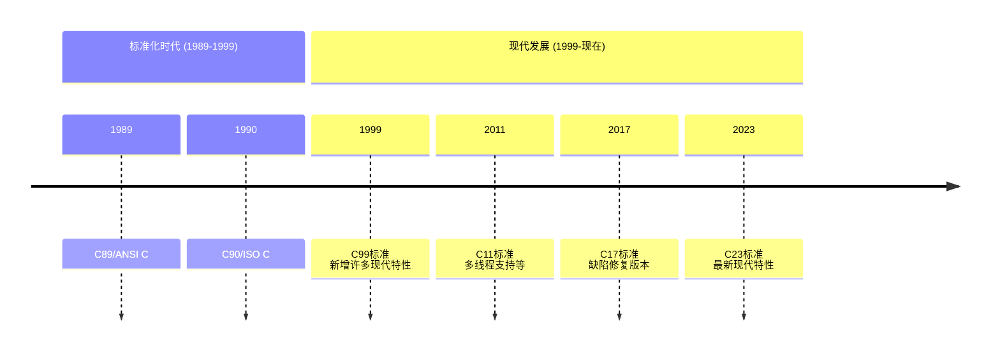

# C 语言标准



> [!NOTE]
>
> 在美国标准化协会（_ANSI_）的推动下，C 语言标准于1988年完成并在1989年正式通过，成为 ANSI 标准。1990年国际标准化组织（_ISO_）通过了此项标准，这一版的 C 语言称为 C89 或 C90。

# C 语言编译过程

编译器在编译一个C语言程序时需要经过以下 4 步：


1. 将C语言源程序预处理，生成 `.i` 文件。
2. 预处理后的 `.i` 文件编译成为汇编语言，生成 `.s` 文件。
3. 将汇编语言文件经过汇编，生成目标文件 `.o ` 文件。
4. 将各个模块的 `.o` 文件链接起来生成一个可执行程序文件。

# 变量

## 标识符

在对函数、变量、宏或者其他实体进行命名，这些命名称为标识符。标识符必须是字母、数字或者下划线。不能以数字开头，标识符区分大小写，不能使用 C 语言关键字。

> [!NOTE]
>
> 在 C99 中，每个函数都可以访问 `__func__` 标识符，它存储了当前正在执行的函数名，其作用相当于在函数体的一开始声明：
>
> ```c
> static const char __func__[] = "function-name";
> ```

## 变量和赋值

程序在产生输出之前需要执行一系列的计算，在程序执行过程中有一种临时存储数据的方法，C 语言中这类存储单元被称为**变量**（_variable_）。在使用变量之前必须对其进行声明，为编译器所做的描述，声明变量要指定变量的类型和名称。变量通过赋值的方式获得值，变量在使用或者赋值之前必须先进行声明。

```c
int num = 1;
```

大多数 C 语言运算符允许操作数是变量、常量或者包含其它运算符的表达式。而赋值运算符要求它的左操作数必须是**左值**（_lvalue_），左值表示存储在计算机内存中的对象，具有对应的可以由用户访问的存储单元，而不是常量或者表达式计算的结果，变量就是一种左值。

## 声明

声明为编译器提供了有关标识符含义的信息，声明的形式如下：

```c
声明说明符 标识符;	// 例如  int i;
```

声明说明符描述声明的变量或函数的性质：

- 存储类型：`auto`、`static`、`extern`、`register`。
- 类型限定符：`const`、`volatile`、`restrict`。
- 类型说明符：`void`、`int`、`char`、`unsigned`、`inline` 等等这些都是类型说明符。`inline` 是 C99 的函数说明符。

> [!NOTE]
>
> 声明中最多可以出现一种存储类型，必须放置在声明的最前面。

下面的规则可以用来理解任何声明：

- 始终从内往外读声明符。
- 在作选择时，始终使 `[]` 和 `()` 优先于 `*`。

```c
// p是一个存放着指向int型变量的指针数组
int *p[10];

// p是一个无参数且返回float型指针的函数
float *p(void);

// p是一个函数，函数参数为空，返回值是指向长度为3的int型数组的指针
int (*p(void))[3];

// p是一个指向int型参数且返回值为空的函数指针
void (*p)(int);

// p是一个存放函数指针的数组，函数参数为空，返回值为int型的指针
int *(*p[10])(void);

// p是一个函数指针数组，函数参数为空，返回值类型是指向长度为5的char型数组的指针
char (*(*p[3])(void))[5];
```

通过[类型定义](##类型定义)可以用来简化声明：

```c
/* 这是一个函数指针数组 */
int *(*p[10])(void);

/*使用类型定义*/
typedef int *fun(void);	// 定义函数类型fun，是参数为空，返回值为int型指针的函数
typedef fun *fun_ptr;	// 定义函数指针类型fun_ptr
typedef fun_ptr fun_ptr_array[10];	// 定义长度为10的函数指针数组类型fun_ptr_array

fun_ptr_array p;	// 定义函数指针数组p
```

## 变量的性质

1. 存储期限

   存储期限决定了为变量预留和内存被释放的时间。具有**自动存储期限**的变量在所属的块被执行时获得内存单元，在块终止的时候释放内存单元。具有**静态存储期限**的变量在程序运行期间占有同一个存储单元，也就是运行变量无期限的保留它的值。

2. 作用域

   变量的作用域指可以引用变量的那部分程序文本，变量可以有**块作用域**或者**文件作用域**。块作用域从声明的地方一直到所在块的结尾都是可见的。而文件作用域从声明的地方一直到文件的末尾都是可见的。

3. 链接

   变量的链接确定了程序的不同部分可以共享此变量的范围。具有外部链接的变量可以被程序中的几个或者全部文件共享。具有内部链接的变量只能属于单独一个文件，但此文件中函数可以共享这个变量。具有无链接的变量属于单独的一个函数，不能被共享。

> [!NOTE]
>
> 作用域和链接的区别：作用域为编译器服务，链接为链接器服务。编译器用标识符的作用域来确定在文件的给定位置访问标识符是否合法。当编译器把源文件翻译成目标代码时，会注意到外部链接的名字，并最终把这些名字存储到目标文件内的一个表中。因此链接器可以访问到具有外部链接的名字，而内部链接的名字或无链接的名字对链接器而言是不可见的。

## 局部变量和全局变量

- 局部变量

  在函数体内声明的变量称为该函数的**局部变量**，局部变量具有**自动存储期限**，**块级作用域**，**无链接**。形式参数就拥有局部变量的性质，但能用于形式参数的存储类型是 `register` 和 `auto`。

- 全局变量

  全局变量拥有**静态存储期限**，**文件作用域**，**外部链接**。如果把全局变量声明为 `static` ，则变量具有内部链接，其他文件不可访问这个变量，但是可以通过指针间接访问这个变量。

## 未初始化的变量

具有自动存储期限的变量没有默认的初始值。具有静态存储期限的变量默认情况下的值为零，用 `calloc` 分配的内存是简单的给字节位置零，而静态变量是基于类型的正确初始化，即整型变量初始化为 0，浮点变量初始化为 0.0，而指针变量则初始化为空指针。

## 共享变量声明

若要共享变量，首先变量的定义放在一个源文件中，然后在需要在使用此变量的其他文件中放置声明：

::: code-group

```c [lib.c]
// 在这个文件中定义变量
int i;
```

```c [main.c]
// 在这个文件中声明这个变量是在外部定义的，然后使用
extern int i;

int a = i;
```

:::

`extern` 告诉编译器这个变量是其它位置定义的，因此不用为变量分配空间。

```c
extern int a[];		// 数组的声明时可以省略数组长度
```

有一个例外的是对变量进行初始化的 `extern` 声明是变量的定义：

```c
extern int i = 0;	// 等价于 int i = 0;
```

`extern` 声明中的变量始终具有静态存储期限，变量的作用域依赖于声明的位置，如果声明在块内部，那么变量具有块作用域，否则变量具有文件作用域：

```c
// 声明在块内部，具有块作用域
void f(void){
	extern int n;
	...
}

// 声明在块外部，具有文件作用域
extern int n;
```

## `register` 存储类型

声明变量具有 `register` 存储类型就要求编译器把变量存储在寄存器中，而不是像其他变量那样保存在内存中，指明变量是 `register` 存储类型是一种请求，而不是命令，编译器可以选择把 `register` 型变量存储在内存中，`registe` 存储类型最好用于需要频繁进行访问或更新的变量。

`register` 存储类型只对局部变量有效，由于寄存器没有地址，所以对 `register` 变量使用取地址运算符是非法的，即使编译器选择把变量存储在内存中，这一限制仍适用。

## 类型限定符

### `const`

`const`用来声明变量是**只读**的，程序可以访问对象的值，但是无法改变它的值。对于指针变量，如果不想改变指针所指向的对象，可以这样声明：

```c
int const *p;
```

如果只是不想改变指针本身，可以这样声明：

```c
int a;
int *const p = &a;	//这种写法要初始化
```

`const`对象==不可以用于常量表达式==，因为在C语言中，`const`表示**只读**而不是**常量**，`const`对象只在它的生命周期内是常量，而不是在程序的整个运行期内，例如：

```c
/* 这段代码不会编译成功 */
const int m = n / 2;
switch(...){
	...
	case m: ...  //这样的写法是错误的
    ...
}
```

### `volatile`

`volatile` 类型限定符通知编译器程序中的某些数据是易变的，`volatile` 涉及到编译器的优化，例如：

```c
a = x;
...		//一些不使用x的代码
b = x;
```

编译器进行优化的时候发现使用了两次 `x`，但并未改变它的值，于是编译器把 `x` 的值存在寄存器中，然后在 `b` 需要 `x` 的时候才从寄存器中读取 `x`，以节约时间（而不是在原始内存位置上读取），这个过程称高速缓存（_caching_），使用 `volatile` 限定符通知编译器每次都要从内存中重新取值。

### `restrict`

`restrict` 只能用于指针，见[受限指针](##受限指针)。

# 运算符

## 算术运算符

1. 一元运算符

   一元正号 `+`、一元负号 `-`。

2. 二元运算符

   加法 `+`、减法 `-`、乘法 `*`、除法 `/`、求余 `%`。

> [!NOTE]
>
> 当 `/` 和 `%` 用于负操作数时，C89 标准指明除法的结果可以向下取整也可以向上取整，而 C99 中指明除法的结果**向零方向取整**。在不同语言里面，对于整数除法取整的处理方式并不一样，C 语言中是向零方向取整，而 Python 则是向负无穷方向取整。

## 赋值运算符

在许多编程语言中，赋值是语句，而在C语言中，赋值是运算符，会产生操作结果，赋值表达式 `v = e` 的值就是赋值运算后 `v` 的值。

> [!WARNING]
>
> 通常运算符不会修改操作数，例如 `i + j` 不会改变 `i` 和 `j` 的值，只会计算出结果，而赋值运算符改变了运算符的左操作数，`i = 0` 的结果为0，并把0赋值给了 `i`（赋值运算的副作用），由于赋值是运算符，所以多个赋值可以串在一起，例如：`i = j = 0`。

`v += e` 并不等价于 `v = v + e`，`v += e` 中只会求一次 `v` 的值，而 `v=v+e` 中会求两次v的值。例如下面两个是不同的：

```c
a[i++] += 1;
a[i++] = a[i++] + 1;
```

## 自增和自减运算符

1. 自增运算符

   ```c
   i++;	// 后缀
   ++i;	// 前缀
   ```

2. 自减运算符

   ```c
   i--;	// 后缀
   --i;	// 前缀
   ```

> [!CAUTION]
>
> 自增或自减在使用的时候可能会产生未定义的行为，在使用的时候要注意。对于不同的编译器，运算的顺序可能不同，可能是从左往右，也可能是从右往左。
>
> ```c
> int i = 2;
> j = i * i++;	// j的值为4或6
> ```

## 关系运算符

当需要测试表达式的值是真还是假，这种逻辑表达式的值只有两个，即真和假，在 C 语言中这样的逻辑表达式的值为整数，0为假，1为真。

大于（`>`）、小于（`<`）、大于等于（`>=`）、小于等于（`<=`）、等于（`==`）、不等于（`!=`）。

## 逻辑运算符

逻辑与（`&&`），逻辑或（`||`），逻辑非（`!`）。

逻辑运算符具有短路的特性，即当左操作数能决定表达式的值就不会计算右操作数。

## 条件运算符

```c
condition ? expression1 : expression2
```

三元运算符，如果 `condition` 为真，则计算 `expression1`，否则计算 `expression2`。

> [!NOTE]
>
> 如果不同类型的值混在一个条件表达式中，表达式的结果将转换为最大的类型，如 `int` 和 `float` 混用，如果结果为 `int` 将会转换为 `float` 类型。

## 逗号运算符

```c
expression1 , expression2
```

计算 `expression1` 和 `expression2` 之后把 `expression2` 的值作为整个表达式的值。

## `sizeof` 运算符

```c
sizeof(type_name)
```

表达式的值是一个无符号整型（`size_t` 类型），代表存储类型名的值所需要的字节数。通常情况下，`sizeof` 运算符也可以用于常量、变量和表达式。应用于表达式时不要求使用圆括号，但是考虑到运算符优先级的问题，`sizeof` 作为一元运算符，优先级始终高于二元运算符，所以在使用时始终加上圆括号。通常情况下编译器本身就能确定 `sizeof` 表达式的值，但是在 C99 中有个例外，就是不能确定变长数组的大小。

## 位运算符

1. 移位运算符

   移位运算符可以通过将移位向左或向右移动来变换整数的二进制表示，C 语言提供了两个移位运算符，`<<`（左移位运算符）和 `>>`（右移位运算符），移位运算符的操作数可以是任意整数类型（包括 `char`）。

   ```c
   // 左移位运算符将i中的位左移j位，每次从i的左端溢出一位，在i的最右端补0
   i << j;

   // 右移位运算符将i中的位右移j位
   // 如果i是无符号数或是非负值，则在i的左端补0
   // 如果i是负值，其结果由实现定义：一些实现会在左端补0，其他一些实现会在左端补1
   i >> j;
   ```

2. 其他位运算符

   按位求反运算符 `~`：一元运算符，对操作数的位进行求反运算。

   按位与运算符 `&`：二元运算符，对两个操作数的相应的位进行按位与运算。

   按位或运算符 `|`：二元运算符，对两个操作数的相应的位进行按位或运算。

   按位异或运算符 `^`：二元运算符，对两个操作数的相应的位进行按位异或运算（异或运算和或运算类似，不同的是当两个操作数都是 1 时，异或运算的结果为 0，而或运算结果为 1）。

   ```c
   unsigned short i, j, k;
   int i = 21;	// 0000000000010101
   int j = 56;	// 0000000000111000
   k = ~i;		// 1111111111101010
   k = i & j;	// 0000000000010000
   k = i | j;	// 0000000000111101
   k = i ^ j;	// 0000000000011011
   ```

## 位运算符的应用

如果需要设置变量的某一位，可以使用以下方法：

```c
// 设置变量i的第5位为1
unsigned short i;
i = 0x0000;		// 00000000000000000
i |= 0x0010;	// 00000000000010000
// 更常用的做法
int j = 4;
i |= 1<<j;
```

如果要清除某一位的，可以使用以下方法：

```c
// 清除变量i的第5位
i = 0x00ff;		// 0000000011111111
i &= ~0x0010;	// 0000000011101111
// 更常用的做法
int j = 4;
i &= ~(1 << j);
```

要测试某一位是否被设置，可以使用以下方法：

```c
// 测试变量i的第5位
if(i & 0x0010) ...
// 更常用的做法
int j = 4;
if(i & 1 << j) ...
```

为了使位的操作更容易，经常会给位取名，例如想要使一个数的第 0、1、2 位对应于相应的颜色蓝绿红：

```c
#define BLUE 1
#define GREEN 2
#define RED 4
// 设置、清除、测试BLUE位
i |= BLUE;
i &= ~BLUE;
if(i & BLUE) ...
// 同时设置、清除、测试几个位
i |= (BLUE | GREEN);
i &= ~ (BLUE | GREEN);
if (i & (BLUE | GREEN)) ...
```

处理一组连续的位比处理单个位要复杂一点：

```c
// 修改位域，将二进制101存入变量i的第5~7位
i = i & ~0x0070 | 0x0050;	// 先清除5~7位再进行修改
// 另一种写法
i = i & ~0x0070 | 0b0101 << 4;
// 获取位域，如要获取变量i的第5~7位
j = (i >> 4) & 0x0007;
```

对数据加密的一种最简单的方法就是将每一个字符与一个密钥进行异或（XOR）运算，要解密则对加密过的消息用密钥再进行异或运算：

```c
int n = 10;		// 0b1010
int key = 7;	// 0b0111
n ^= key;		// 加密 ---> 0b1101
n ^= key;		// 解密 ---> 0b1010
```

不使用第三个变量交换两个元素：

```c
int a = 1; // 0b0001
int b = 2; // 0b0010
a ^= b;    // a:0b0011 b:0b0010
b ^= a;    // a:0b0011 b:0b0001
a ^= b;    // a:0b0010 b:0b0001
```

利用位运算符优化模二运算：

```c
// 判断一个数是否为奇数：
if(i & 1 == 1) ...
```

判断一个数是否是 2 的 n 次幂：

```c
if (n > 0 && (n & (n - 1) == 0) ...
```

当除数为 2 的 n 次幂时，求余可以这样写：

```c
// 取出低位的数即是余数
a & (b - 1)
```

# 语句

## `switch` 语句

```c
switch(expression){
    case 整型常量表达式 : 语句
    ...
    case 整型常量表达式 : 语句
    default : 语句
}
```

## C99 中的 `for` 循环

在 C99 中，`for` 语句的第一个表达式可以替换为一个声明，这一特性可以声明一个只用于循环的变量。

```c
for(definition ; condition ; expression)
{
	...
}
```

## `goto` 语句

`goto` 语句可以可以跳转到同一函数中任何有语句标号的语句处，C99规定 `goto` 语句不可以绕过变长数组。

```c
标识符 : 语句

goto 标识符;
```

## 空语句

语句可以为空，就是除了末尾处的分号以外什么也没有。

```c
;
```

# 基本类型

## 整数类型

整数类型分为两大类：有符号和无符号，默认情况下，C 语言中的整型变量都是有符号的，若告诉编译器变量没有符号位，则需把它声明成 `unsigned` 类型。

- 有符号整数：有符号的整数如果为正数或零，那么最左边的位（符号位）为 0，如果是负数，则符号位为1，因此最大的 16 位有符号整数是 $2^{15}-1$ （即32767）
- 无符号整数：不带符号位的整数称为无符号整数，最大的 16 位无符号整数是 $2^{16}-1$ （即65535）

C语言的整数类型有不同的尺寸，`int` 类型通常位 32 位，但在老的 CPU 上可能是 16 位，有时候为了节省空间会指示编译器比正常存储小的空间来存储一些数。可以指明变量是 `long` 类型或`short` 类型，`signed` 类型或者 `unsigned` 类型，说明符也可以组合起来用，实际上只有这些组合可以产生不同的类型：

- `short int`
- `unsigned short int`
- `int`
- `unsigned int`
- `long int`
- `unsigned long int`

除非额外声明，否则所有的整数都是有符号的，所以 `signed int` 和 `int` 是一样的。说明符的顺序没有说明影响，所以 `unsigned short` 和 `short unsigned` 是一样的。

C语言允许通过省略单词 `int` 来缩写整数类型的名字，如 `unsigned short int` 可以缩写为 `unsigned short` ，而 `long int` 可以缩写为 `long`。

6 种类型每种表示的取值范围都会根据机器的不同而不同，C标准要求 `short int` ，`int` ，`long int` 中的每一种类型都要覆盖一个确定的最小范围，`int` 不能比 `short int` 短 ，`long int` 不能比 `int` 短。

- 16 位机的整数类型

  | 类型               |      最小值 |     最大值 | 位数 |
  | :----------------- | ----------: | ---------: | :--: |
  | short int          |      -32768 |      32767 |  16  |
  | unsigned short int |           0 |      65535 |  16  |
  | int                |      -32768 |      32767 |  16  |
  | unsigned int       |           0 |      65535 |  16  |
  | long int           | -2147483648 | 2147483647 |  32  |
  | unsigned long int  |           0 | 4294967295 |  32  |

- 32 位机的整数类型

  | 类型               |      最小值 |     最大值 | 位数 |
  | :----------------- | ----------: | ---------: | :--: |
  | short int          |      -32768 |      32767 |  16  |
  | unsigned short int |           0 |      65535 |  16  |
  | int                | -2147483648 | 2147483647 |  32  |
  | unsigned int       |           0 | 4294967295 |  32  |
  | long int           | -2147483648 | 2147483647 |  32  |
  | unsigned long int  |           0 | 4294967295 |  32  |

- 64 位机的整数类型

  | 类型               |               最小值 |               最大值 | 位数 |
  | :----------------- | -------------------: | -------------------: | :--: |
  | short int          |               -32768 |                32767 |  16  |
  | unsigned short int |                    0 |                65535 |  16  |
  | int                |          -2147483648 |           2147483647 |  32  |
  | unsigned int       |                    0 |           4294967295 |  32  |
  | long int           | -9223372036854775808 |  9223372036854775807 |  64  |
  | unsigned long int  |                    0 | 18446744073709551615 |  64  |

表中给出的取值范围不是 C 标准强制的，会随着编译器的不同而不同，对于特定的实现，确定整数类型的范围的一种方法的检查 `limits.h` 头文件，其中定义了表示每种类型的最大值和最小值的宏。

## C99 中的整数类型

C99 提供了两个额外的标准整数类型，`long long int` 和 `unsigned long long int`，要求至少 64 位宽，所以 `long long int` 通常取值范围是 $-2^{63}$ ~ $2^{63}-1$ ， 而 `unsigned long long int` 通常取值范围是 $0$ ~ $2^{64}-1$。

## 整数常量

在程序中以文本形式出现的数，而不是读写或计算出来的数，C 语言允许用 2、8、10、16 进制形式书写的整数常量。2 进制以 `0b` 或 `0B` 开头，8 进制以 `0` 开头，16 进制以 `0x` 或 `0X` 开头，其中的英文字母可以是大写或是小写。

```c
int bin = 0B10101;	// 2进制
int oct = 0101010;	// 8进制
int hex = 0X10101;	// 16进制
```

10 进制整数常量的类型通常为 `int` ，如果无法存储在 `int` 型中，编译器会尝试 `long int` ，如果还不行编译器会用 `unsigned long int` 进行最后的尝试。确定8和16进制常量的规则略有不同，编译器会依次尝试 `int`、`unsigned int`、`long int`、`unsigned long int` ，直到找到能表示该常量的类型。

为了强制编译器把常量作为长整型来处理，可以在后面加上 `l` 或 `L` ，如 `15L`。为了指明是无符号的常量，可以在常量后面加上字母 `u` 或 `U` ，如 `15U` 。`u` 和 `l` 可以结合使用，顺序和大小无所谓。

## C99 中的整数常量

在 C99 中，以 `ll` 或 `LL` 结尾的整数常量是 `long long int` 型的。

C99 中确定整数类型的规则和 C89 有些不同，对于没有后缀的 10 进制常量，其类型是 `int`、`long int`、`long long int` 中能表示该值的最小类型。对于 8 进制和 16 进制常量，可能的顺序为 `int`、`unsigned int`、`long int`、`unsigned long int`、`long long int`、`unsigned long long int`

常量后面的任何后缀都会改变可能类型的列表，如以 `u` 结尾的常量类型一定是 `unsigned int`、`unsigned long int`、`unsigned long long int` 中的一种，以 `l` 结尾的常量类型一定是 `long int`、`long long int` 中的一种。

> [!TIP]
>
> 如果常量的数值过大以至不能用标准的整数类型表示，则可以使用扩展的整数类型。

## 整数溢出

对整数执行算术运算时，其结果如果需要的位数太多就会发生溢出，有符号整数的运算溢出结果是未定义的，无符号整数运算的溢出是有定义的，即对 $2^n$ 取模，n 是用于存储结果的位数。

## C99 中的布尔值

为了解决长期缺乏布尔类型的问题，C99 提供了 `_Bool` 型，在这一版本中，布尔型变量可以声明为：

```c
_Bool flag;
```

`_Bool` 是无符号整数类型。和一般的整型不同，`_Bool` 只能赋值为0和1，往 `_Bool` 变量中存储非零值会导致变量赋值为 1。

C99还提供了一个新的头 `<stdbool.h>` ，该头提供了 `bool` 宏，用来代表 `_Bool` ，同时还提供了 `true` 和 `false` 两个宏来分别代表 1 和 0。

## 浮点类型

C 语言提供了三种浮点类型：`float` 单精度浮点数、`double` 双精度浮点数、`long double` 扩展精度浮点数。

在 C99 中，浮点类型分为两种：实浮点类型（`float` ，`double`， `long double`）和 C99 新增的复数类型。

## 浮点常量

浮点常量必须包含小数点或者指数，默认情况下，浮点常量都以双精度数的形式存储。为了强制浮点常量以 `float` 或 `long double` 格式存储浮点常量，可以在常量末尾使用字符 `f` 、 `F` 或 `l` 、 `L` ，如 `23.0f` 或者 `12.0l`。

C99 提供了 16 进制浮点常量的书写规范，以 `0x` 或 `0X` 开头，指数跟在字母 `p` 或 `P` 后面，可以有符号，指数部分用十进制表示，代表的是 2 的幂，而不是 10 的幂，例如 `0x1.Bp3` 表示 $1.6875\times2^3$。

## 字符类型

C语言把字符当做小整数进行处理，字符常量实际上是 `int` 类型而不是 `char` 类型，C 语言标准没有说明普通 `char` 类型是有符号还是无符号，有些编译器当做有符号处理，有些则当做无符号处理，标准 C 允许使用单词 `signed` 和 `unsigned` 来修饰 `char` 类型。

## 转义序列

有些非打印字符无法使用单引号括起来书写，因为不可见，可以使用转义序列来表示，转义序列有两种：字符转义序列、数字转义序列。

1. 字符转义序列

   | 名称     | 转义序列 |
   | -------- | -------- |
   | 响铃     | `\a`     |
   | 回退     | `\b`     |
   | 换页     | `\f`     |
   | 换行     | `\n`     |
   | 回车     | `\r`     |
   | 水平制表 | `\t`     |
   | 垂直制表 | `\v`     |
   | 反斜杠   | `\\`     |
   | 问号     | `\?`     |
   | 单引号   | `\'`     |
   | 双引号   | `\"`     |

2. 数字转义序列

   字符转义序列无法用于表示基本的 128 个 ASCII 字符以外的字符，而数字转义序列可以表示任何字符。
   - 8 进制转义序列

     由字符 `\` 和后面的一个最多含有 3 位数字的 8 进制数组成（不一定要用 0 开头），此数字必须表示成无符号字符，所以最大值通常是 8 进制的 377（即 10 进制的 255） 。8 进制数的转义序列在 3 个数字后结束，或在第一个非 8 进制数字符处结束。例如字符串 `"\1234"` 包含两个字符 `'\123'` 和 `'4'`，字符串 `"\189"` 包含三个字符 `'\1'`，`'8'`，`'9'`。

   - 16 进制转义序列

     由 `\x` 和跟随其后的一个 16 进制数组成，标准 C 对于 16 进制的位数没有限制，转义字符中的 `x` 必须小写，但是 16 进制数字不限大小写。16进制数的转义序列不限制为 3 个数字，而是直到第一个非 16 进制数字字符截止，16 进制数的转义序列通常范围限制在 `\x00` 到 `\xff`。

## 类型转换

### 隐式转换

发生隐式转换的情况：

- 当算术表达式或逻辑表达式中操作数的类型不同时。

- 当赋值运算左右操作数类型不匹配时。

- 当函数调用中实参类型与形参类型不匹配时。

- 当 `return` 语句中表达式的类型和函数返回值不匹配时。

- 一元运算符对操作数的整数提升。

为了统一操作数的类型，通常可以将相对较狭小类型的操作数转换成另一个操作数的类型来实现，这就是所谓的提升。最常用的是**整值提升**，把 `char` 或 `short int` 转换成 `int`（或者某些情况下是 `unsigned int`）。

常用算术转换的规则：

- 任一操作数是浮点类型

  ```mermaid
  graph LR
  type_1(float) --> type_2(double) --> type_3(long double)
  classDef type fill:#000000,color:#22a9f2,stroke-width:2px;
  class type_1,type_2,type_3 type;
  ```

- 两个操作数都不是浮点类型

  首先对两个操作数进行**整值提升**，保证没有一个操作数是 `char` 或 `short int`，然后对类型较狭小的操作数进行提升：

  ```mermaid
  graph LR
  type_1(int) --> type_2(unsigned int) --> type_3(long int) --> type_4(unsigned long int)
  classDef type fill:#000000,color:#22a9f2,stroke-width:2px;
  class type_1,type_2,type_3,type_4 type;
  ```

### C99 中的隐式转换

C99 中的隐式转换和 C89 中的隐式转换略有不同，因为 C99 中增加了一些新的类型（`_Bool`、`long long int`、扩展整数类型、复数类型）。

C99 用**整数提升**取代了**整值提升**，将任何低于 `int` 和 `unsigned int` 的类型转换为 `int` 或 `unsigned int`。

C99 的算术转换规则：

- 任一操作数是浮点类型

  只要不是复数类型，规则与前面一样

- 两个操作数都不是浮点类型

  首先对两个操作数进行**整数提升**，然后对类型狭小的操作数进行提升

### 隐式转换可能的错误

当把有符号操作数和无符号操作数组合时，有符号数会转换成无符号数，这条规则可能会导致某些编程错误，例如：

```c
int a = -1;				// 有符号整型
unsigned int b = 1;		// 无符号整型
printf("%d", a < b);	// 结果为0
```

因为变量 `a` 在关系运算时被当成无符号的整型处理，此时 `a` 被认为是 $2^n-1$ （n为整型的位数），在实际使用时应该避免无符号整数和有符号整数的混用。

### 显式转换

显式转换也叫**强制类型转换**，格式如下：

```c
(type) expression
```

> [!NOTE]
>
> C 语言把类型名视为一元运算符，一元运算符的优先级高于二元运算符。

## 类型定义

使用类型定义 `typedef` ，所定义的类型的名字放在最后，编译器会在它所识别的类型名列表中加入 `Bool` ，把 `Bool` 类型看成 `int` 类型的同义词。

```c
typedef int Bool
```

类型定义比宏定义功能更加强大，数组和指针是不能定义为宏的，因为：

```c
/* 在预处理后变成如下，只有a是指针，而b和c是普通的整型变量 */
#define Pointer int *
Pointer a, b, c; // int * a, b, c;
```

另外，`typedef` 命名的对象具有和变量相同的作用域规则，定义在函数体内的 `typedef` 名字在函数外无法识别。

# 指针和数组

## 数组的初始化

数组初始化式常见格式是用一个大括号括起来的常量表达式列表，常量表达式之间用逗号分隔。多维数组初始化时，如果内层列表不足以填满数组一行，则把剩下的初始化为 0。

```c
int a[5] = {1, 2, 3, 4, 5};

int a[5] = {1, 2}; // 如果初始化式比数组短，剩余元素为0

int a[] = {1, 2, 3}; // 给定了初始化式，可以省略数组长度

int a[3][3] = {{1, 2, 3}, {4, 5, 6}, {7, 8, 9}}; // 多维数组初始化，也可以省略内层括号
```

## 指定初始化式

在 C99 中可以指定初始化式，指示符必须是整型常量表达式：

```c
int a[5] = {[2] = 9, [4] = 7};

int a[] = {[2] = 9, [4] = 7}; // 编译器会根据指示符推断数组长度
```

指定初始化可能对同一个数组元素初始化多次，如下：

```c
int a[] = {4, 9, 1, 8, [0] = 5, 7};	// 数组结果为{5，7，1，8}
```

## 对数组使用 `sizeof` 运算符

可以通过 `sizeof` 运算符来计算数组的元素个数，例如：

```c
sizeof(a) / sizeof(a[0])	// 在这里a为一个数组而不是指针
```

## 变长数组

在 C99 中，可以使用非常量表达式来定义数组长度，即**变长数组**（_Variable-Length Array_）。变长数组的长度是在程序执行的时候计算的，而不是在编译的时候计算的。变长数组必须是自动存储期限的，而且**不可以初始化**，不能使用 `static` 和 `extern` 修饰。

```c
/* 下面的写法如果数组具有自动存储期限则是合法的，如果数组是静态存储期限则会出错 */
int n = 10;
int a[n];
```

静态变量的存储空间是在编译期分配的，必须在编译期就能确定变量的存储空间的大小，因此变长数组必须是自动存储期限的。

```c
/* 考虑这种情况，如果数组是静态静态存储期限，则在编译期无法确定n的值，因此无法为数组分配空间，所以变长数组不能是静态存储期限 */
extra int n;
int a[n];
```

## 指针的算术运算

C语言只支持3种格式的指针算术运算：

- 指针加/减整数：产生指向特定元素的指针。
- 两个指针相减：结果为指针之间的距离（用数组元素的个数来衡量）。

```c
int n[10];
int *p = &n[1];
int *q = &n[3];
p + 1;	// 结果为&n[2]
p - 1;	// 结果为&n[0]
q - p;	// 结果为2
```

## 指针比较

可以使用关系运算符进行指针比较，只有在两个指针指向同一数组时，用关系运算符进行的指针比较才有意义。

```c
int n[10];
int *p = &n[1];
int *q = &n[3];
p < q; // 结果为1
```

## 用数组名作为指针

可以用数组的名字作为指向数组第一个元素的指针，数组名在传递给函数时，总是被视为指针。

对于形式参数而言，声明为数组跟声明为指针是一样的。对变量来说是不同的，声明数组会导致编译器为其分配数组空间，声明为指针只会分配一个指针变量的空间。

> 指针通常和地址一样，但不总是，考虑用字而不是字节划分内存的计算机，字可能包含36位、60位等等，每个字都有一个地址，但是，字可以存储多于一个的字符，例如36位的字可以存储6个6位字符，或者4个9位字符，由于这个原因，可能需要不同于其他指针的格式存储指向字符的指针，指向字符的指针可以由一个地址加上一个小整数组成。而在一些计算机上，指针可能是偏移量而不完全是地址。

## 指向复合常量的指针

在C99中，可以用指针指向[复合字面量](##复合字面量)创建的数组。

```c
int *p = (int []){1, 2, 3, 4};
```

## 指针和多维数组

可以这样初始化一个二维数组：

```c
int a[3][3];
for (int *i = &a[0][0]; i <= &a[2][2]; i++)
{
    *i = 5;
}
```

处理二维数组中的某列，例如，对数组 a 的第3列清零：

```c
int a[3][3] = {1, 2, 3, 4, 5, 6, 7, 8, 9};
int (*p)[3];	// 指向长度为3的一维数组的指针
for (p = &a[0]; p <= &a[2]; p++)
{
    (*p)[2] = 0;
}
```

## 动态存储分配

为了动态分配存储空间，需要调用3种内存分配函数的一种，这些函数都是声明在 `<stdlib>` 头文件中。

1. `malloc` 函数：分配内存块，但不对内存块进行初始化 。
2. `calloc` 函数：分配内存块，并且对内存进行清零。
3. `realloc` 函数：调整先前分配的内存块大小。

为申请内存块而调用内存分配函数时，由于函数不知道计算存储在内存块中的数据是什么类型的，所以不能返回具体类型的指针，而是会返回 `void *` 类型的值，即**通用指针**。

### 空指针

当调用内存分配函数时，如果找不到满足我们需要的足够大的内存块，函数则会返回**空指针**（_null pointer_），空指针是不指向任何地方的指针。

空指针使用名为 `NULL` 的宏来表示，指针测试真假的方法和数的测试一样，所有的非可控指针都为真，只有空指针为假。

`NULL` 实际表示为0，当在要求指针的地方使用0时，编译器会把它看成空指针而不是整数0，提供宏 `NULL` 只是为了避免混淆。

```c
#define NULL (void *) 0
```

把0强制转换为 `void *` 可以帮助编译器检查到空指针的不正确使用，例如：试图把 `NULL` 赋值给整型变量，编译器会提示把指针赋值给了整型变量。

==空指针不一定是各位都为零的地址==，每个C语言编译器被允许用不同的方式来表示空指针，不是所有编译器都使用零地址的，有些编译器为空指针使用不存在的内存地址，这样硬件就能检查出试图通过空指针访问内存的方式。

### `malloc`函数

```c
void *malloc(size_t size);
```

`malloc` 函数分配 `size` 个字节的内存块，并且返回指向该内存块的指针。

```c
//为字符串分配内存空间
char *p = malloc(n + 1);
strcpy(p, "abc");
```

通常情况下可以把 `void *` 类型值赋给任意指针类型变量，反之亦然。

```c
//为数组分配空间，分配了一个长度为n的数组
int *a = malloc(n * sizeof(int));
```

在调用 `malloc` 为单个对象分配内存时，一些程序员使用下面的用法：

```c
p = malloc(sizeof(*p));
```

指针 `p` 没有初始化，从而 `*p` 的值没有定义，但是 `sizeof` 并不对 `*p` 求值，而是仅仅计算其大小，所以即便指针 `p` 没有初始化或者包含空指针，这种写法也没有问题。

### `calloc`函数

```c
void *calloc(size_t n, size_t size);
```

为 `n` 个元素分配内存空间，其中每个元素的长度都是 `size` 个字节，如果要求的空间无效，则返回空指针，在分配了内存后，函数会把所有位设置为 0 的方式来进行初始化。

```c
int *a = calloc(n, size(int));
```

### `realloc`函数

```c
void *realloc(void *ptr, size_t size);
```

为数组分配完内存后可能发现数组过大或者过小，`realloc` 函数可以调整数组的大小使它更适合需要，`size` 表示内存块的新尺寸，新尺寸可能大于或小于原有尺寸。如果原先的内存尾部空间不足，或原先的内存块无法改变大小，`realloc` 将重新分配一块 `size` 大小的内存，并把原先那块内存的内容复制到新的内存块上。因此，使用 `realloc` 后就应该改用 `realloc` 返回的新指针。

当扩展内存块时，`realloc` 函数不会对添加进内存块的字节进行初始化。如果不能按要求扩大内存块，则会返回空指针，原有的内存块中的数据不会发生改变。如果第一个参数是空指针，则行为就像 `malloc` 函数一样。如果第二个参数是0，则会释放掉内存块。

> 要确定传递给 `realloc` 函数的指针来自于先前 `malloc` 、`calloc` 、`realloc` 的调用，如果不是这样的指针，程序可能会行为异常。

### `free`函数

内存分配函数所获得的内存块都来自一个称为**堆**（_heap_）的存储池，过于频繁的调用这些函数可能会耗尽堆，这会导致函数返回空指针。

```c
// 这会导致之前p指向的内存块被浪费
p = malloc(3);
q = malloc(3);
p = q;
```

因为没有指针指向内存块，对于程序而言，不可再访问到的内存块是垃圾，留有垃圾的程序存在**内存泄漏现象**（_memory leak_），C语言要通过调用 `free` 函数来释放不需要的内存，函数原型如下：

```c
void free(void *ptr);
```

使用 `free` 如下：

```c
p = malloc(3);
q = malloc(3);
free(p);	// 释放p指向的内存块
p = q;
```

调用 `free` 函数会释放指针所指向的内存块，但是不会改变指针本身，这就造成了**悬空指针**，修改悬空指针所指向的内存是严重的错误，因为程序不再对此内存有任何控制权。

```c
char *p = malloc(4);
free(p);
strcpy(p , "abc");	// 错误的行为
```

## 指向函数的指针

C语言允许指针指向函数，函数占用内存，因此每个函数都有地址。

在C语言中把函数指针作为参数进行传递是十分普遍的，例如把形参定义为指向函数的指针：

```c
int integrate(double (*f)(double));	// 函数原型
int integrate(double f(double));	// 这种写法也是合法的
```

在调用函数 `integrate` 时，把函数名作为实际参数传入，==当函数名后面没有跟着圆括号时，C语言编译器会产生指向函数的指针而不会产生函数调用的代码==。

而在 `integrate` 函数体内，`f` 表示指向函数的指针，所以调用函数则是 `(*f)(x)`，C语言允许使用 `f(x)` 来调用 `f` 所指向的函数，所以这两种写法都可以。

### 函数指针其他的用途

用变量存储指向函数的指针：

```c
void (*p)(int);	// 定义变量p指向形参是int且返回值为void的函数
p = f;			// 将p指向函数f
p();			// 第一种调用方式
(*p)();			// 第二种调用方式
```

如果要编写向用户显示可选择的命令菜单程序，可以将这些命令的函数的指针存放在数组中，用户通过选择数字来执行这些命令：

```c
void (*file_cmd[])(void) = {open, close, exit, print};	// 函数指针数组
(file_cmd[n])();	// 第一种调用函数的方法
(*file_cmd[n])();	// 第二种调用函数的方法
```

## `qsort`函数

`qsort` 函数是给数组任意数组排序的通用函数，函数原型可在 `<stdlib.h>` 找到，如下：

```c
void qsort(void *base, size_t num, size_t size, int (*compare)(const void *, const void *));
```

`base` 指向数组中的要排序范围的第一个元素，`num` 表示要排序元素的数量，`size` 是数组元素字节的大小，`compare` 是指向比较函数的指针。

当调用 `qsort` 函数的时候，会对数组继续升序排列，并且在任何需要比较数组元素的时候调用比较函数。

```c
// 因为void *类型的指针不能访问数组成员，所以需要指向数组成员的指针类型
int compare(const void *p ,const void *q)
{
	const ElemType *p1 = p;	// 关键字const防止编译器生成警告
	const ElemType *q1 = q;
	return *a < *b ? -1 : (*a == *b ? 0 : 1);
}
```

如果需要对字符串数组进行排序，`compare` 函数的编写如下：

```c
char *str[] = {"asddd", "ssdqs", "aedsf"};	// 实际存储的是字符串的指针
qsort(str, 3, 4, compare);

// 给compare函数传递的值是指向char *类型的指针（即char **），因此传递给strcmp函数的时候要进行转换，使strcmp函数能比较字符
int compare(const void *p, const void *q)
{
    return strcmp(*(char **)p, *(char **)q);
}
```

## 受限指针

在C99中，使用关键字 `restrict` 声明的指针叫做**受限指针**（_restricted pointer_），`restrict` 告诉编译器受限指针指向的对象只能通过受限指针来访问，不存在其它方式的访问途径，这样有利于编译器产生更有效的代码，这个过程称为**优化**。

例如 `memcpy` 函数和 `memmove` 函数，函数在C99的原型如下：

```c
void *memcpy(void * restrict s1, const void * restrict s2, size_t n);
void *memmove(void *s1, void *s2, size_t n);
```

`memcpy` 函数是从一个对象向另一个对象复制字节，`s1` 指向复制的数据存放的目的地，`s2` 指向待复制的数据，`n` 是待复制的字节数，`s1` 和 `s2` 都使用 `restrict` ，说明复制的源和目的地不应互相重叠（但不能确保不重叠）。

`memmove` 函数和 `memcpy` 函数功能相同，不同的是 `memmove` 可以保证当源和目的地重叠时依然执行复制的过程，例如，可以把数组中的元素偏移一个位置：

```c
char n[10] = "abcd";
memmove(n + 1, n, 5);	// 此时数组n的内容为"aabcd"
```

## 灵活数组成员

这里 `N` 是表示字符串最大长度的宏，但是使用这样的定长数组会迫使我们限制字符串的长度，而且如果字符串用不到 `N` 个字符会造成浪费内存。

```c
struct vstring{
	int len;
	char chars[N];
};
```

传统的解决办法是声明 `chars` 的长度为1，然后动态的分配每一个字符串：

```c
struct vstring{
	int len;
	char chars[1];
};
struct vstring *str = malloc(sizeof(struct vstring) + n - 1);
str->len = n;
```

这里使用一种欺骗的方法，分配比该结构应具有的内存更多的内存，然后使用这些内存来存储 `chars` 数组额外的元素，这种方法称为 _struct hack_。

有的编译器甚至允许数组的长度为0，这就使这一技巧更明显了，但C89标准并不能保证 *struct hac*k 工作，也不允许数组长度为0，因为 _struct hack_ 技术是非常有用的，C99提供了**灵活数组成员**来达到同样的目的，当结构的最后一个成员是数组时，其长度可以省略：

```c
struct vstring{
	int len;
	char chars[];
};
struct vstring *str = malloc(sizeof(struct vstring) + n);
str->len = n;
```

`sizeof` 运算符在计算结构大小时会忽略 `chars` 的大小，灵活数组成员在结构内并不占空间，包含灵活数组成员的结构必须至少有一个其他成员，复制包含灵活数组成员的结构时，其他成员都会被复制，但不复制灵活数组成员本身。

> 具有灵活数组成员的结构是[不完整类型](##不完整类型)，不完整类型缺少用于确定所需内存大小的信息，不完整类型（包含有灵活数组成员的结构）不能作为其它结构的成员和数组的元素。

# 函数

## 函数定义

```c
返回类型 函数名 (形式参数)
{
	函数体
}
```

如果函数没有形式参数，则括号内应该出现 `void`。如果省略函数返回类型，C89会认为返回值的类型是 `int`，而C99中这是不合法的。

## 函数调用

如果不需要非 `void` 函数的返回值，可以将其丢弃。为了清楚的表明函数的返回值是被故意丢掉的，C语言允许在函数调用前加上 `(void)` ，但是在调用函数的时候都使用 `(void)` 会很麻烦，所以一般不写。

```c
// printf函数返回显示的字符个数，通常丢弃返回值
(void) printf("hello");
```

## 函数声明

当函数定义在函数调用之后，编译器没有任何关于函数的信息，不知道这个函数会有多少形参，形参类型是什么，返回值类型是什么。编译器不会给出错误消息，而是假设函数返回 `int` 型的值，可以说编译器给函数创建一个隐式声明。编译器不能检查实参的个数和类型，只能进行默认的实际参数提升，在后面遇到函数的定义时，发现返回值类型并不是`int`，则会得到一条错误的消息。

C语言提供了一种解决办法，在调用函数之前对函数进行声明：

```c
返回类型 函数名 (形式参数);
```

为了与过去那种圆括号内为空的函数声明风格相区别，把正在讨论的这类函数声明称为**函数原型**，函数原型不需要说明形式参数的名字，只要显示他们的类型就可以了。

## 实际参数

形式参数（_parameter_）出现在函数定义中，实际参数（_argument_）出现在函数调用的表达式。在C语言中，实际参数是通过值传递的。调用函数时，计算出每个实际参数的值并且把它赋值给相应的形式参数。

C语言允许实际参数的类型与形式参数的类型不匹配的情况下进行函数调用：

- 函数调用前遇到原型

  每个实际参数被转换成相应的形参类型。

- 函数调用后遇到原型

  编译器进行默认的实际参数提升，把 `float` 转换成 `double`，执行整值提升（C99中是整数提升）。

## 变长数组形式参数

在C99中，如果使用变长数组形式参数，可以说明数组的长度是多少，如：

```c
// 这里参数的顺序很重要，n 要在 a[n] 前面
int sum(int n, int a[n]){
	...
}
```

对于函数的声明，可以如下：

```c
int sum(int n, int a[n]);

// 使用星号的理由是函数声明时形式参数的名字是可选的，如果第一个参数被省略，没有办法说明数组a的长度是n，而使用星号则是提示数组的长度和前面的参数有关
int sum(int n, int a[*]);
int sum(int, int a[*]);

// 可以让方括号为空，但是这样不能说明n和a之间的联系
int sum(int, int []);
```

如果变长数组参数是多维的则更加实用，如下：

```c
int sum(int n, int m, int a[n][m]){
	...
}

// 函数原型可以如下：
int sum(int n, int m, int a[n][m]);
int sum(int n, int m, int a[*][*]);
int sum(int n, int m, int a[][m]);
int sum(int n, int m, int a[][*]);
```

## 在数组参数声明中使用`static`

C99允许在数组参数声明中使用关键字 `static`。

```c
/* static关键字表明数组的长度至少是3 */
int sum(int a[static 3], int n){
	...
}
```

`static` 的存在是一个提示，编译器可以据此生成更快的指令来访问数组。如果编译器知道数组总是具有某个最小值，那么可以在函数调用时预先从内存中取出这些元素值，而不是在遇到函数内部实际需要用到这些元素的语句时才取出相应的值。

> 如果数组参数是多维的，`static` 仅可用于第一维（例如指定二维数组的行数）。

## 复合字面量

在C99中，可以使用复合字面量来创建没有名字的数组，如下：

```c
// 在函数调用时
sum((int []){1, 2, 3, 4});
```

C99标准指出，如果复合字面量出现在函数体之外，那么复合字面量所表示的对象具有静态存储期限，否则，它具有自动存储期限，因而对象所占用的内存会在复合字面量所在块的末尾释放。

```c
typedef struct pointer{
	int x;
	int y;
}pointer;

// 这个函数会正常工作，函数在返回时复合字面量对象会被复制，原始对象被销毁
pointer create(int x, int y){
	return (pointer){x, y};
}

// 这个函数则会导致未定义的行为，因为原始复合字面量对象被销毁了
pointer *create(int x, int y){
    return &(pointer){x, y};
}

// 这个函数同样会导致未定义的行为
int *f(void){
    return (int []){1, 2, 3, 4};
}
```

## 程序终止

正常情况下`main`函数的返回值是`int`类型，`main`函数的返回值是状态码，在某些操作系统终止时可以正常检测到状态码。在`main`函数中执行`return`语句是终止程序的一种方法，另一种方法是调用`exit`函数，此函数属于`<stdlib.h>`头文件。传递给`exit`函数的实际参数和`main`函数的返回值具有相同的含义，两者都说明程序终止时的状态。

```c
exit(0);				// 表示正常终止
exit(EXIT_SUCCESS);		// 和0效果是一样的
exit(EXIT_FAILURE);		// 表示异常终止
```

> `return`语句和`exit`函数的差异是：不管哪个函数调用`exit`函数都会导致程序的终止，而`return`语句仅当`main`函数调用的时候才会导致程序的终止。

## 函数的存储类型

函数**声明和定义**也可以包括存储类型，但是只有 `extern` 和 `static`。

在函数声明处使用 `extern` 指明函数具有外部链接，也就是允许其他文件调用此函数。如果不指明函数的存储类型，则默认函数是具有外部链接的。

`static` 说明函数是内部链接，只能在定义函数的文件内部调用此函数，但是不能完全阻止在别的文件中调用此函数，通过函数指针进行间接调用仍然是可能的。

```c
extern int f(void);	// 具有外部链接
static int g(void);	// 具有内部链接
int h(void);		// 具有外部链接
```

## 内联函数

在C99中函数声明中可以包含关键字 `inline`。在机器层面，在函数调用之前可能需要预先执行一些指令，调用本身需要跳转到函数的第一条指令，函数本身可能需要执行一些额外的指令来启动执行，如果函数有参数，参数需要被复制。调用函数和从函数返回所需要的工作量称为额外开销。因为我们没有要求函数执行这些工作，在特定的的情况下额外开销会产生累积效应，例如函数需要调用数百万次。

在C89中避免函数开销的唯一方式是使用带参数的宏，C99提供了一种更好的解决方案，创建内联函数（_inline funtion_），内联表示编译器把函数的每一次调用都用函数的机器指令来代替，这种方法虽然会使被编译的程序大小增加一些，但是可以避免额外的开销。

把函数声明为 `inline` 并不是强制编译器将代码内联编译，只是建议编译器应该使函数调用尽可能的快，和关键字 `register` 、`restrict` 一样，都是用于提升性能的。

> 在GCC中使用内联函数要通过`-O`命令选项请求优化时，才会对函数进行内联。

```c
inline int f(){
	...
}
```

由于函数 `f` 具有外部链接，所以在其他源文件也可以调用，但是编译器并没有考虑函数的定义是外部定义（它是内联定义），所以试图在别的文件中调用函数是错误的。避免这种错误的方法是在函数定义或声明加上关键词 `static`，表示函数具有内部链接，其他文件不能调用它。

```c
static inline int f(){
	...
}
```

更好的实现方式是，将函数内联定义放入头文件，在任何一个需要调用内联函数的文件中包含该头文件就可以了。

```c
// f.h定义内联函数头文件
#ifndef F_H
#define F_H

inline int f(void){
	...
}

#endif
```

# 字符串

字符串字面量是用一对双引号括起来的字符序列，C语言把字符串字面量作为字符数组来处理，字符串字面量在存储时用**空字符**`\0`来结尾（空字符是一个所有位都为0的字节）。编译器把字符串字面量看作是`char *`型的指针。

## 延续字符串字面量

如果字符串字面量太长无法放置在单独的一行内，可以在第一行的结尾使用`\`字符来延续字符串字面量，这样的方法同样适用于表达式和语句。

```c
// 反斜杠和换行符会被转义，被忽略掉
printf("hello\
world");
```

使用 `\` 有一个缺陷，字符串字面量必须从下一行的起始位置继续，因此破坏了程序的缩进结构。可以使用另一种方法：当两条或多条字符串字面量相邻时，编译器会把它们合并成一条字符串字面量。

```c
// 下面的语句具有相同的效果
printf("helloworld");
printf("hello" "world");
printf("hello"
       "world");
```

## 字符数组和字符指针

```c
// 下面两种声明是不一样的
char date[] = "June 14";
char *date = "June 14";
```

在声明为数组时，可以修改存储在`date`中的字符，而声明为指针时，不可以修改`date`中的字符。

## 字符串字面量的操作

可以对字符串字面量取下标。

```c
// 此时a的值为'b'，0为a，1为b，2为c，3为空字符
char a = "abc"[1];

// 把0-15转换成16进制的字符形式
char digit_to_hex_char(int digit)
{
	return "0123456789ABCDEF"[digit];
}
```

因为C语言把字符串字面量看作字符数组，所以对字符串字面量取址是一个指向字符数组的指针。

```c
char (*p)[4] = &"abc";
```

## `puts`和`gets`函数

C函数库提供了 `puts` 函数来输出字符串，使用 `puts` 函数总会在结尾额外增加一个换行符。

```c
int puts(const char *);
```

C语言提供了 `gets` 函数来输入字符串，`gets` 函数不会忽略空白符，而且会持续读入直到找到换行符为止，然后忽略换行符，添加一个空字符作为字符串的结尾。

```c
char *gets(char *);
```

输入输出如下：

```c
char n[10];
gets(n);
puts(n);
```

## 使用C语言的字符串库

C语言提供了对字符串操作的函数集，这些函数原型包含在 `<string.h>` 头中。

### `strcpy`函数

把`s2`指向的字符串复制到`s1`指向的数组中，`strcpy`函数把`s2`中的字符复制到`s1`中直到遇到`s2`中的第一个空字符为止（该空字符也要复制），`strcpy`函数返回`s1`。

```c
char *strcpy(char *s1, const char *s2);
```

> `strcpy`函数不能检查`s2`指向的字符串的大小是否真的适合`s1`指向的数组，如果`s1`数组长度为`n` ，`s2`指向的字符串的字符长度不超过`n-1` ，那么复制操作可以完成，否则结果无法预料。

为了确保`s1`总能以空字符结尾，可以在调用后加上这句：

```c
s1[sizeof(s1) - 1] = '\0';
```

一种更安全的复制字符串的方法，`strncpy`函数，类似于`strcpy`，但是它有第三个参数可以用于限制所复制的字符数，使用如下：

```c
strncpy(str1, str2, sizeof(str1) - 1);	// 给str1数组预留一个位置存放空字符
str1[sizeof(str1) - 1] = '\0';			// 手动赋值使最后一个字符为空字符
```

### `strlen`函数

```c
size_t strlen(const char *s);
```

求字符串的长度，`strlen`不会测量数组本身的长度，而是返回存储在数组中的字符串的长度。

> `strlen`函数的返回值是无符号整型，在与负数比较时要尤其注意。

### `strcat`函数

字符串拼接，把字符串`s2`的内容追加到字符串`s1`的末尾，并返回字符串`s1`。

```c
char *strcat(char *s1, const char *s2);
```

如果`s1`指向的数组没有大到足以容纳`s2`指向的字符串中的字符，那么结果是不可预测的。一种更安全的方法，使用`strncat`函数来拼接字符串，第三个参数用来限制所拼接的字符数。

```c
// 拼接完成后会在后面加上空字符，因此不用手动指定最后一个索引为空字符
strncat(str1, str2, sizeof(str1) - strlen(str1) - 1);
```

实现简单的`strcat`函数：

```c
char *strcat(char *s1, const char *s2){
	char *p = s1;
	while(*p)
		p++;
	while(*p++ = *s2++);	// 简单的用法
	return s1;
}
```

### `strcmp`函数

比较字符串`s1`和`s2`，然后根据`s1`是否小于、大于或者等于`s2`，返回一个小于、大于或等于0的值。

```c
int strcmp(const char *s1, const char *s2);
```

## 字符串数组

字符串数组的初始化：

```c
char s[][4] = {"abc", "def", "ghi"};
/* s的内容如下3行4列的二维数组
 *  'a' 'b' 'c' '\0'
 *  'd' 'e' 'f' '\0'
 *  'g' 'h' 'i' '\0'
 */
```

这种创建字符串数组的方法比较浪费空间，可以改成如下写法：

```c
// 创建一个指向字符串的指针数组
char *p[] = {"abc", "def", "ghi"};	// 若要访问其中的字符，列如字符'a'，即p[0][0]
```

## 命令行参数

为了能够访问命令行参数，必须把`main`函数定义含有两个参数的函数，这两个参数通常命名为`argc`和 `argv`（不是必须使用这两个名字作为`main`函数的参数名，这仅仅是一种习惯，而不是语言本身的要求）。

```c
int main(int argc, char *argv[]){
	...
}
```

`argc`是命令行参数的数量，包括程序名本身，`argv`是指向命令行参数的指针数组，这些命令行参数以字符串的形式存储。

> `argv[0]`指向程序名，`argv[1]`到`argv[argc-1]`指向剩余的命令行参数，`argv[argc]`始终是一个空指针。

```c
/* 打印命令行参数 */
for(char **p = &argv[1]; *p != NULL; p++){
	puts(*p);
}
```

# 预处理器

预处理器的行为是由预处理指令控制的（由`#`开头的一些命令）。程序在编译前预处理器会执行预处理指令，并删除这些指令，预处理器处理后的程序再交给编译器，检查程序是否有错误，并将程序翻译成目标代码。

## 预处理指令

大多数预处理指令都属于下面的3种类型之一：

- 宏定义
- 文件包含
- 条件编译

指令都以`#`号开始，在指令之间可以插入任意数量的空格或水平制表符。

```c
#	define 	N	100
```

指令总是在第一个换行符处结束，除非指明要延续。

```c
#define	N(n) n?\
			1:0
```

`#`号也可c以单独占一行，就是所谓的**空指令**，空指令没有任何作用，一些程序员用空指令作为条件编译模块之间的间隔。

```c
#if INT_MAX < 100000
#
#error int type is too small
#
#endif
```

## 宏定义

### 带参数的宏

```c
/* 基本格式 */
#define 标识符(参数列表) 替换列表
```

宏定义中的圆括号过多是为了使表达式计算不会出现意想不到的情况，如运算符优先级问题导致出现意料之外的结果。

```c
#define MAX(x, y) ((x) > (y) ? (x) : (y))
```

C99中允许宏调用中的任意或所有的参数为空，例如：

```c
#define ADD(x, y) ((x) + (y))
i = ADD(, k);		//预处理后变为  i = (+k);
```

如果一个宏需要包含一系列的语句，而不仅仅是一系列的表达式，可以使用下面的技巧：

```c
/* 使用 do{...}while(0) 来包含表达式，注意结尾不要加分号 */
#define ECHO(s) do { gets(s);puts(s); } while(0)
```

宏可能会不止一次计算它的参数，函数对它的参数只会计算一次，而宏可能会计算多次。如果参数有副作用，多次计算参数的值可能会产生不可预知的结果。

```c
/* 如果i大于j，那么i可能会被错误的增加两次 */
#define MAX(x, y) ((x) > (y) ? (x) : (y))
n = MAX(i++, j); // n = ((i++) > j ? (i++) : (j));
```

> 最好避免使用带有副作用的参数。

### `#`运算符

`#`运算符将宏的一个参数转化成字符串字面量。当参数为空时，结果将是空字符串 `""`。如果被字符串化的参数包含 `"` 或 `\` 字符，则会转换为`\"` 或 `\\`。

```c
#define PRINT_INT(n) printf(#n "=%d\n", n)

PRINT_INT(i / j); // 调用后的结果 printf("i/j=%d\n", i / j);
```

### `##`运算符

将两个记号粘合在一起，成为一个记号，如果其中一个操作数是宏参数，会在形式参数被实际参数替换后发生粘合。

```c
/* 第一种应用 */
#define MK_ID(n) i##n
int MK_ID(1),MK_ID(2);	//替换后变成   int i1,i2;

/* 第二种应用 */
#define GENERIC_MAX(type) 		 \
type type##_max(type x , type y) \
{								 \
	return x > y ? x : y;		 \
}

/* 定义函数 */
GENERIC_MAX(float)
/* 替换后变成 */
float float_max(float x , float y)
{
	return x > y ? x : y;
}
```

使用 `##` 运算符有个问题要注意，例如：

```c
/* 当嵌套调用时，这个结果将不是abc，而是 aCONCAT(b,c) */
#define CONCAT(x,y) x##y
CONCAT(a,CONCAT(b,c))	// 结果为aCONCAT(b,c)

/* 想要得到abc，必须再定义一个宏来调用第一个宏 */
#define CONCAT1(x,y) CONCAT(x,y)
CONCAT1(a,CONCAT(b,c))	// 结果为abc
```

### `undef`指令

宏定义的作用范围通常到出现这个宏的文件末尾，取消宏定义可以使用 `undef` 指令，以便给出新的定义。

```c
#undef N   // 会删除当前宏N的定义
```

### 重复的宏定义

如果预处理器再重新扫描时又发现了最初的宏，是否会无限循环？例如：

```c
#define N (2*M)
#define M (N+1)

i = N;	//处理后的结果为 i=(2*(N+1));
```

早期的预处理器确实会进入无限循环，但是新的处理器则不会，按照C语言标准，如果在扩展宏的过程中原先的宏名重复出现的话，宏名不会再次被替换。

我们可以利用这一行为编写和保留字或标准库的函数名同名的宏，如 `sqrt` 函数，如果我们希望当参数为负值时返回一个由我们自己定义的值：

```c
#undef sqrt // 这句的作用是防止库中已经把sqrt定义为宏
#define sqrt(x) ((x) > 0 ? sqrt(x) : 0)
```

### 预定义宏

C语言有一些预定义宏，每个宏表示一个整数常量或字符串字面量，这些宏提供了当前编译或编译器本身的信息。

| 名字       | 描述                                       |
| ---------- | ------------------------------------------ |
| `__LINE__` | 被编译的文件中的行号                       |
| `__FILE__` | 被编译的文件名                             |
| `__DATE__` | 编译的日期                                 |
| `__TIME__` | 编译的时间                                 |
| `__STDC__` | 如果编译器符合C标准（C89或C99），那么值为1 |

## 文件包含

`#include` 指令告诉预处理器打开指定的文件，并把文件的内容插入到当前文件中，因此如果想让几个源文件可以访问相同的信息，可以把此信息放入一个文件中，让后利用 `#include` 指令。按照这种方式包含的文件称为**头文件**。

```c
#include <文件名>			// 搜索系统头文件所在的目录
#include "文件名"			// 先搜索当前目录，然后搜索系统头文件目录
#include <C:/user/utils.h> // 文件名可以含有定位文件的信息
#include 标识符			// 可以和#define指令一起搭配使用
```

## 条件编译

### `#if`和`#endif`

预处理器遇到 `#if` 指令时会计算常量表达式的值，如果表达式的值为0，那么将这几行从程序中删除。如果常量表达式的值为不为0，那么将之间的行保留在程序中。

```c
#if 常量表达式
...
#endif
```

`#if` 指令会把没有定义过的标识符当成是值为0的宏对待。

```c
// 如果省略DEBUG的定义，那么将不会保留这几行
#if DEBUG
...
#endif
```

### `defined`运算符

`defined` 运算符是一个专用于预处理器的运算符，用于标识符时，如果标识符是一个定义过的宏则返回1，否则返回0。

```c
#if defined(DEBUG)
...
#endif
```

> 括号不是必须的，可以这样写`#if defined DEBUG`。

### `#ifdef`和`#ifndef`

`#ifdef` 测试一个标识符是否已经定义为宏，等价于`#if defined 标识符`。

```c
#ifdef 标识符
```

`#ifndef` 测试一个标识符是否没有被定义为宏。

```c
#ifndef 标识符
```

### `#elif`和`#else`

指令 `#if`，`#else`，`#elif`，`#endif` 可以像普通的if语句那样嵌套使用。

```c
#if 表达式1
	...
#elif 表达式2
	...
#else
	...
#endif
```

### 保护头文件

如果一个源文件包含同一个头文件两次，可能会发生编译错误，为了防止头文件多次包含，用 `#ifndef` 和 `#endif` 指令来封闭文件的内容。

```c
// 用如下的方式来保护文件 test.h
#ifndef TEST_H
#define TEST_H
...
#endif
```

在首次包含这个文件时没有定义宏 `TEST_H` ，如果再次包含此文件，那么预处理器会删除再次包含的内容。

## 其它指令

### `#error`指令

```c
#error 消息
```

遇到 `#error` 指令表示程序中出现了很严重的错误，有些编译器会立刻终止编译而不再检查其他错误。

```c
// 确保程序无法在int类型不能存储100000的机器上运行，如果在以16位存储整数的机器上编译这个程序就会出错
#if INT_MAX < 100000
#error int type is too small
#endif
```

### `#line`指令

改变程序行编号的方式，`#line` 指令会影响 `__LINE__` 宏或 `__FILE__` 宏的值。

```c
// 这条指令要求后续的行被编号为 n , n+1 , n+2 , ...
#line n

// 指令后面的行会被认为来自demo.c文件
#line n "demo.c"
```

> `#line` 指令用于那些产生C代码作为输出的程序，使调试更加容易。

### `#pragma`指令

`#pragma` 指令为要求编译器执行某些特殊操作提供了一种方法。

```c
#pragma 记号
```

指令中出现的命令集在不同编译器上是不一样的，必须通过查阅所使用的编译器文档来了解可以使用哪些命令，以及这些命令的功能，如果`#pragma`指令包含了无法识别的命令，预处理器必须忽略这些指令，不允许给出出错消息。

### `_Pragma`运算符

C99中引入了与`#pragma`指令一起使用的`_Pragma`运算符。

```c
_Pragma(字符串字面量)
```

在遇到该表达式时，预处理器通过移除字符串两端的双引号并分别用字符 `"` 和 `\` 代替转义序列 `\"` 和 `\\` 来实现对字符串字面量的去字符串化，表达式的结果是一系列的记号，这些记号被视为出现在`#pragma`指令中。

```c
/* 下面的效果是等价的 */
_Pragma("data(heap_size >= 1000, stack_size >= 2000)")

#pragma data(heap_size >= 1000, stack_size >= 2000)
```

# 结构

结构的成员在内存中是按照声明顺序存储的，结构变量的声明如下：

```c
struct student{
	int number;
	char name[10];
} num1, num2;
```

结构变量也可以在声明的同时进行初始化，如下：

```c
struct {
    int number;
    char name[10];
} num1 = {10, "hello"},
  num2 = {11, "world"};
```

初始化式中的成员数可以少于它所初始化的结构，就像数组那样，剩余的成员都用0作为初始值，字符数组为空字符。

## 结构的指定初始化

C99中的指定初始化也可以在结构中使用，点号和成员名称的组合称为指示符，例如：

```c
{.number = 10, .name = "jack"}
```

结构数组的初始化指定初始化，如下：

```c
struct student{
	int age;
	char name[10];
};
struct student n[5] = {[0].age = 10, [0].name = "jack"};
```

## 结构的赋值运算

可以将结构变量赋值给另一个结构变量，例如将`num1.number`赋值给`num2.number`，将`num1.name`赋值给`nm2.name`。

```c
struct student{
	int number;
	char name[5];
} num1 = {12, "jack"},
  num2 = num1; 	// 将num1赋值给num2
```

因为数组不能用赋值运算符进行复制，而结构却可以实现这样的复制，可以利用这种性质来进行数组的复制。

```c
// 一种复制数组的技巧
struct {int a[10];} a1, a2;
a1 = a2;
```

## 结构类型

根据C语言的规则，两个变量如果不具有兼容的类型，则不能赋值，而且如果变量的类型没有名字，也不能作为函数调用的参数，因此需要定义结构类型的名字。

1. 使用结构标记来命名结构

   ```c
   struct student{
       int number;
       char name[5];
   };

   // 使用结构标记来声明变量
   struct student num;
   ```

2. 使用 `typedef` 来命名结构

   ```c
   typedef struct {
       int number;
       char name[5];
   } Student;

   // 声明变量
   Student num1, num2;
   ```

## 对结构使用复合字面量

可以使用复合字面量来创建一个结构，将这个结构传递给函数。

```c
// 函数f的形参类型为struct student
f((struct student){10, "hello"});
```

## 对结构使用 `sizeof` 运算

一些计算机要求特定数据项的地址是某个字节数的倍数，为了满足这个要求，编译器会在邻近的成员之间留空洞，从而使结构的成员对齐。

```c
// 如果数据项必须从四个字节的倍数开始，成员a的后面将会有三个字节的空洞，从而sizeof(s)的结果为8
struct {
	char a;
	int b;
} s;

// 结构也可以在末尾有空洞
struct {
	int a;
	char b;
} s;
```

## `->`运算符

利用指针访问结构中的成员是非常普遍的，C语言提供了一种专门的运算符，即**右箭头选择**。

```c
// 定义一个名为node的结构
struct node{
	int value;
	struct node *next;
};
// 定义一个指向node结构的指针
struct node *p = malloc(sizeof(struct node));
// 第一种给成员赋值的方法
(*p).value = 10;
// 第二种给成员赋值的方法，使用右箭头选择
p->value = 10;
```

## 结构中的位域

C语言提供了声明其成员表示位域的结构。例如在MS-DOS操作系统中定义日期结构，由于日、月、年都是很小的数，将它们按照整数存储会浪费空间，DOS只为日期分配了16位，5位用于日、4位用于月、7位用于年。

```c
struct file_date{
	unsigned int day : 5;
	unsigned int month : 4;
	unsigned int year : 7;
};
```

位域的类型必须是`int`、`unsigned int`或`signed int`，使用`int`会引起二义性，因为一些编译器将位域的最高位作为符号位，而其他一些编译器则不会。在C99中，位域可以具有`_Bool`类型，C99编译器还允许额外的位域类型。可以将位域像其他结构成员一样使用：

```c
struct file_date date;
date.day = 30;
date.month = 8;
date.year = 8; // 表示1988，year成员是相对于1980年存储的，据说这是DOS出现的时间
```

使用位域有一个限制，通常意义上讲位域没有地址，C语言不允许将`&`运算符用于位域，所以无法使用`scanf`函数直接向位域中存储数据，但是可以将数据存入到一个普通变量中，然后再赋值给位域。

```c
// 如果不关心某个字段，可以不命名，其他的位域仍会正常对齐
struct data{
	unsigned int : 5;
	unsigned int minutes : 6;
    unsigned int hours : 5;
};

// 给未命名的字段指定长度为0，告诉编译器将下一个位域在一个存储单元的起始位置对齐。如果存储单元是16位，编译器会给a分配4位，然后跳过12位，再给b分配8位
struct data{
	unsigned int a : 4;
	unsigned int : 0;
	unsigned int b : 8;
};
```

编译器处理位域的规则与存储单元有关，存储单元的大小由实现定义，通常为8位、16位、32位。编译器处理特殊结构的声明时，会将位域逐个放入存储单元，位域之间没有间隙，直到剩下的空间不够用来放下一个位域，一些编译器会跳到下一个存储单元的开始，而另一些编译器会将位域拆开跨存储单元存放，具体是哪种情况由实现定义，位域存放的顺序（从左到右，还是从右到左）也是由实现定义的。

## 不完整类型

C 语言提供的唯一封装工具为不完整类型（_incomplete type_），不完整类型描述了对象但缺少定义对象大小所需的信息，例如：

```c
struct t;	// 告诉编译器t是一个结构标记，但没有描述结构的成员
```

不完整类型的使用是受限的，因为编译器不知道不完整类型的大小，所以不能用来声明变量，但是完全可以定义一个指针类型引用不完整类型，因为指针的大小并不依赖于它指向的对象。

```c
/* 在一个不包含结构t完整定义的文件中使用不完整类型 */
typedef struct t *T;	// 类型T是指向结构t的指针
T p;					// 定义指向结构t的指针p
struct t *q;			// 定义指向结构t的指针q
```

不能对指向不完整类型的指针使用 `->` 运算符，因为编译器对结构 `t` 的成员一无所知。

抽象数据类型利用不完整类型进行封装，例如要实现一个栈抽象数据类型。

```c
/* stackADT.h */
#ifndef STACKADT_H
#define STACKADT_H

typedef struct strack_type *Stack;	// 定义指向不完整类型的指针类型
...									// 各种函数原型

#endif
```

抽象数据类型的实现写在另一个文件 `stackADT.c` 中，在使用栈类型的文件中包含 `stackADT.h` 文件，例如声明指向栈类型的指针变量，虽然能定义栈类型的指针变量但是不能使用成员运算符来访问结构的成员，因为该结构的定义在另一个文件中。

```c
#inlcude "stackADT.h"

int main()
{
	Stack s1;	//声明指向栈类型的指针变量s1
	...
}
```

# 联合

联合（_union_）和结构类似，不同的是联合的成员占用同一个地址。

```c
union{
	int i;
	double d;
} u;
```

联合变量`u`的成员存在同一内存地址，改变一个成员会使之前的存储在其他成员的值发生改变，联合的性质和结构几乎一样，也可以使用赋值运算符进行复制。

# 枚举

C语言为具有可能值较少的变量提供了一种专用类型，枚举类型（_enumeration type_），是一种值由程序员列出的类型，程序员必须为每个值命名（枚举常量）。

```c
// 变量s1、s2的值只能是枚举常量其中之一
enum {RED, GREEN, BLUE} s1, s2 ;
```

枚举类型命名和结构具有同样的规则，可以使用枚举标记或者`typedef`。

```c
// 枚举标记命名
enum color {RED, GREEN, BLUE};

// typedef命名
typedef enum {RED, GREEN, BLUE} Color;
```

在系统内部，C语言会把枚举变量和常量作为整数来处理，默认情况下会把整数0，1，2，…… 赋给枚举中的常量，我们可以为枚举常量自由选择不同的值，可以在声明的时候指明。

```c
enum color{RED = 1, GREEN = 2, BLUE = 3};
```

枚举常量可以用作数组的下标，因为是整数，值默认从0开始增加，所以是理想的下标。

```c
// C99中枚举常量可以用作指定初始化式的下标
enum color {RED, GREEN, BLUE};
int a[] = {[RED] = 1, [GREEN] = 2, [BLUE] = 3};
```

# 输入/输出

## 流

流（_stream_）表示任意输入的源或任意输出的目的地，许多小型程序都是通过一个流获得全部的输入，并且通过另一个流写出全部的输出，流是物质从一处向另一处流动的过程，是对一种有序连续且具有方向性的数据（其单位可以是*bit*，_byte_，_packet_ ）的抽象描述。

C程序中对流的访问是通过**文件指针**实现的，此指针的类型为`FILE *`，`FILE`类型在`<stdio.h>`中声明。`<stdio.h>`提供了3个标准流，可以直接使用，不需要进行声明，也不用打开或者关闭它们，C程序会自动打开3个标准流。之前用过的函数（如`printf`、`scanf`等）都是通过`stdin`获得输入的，并且用`stdout`输出的。

| 文件指针 |    流    | 默认的含义 |
| :------: | :------: | :--------: |
| `stdin`  | 标准输入 |    键盘    |
| `stdout` | 标准输出 |    屏幕    |
| `stderr` | 标准错误 |    屏幕    |

## 输入/输出重定向

许多操作系统允许通过一种称为重定向的机制来改变默认的含义。通常可以强制程序从文件而不是键盘获得输入，方法是在命令行的文件名之前加上字符：

```shell
demo <in.txt
demo >out.txt
# 字符<>不需要于文件名相邻，重定向文件顺序也不重要
demo < in.txt > out.txt
```

这种方法被称为**输入/输出重定向**，本质是使`stdin`流表示文件而非键盘，demo程序不会意识到正在从文件中读取数据，它会认为从`stdin`获得的任何数据都是从键盘上录入的。

> 使用输入/输出重定向后，重定向后的文件名不会作为命令行参数显示出来。

## 标准I/O

大多数情况下，可以选择I/O的两个级别：**底层I/O**和**标准高级I/O**。底层I/O使用操作系统提供的基本I/O服务，标准高级I/O使用C库的标准包和`<stdio.h>`头文件定义。因为无法保证所有操作系统都使用相同的底层I/O模型，C标准只支持标准I/O包。有些实现会提供底层库，但是C标准建立了可移植的I/O模型，主要讨论这些I/O。

与底层I/O相比，标准I/O除了可移植以外还有两个好处：

- 标准I/O有许多函数简化了处理不同I/O的问题，例如`printf`函数把不同形式的数据转换成与终端相适应的字符串输出。
- 输入和输出是缓冲的，例如当程序读取文件时，一块数据被拷贝到缓冲区，这种缓冲提高了数据传输的效率。

---

通常，使用标准I/O的第一步是调用`fopen`函数打开文件，`fopen`函数不仅打开一个文件，还创建一个缓冲区（在读写模式下会创建两个缓冲区）以及一个包含文件和缓冲区数据的结构，我们就说`fopen`函数打开一个流，如果以文本模式打开该文件，就获得一个文本流，如果以二进制模式打开该文件，就获得一个二进制流。

```c
/* 结构体FILE */
typedef struct _iobuf
{
  char	*_ptr;		// 文件输入的下一个位置
  int	 _cnt;		// 当前缓冲区的相对位置
  char	*_base;		// 文件的起始位置
  int	 _flag;		// 文件标志
  int	 _file;		// 文件的有效性验证
  int	 _charbuf;	// 检查缓冲区状况，若无缓冲区则不读取
  int	 _bufsiz;	// 文件的大小
  char	*_tmpfname;	// 临时文件名
} FILE;
```

这个结构通常包含一个指定流中当前位置的文件位置指示器、一个错误和文件结尾的指示器、一个指向缓冲区开始处的指针、一个文件标识符、一个计数（统计实际拷贝进缓冲区的字节数）。

考虑文件输入的情况，通常使用标准I/O的第二步是调用一个定义在`<stdio.h>`的输入函数，调用这些函数，文件中的数据块就会被拷贝进缓冲区中，缓冲区的大小由实现定义。

输出函数以类似的方式把数据写入缓冲区，当缓冲区被填满时，数据将被拷贝至文件中。

## 文本文件和二进制文件

在文本文件中，字节表示字符。在二进制文件中，字节不一定表示字符，二进制文件不分行，也没有行末标记和文件末尾标记，所有的字节都是平等对待。文本文件具有两种二进制文件没有的特性：

- **文本文件分为若干行**

  文本文件的每一行通常以一两个特殊的字符结尾，特殊字符的选择与操作系统有关。在Windows中，行末的标记是回车符`\r`和一个紧跟其后的换行符`\n`。

- **文本文件可以包含一个特殊的文件末尾标记**

  一些操作系统允许在文本文件的末尾使用一个特殊的字节作为标记，在Windows中，标记为`\x1a` （Ctrl + Z），`\x1a`不是必须的，但是如果存在就标志着文件的结束，其后的字节都会被忽略。大多数操作系统没有专门的文件尾字符。

---

为了规范文本文件的处理，C提供了两种访问文件的方式：**二进制模式**和**文本模式**。

- 在二进制模式中，程序可以访问文件的每个字节。
- 在文本模式中，程序把本地环境表示的行末尾或文件结尾映射成C模式，例如在MS-DOS平台，用文本模式写入时，把`\n`看成`\r\n`，用文本模式读取时，把`\r\n`看成`\n`。

## 文件尾

从文件中读取数据在读到文件结尾时要停止，例如`getc`函数在读取一个字符时发现是文件结尾，将返回一个特殊值`EOF`（_end of file_，在`<stdio.h>`中定义的宏），C程序只有在读到超过文件末尾时才会发现文件的结尾，一些其他语言用一个特殊的函数在读取之前测试文件的结尾，C语言则不同。

## 打开文件

如果把文件用作流，需要调用`fopen`函数，第一个参数是文件名，第二个参数是**模式字符串**，来指定对文件执行的操作。

```c
FILE * fopen(const char * filename, const char * mode);
```

`fopen`函数返回一个文件指针，指向一个包含文件信息的数据对象，其中包含操作文件的I/O函数所用的缓冲区信息。当无法打开文件时，`fopen`会返回空指针，可能是文件不存在，也可能是文件位置不对，或者是没有打开文件的权限。

---

给`fopen`函数传递的模式字符串不仅依赖于对文件的操作，还取决于文件中的数据是文本形式还是二进制形式：

- 用于文本文件的模式字符串

  | 字符串 | 含义                     |
  | :----: | :----------------------- |
  | `"r"`  | 读文件                   |
  | `"w"`  | 写文件（文件不需要存在） |
  | `"a"`  | 追加（文件不需要存在）   |
  | `"r+"` | 读和写（从文件头开始）   |
  | `"w+"` | 读和写（文件存在就截去） |
  | `"a+"` | 读和写（文件存在就追加） |

- 用于二进制文件的模式字符串

  |      字符串      | 含义                     |
  | :--------------: | :----------------------- |
  |      `"rb"`      | 读文件                   |
  |      `"wb"`      | 写文件（文件不需要存在） |
  |      `"ab"`      | 追加（文件不需要存在）   |
  | `"rb+"`或`"r+b"` | 读和写（从文件头开始）   |
  | `"wb+"`或`"w+b"` | 读和写（文件存在就截去） |
  | `"ab+"`或`"a+b"` | 读和写（文件存在就追加） |

以写模式打开文件会将文件的内容删除，以便程序在一个空白文件中操作。当打开文件用于追加时，向文件写入的数据添加在文件末尾，可以保留文件原始内容。当打开文件用于读和写（即包含字符`+`）时，如果没有先调用一个文件定位函数，那么就不能从读模式转换成写模式，除非遇到文件尾。如果没有调用文件定位函数，也没有调用`fflush`函数，那么就不能从写模式转换到读模式。

## 关闭文件

```c
int fclose(FILE *stream);
```

`fclose`函数允许程序关闭不再使用的文件。如果成功关闭了文件，`fclose`函数会返回0，否则会返回`EOF`。

## 为打开的流附加文件

```c
FILE *freopen(const char *filename, const char *mode, FILE *stream);
```

`freopen`函数为一个已经打开的流附加上一个不同的文件，把一个新的文件名`filename`与给定的打开的流`stream`关联，同时关闭流中的旧文件。最常见的用法是把文件和一个标准流相关联。

`freopen`函数的返回值通常是它的第三个参数，如果无法打开新文件，那么`freopen`函数就会返回空指针，如果无法关闭旧的文件，那么`freopen`函数会忽略错误。

```c
// 例如往文件foo中写入数据
if(freopen("foo", "w", stdout) == NULL){
	...
}
```

## 临时文件

```c
FILE *tmpfile(void);
```

程序会经常产生临时文件，即在程序运行时存在的文件。`tmpfile`函数创建一个临时文件（用`wb+`模式打开），该临时文件将一直存在，除非关闭它或程序终止。如果创建失败则会返回空指针。`tmpfile`函数会返回文件指针，可以用于稍后访问该文件。

```c
char *tmpnam(char *s);
```

`tmpnam`函数为临时文件产生名字，如果产生文件名失败，则会返回空指针。如果`tmpnam`函数的实际参数为空指针，则会把文件名存储到一个静态变量中，并且返回指向此变量的指针。如果实际参数不为空，则会把文件名复制到字符数组中。

> `tmpnam`仅仅是产生一个文件名，必须使用`fopen`函数创建临时文件。因此在文件关闭或程序停止时，该文件不会自动删除，必须手动处理。

```c
/* 第一种用法 */
char *filename = tmpnam(NULL);
/* 第二种用法 */
char filename[L_tmpnam]; // L_tmpnam是<stdio.h>中的一个宏，指明了保存临时文件名的字符数组的长度
tmpnam(filename);
```

不能过于频繁的调用`tmpnam`函数，宏`TMP_MAX`（在`<stdio.h>`中定义）指明了程序执行期间`tmpnam`函数产生的临时文件名的最大数量。

## 文件缓冲

向磁盘驱动器传入、传出数据都是相对较慢的操作。每次程序想读写数据时直接访问磁盘是不可行的，获得较好性能的诀窍就是**缓冲**（_buffering_）。

```c
int fflush(FILE *stream);
```

当程序向文件中写入时，数据通常放入缓冲区中。当缓冲区满了或者关闭流时，缓冲区会自动进行清洗。然而通过调用`fflush`函数，程序可以按照所希望的频率来清洗文件的缓冲区。如果调用成功，`fflush`函数返回0，否则返回`EOF`。

```c
fflush(fp);		// 为和fp关联的文件清洗缓冲区
fflush(NULL);	// 清洗了全部的缓冲区
```

`setvbuf`函数允许改变缓冲流的方法，并且允许控制缓冲区的大小和位置。`setvbuf`函数的调用必须在打开流之后，在对其执行任何操作之前。

```c
int setvbuf(FILE *stream, char *buf, int mode, size_t size);
```

- `buf`：如果不是空指针的话则是缓冲区期望的地址。缓冲区可以具有静态、自动存储期限，还可以是动态分配的。

- `mode`：指明了期望的缓冲类型，该参数为以下三个宏：

  |    值    | 意义                                                               |
  | :------: | :----------------------------------------------------------------- |
  | `_IOFBF` | 满缓冲。当缓冲区为空时，从流读入数据；当缓冲区满时，向流写入数据。 |
  | `_IOLBF` | 行缓冲。每次从缓冲区读入一行数据或者向流写入一行数据。             |
  | `_IONBF` | 无缓冲。直接从流读入数据或者直接向流写入数据，而没有缓冲区。       |

- `size`：缓冲区内字节的数量。

## 删除和重命名文件

```c
/* 删除文件 */
int remove(const char * filename);
/* 重命名文件 */
int rename(const char *old ,const char *new);
```

`remove`函数和`rename`函数允许程序执行基本的文件管理操作，如果调用成功，则会返回零，否则会返回非零值。

## 检测文件末尾和错误条件

每个流都有**错误指示器**和**文件末尾指示器**。当打开流时会清除这些指示器，遇到文件末尾就设置文件末尾指示器，遇到错误就设置错误指示器。一旦设置了错误指示器或者文件末尾指示器，就会保持这种状态直到被显式清除。

```c
void clearerr(FILE *stream);
int feof(FILE *stream);
int ferror(FILE *stream);
```

调用`clearerr`函数会同时清除流的文件末尾指示器和错误指示器。

调用`feof`函数来测试文件是否到达文件尾，如果返回非零值，则表示文件到达了文件尾。

调用`ferror`函数来测试文件是否发生错误，如果返回非零值，则表示文件出现错误。

## 文件定位

每个流都有相关联的文件位置，打开文件时，会将文件位置设置在文件的起始处。在执行读或写操作时，文件位置会自动推进，并且允许按照顺序贯穿整个文件。

> 如果按追加模式打开，起始的位置可以在文件起始处也可以在文件末尾，这取决于具体的实现。

### `fseek`函数

```c
int fseek(FILE *stream, long offset, int whence);
```

某些程序需要具有在文件中跳跃的能力。`fseek`函数可以改变文件的位置。

- `offset`：字节计数，表示与当前文件位置的偏移量。

- `whence`：说明文件的新位置。

  |     值     | 描述           |
  | :--------: | -------------- |
  | `SEEK_SET` | 文件的起始处   |
  | `SEEK_CUR` | 文件的当前位置 |
  | `SEEK_END` | 文件的末尾处   |

常规用法如下：

```
/* 移动到文件的开头 */
fseek(fp, 0L, SEEK_SET);
/* 移动到文件的末尾 */
fseek(fp, 0L, SEEK_END);
/* 往回移动10个字节 */
fseek(fp, -10L, SEEK_CUR);
```

### `ftell`函数

```c
long ftell(FILE *stream);
```

`ftell`函数以长整数返回当前文件位置。如果发生错误，`ftell`函数会返回`-1L`，并且把错误码存储到`errno`中。

> `ftell`和`fseek`函数都有一个问题，它们只能适用于文件位置可以存储在长整数`long int`中的文件。为了用于非常大的文件，C语言提供了另外的两个函数：`fgetpos`和`fsetpos`。

### `fgetpos`和`fsetpos`函数

```c
int fgetpos(FILE *stream, fpos_t file_pos);
int fsetpos(FILE *stream, fpos_t file_pos);
```

这两个函数用于处理大型文件，因为它们用`fpos_t`类型的值来表示文件位置。`fpos_t`类型值不一定是整数，可以是结构。当调用成功时都会返回0，否则都会返回非0值。

调用`fgetpos(fp, &file_pos)`函数会把与`fp`相关的文件位置存储到`file_pos`变量中。调用`fsetpos(fp, &file_pos)`会为`fp`设置文件的位置。

```c
fpost_t file_pos;
...
fgetpos(fp, &file_pos); // 存储文件位置到file_pos
...
fsetpos(fp, &file_pos); // 设置文件位置
```

### `rewind`函数

```c
void rewind(FILE *stream);
```

`rewind`函数会把文件设置在起始处。调用`rewind(fp)`几乎等价于`fseek(fp, 0L, SEEK_SET)`，两者的差异是`rewind`函数不会返回值，但是会为流清除错误指示器和文件末尾指示器。

## 字符的输入/输出

### `putchar`和`getchar`函数

```c
int putchar(int c);
int getchar(void);
```

`putchar`函数向标准流`stdout`输出一个字符。`getchar`函数从标准流`stdin`读入一个字符。

### `putc`和`getc`函数

```c
/* 通常putc作为宏实现，也有作为函数实现，而fputc只作为函数实现 */
int fputc(int c, FILE *stream);
int putc(int c, FILE *stream);
```

`fputc`和`putc`函数向任意流输出字符。如果出现写错误，则会为流设置错误指示器并且返回`EOF`。

```c
/* getc通常作为宏实现，也有作为函数实现，而fgetc只作为函数实现 */
int fgetc(int c, FILE *stream);
int getc(int c, FILE *stream);
```

`fgetc`和`getc`函数从任意流中读入一个字符。如果读取任何字符之前遇到文件尾，则会设置流的文件末尾指示器并且返回`EOF`。如果出现读错误，则会设置流的错误指示器并且返回`EOF`。为了区分这两中情况，可以调用`feof`或者`ferror`函数。

---

最常见的用法就是从文件逐个读入字符直到遇到文件尾：

```c
int ch;	// 不能声明为char类型
while((ch = getc(fp)) != EOF){
	...
}
```

始终要把`fget`、`getc`函数的返回值存储在`int`类型的变量中，而不是`char`类型的变量中，把`char`类型变量与`EOF`比较可能会得到错误的结果。

假定`char`是无符号类型的（有些编译器把`char`作为无符号处理，有些不会），如果`EOF`表示为-1。如果`getc`返回`EOF`，把该返回值存储在`char`类型中，将`ch`与`EOF`比较就会把`ch`转换为有符号整数，即255与-1比较。

假定`char`是有符号类型的，如果`getc`从二进制流中读入了含有值255的字节（所有位全为1），转换为有符号整数即为-1，`ch`与`EOF`比较结果为相等，从而提前结束从文件读取字符。

### `ungetc`函数

`ungetc`函数把从流中读入的字符放回并清除流的文件末尾指示器。如果试图放回`EOF`或者试图放回超过最大允许数量的字符数，则会返回`EOF`。

```c
int ungetc(int c, FILE *stream);
```

如果在输入过程中需要往前多看一个字符，例如为了读入一系列数字，并且在遇到首个非数字时停止操作。

```c
while(isdigit(ch = getc(fp))){
	...
}
ungetc(ch, fp);
```

### `fputs`和`fgets`函数

```c
int fputs(char *s, FILE *stream);
```

`fputs`函数向流输出，不同于`puts`函数，`fputs`不会输出换行符。当出现写错误时，则会返回`EOF`。

```c
char *fgets(char *s, int n, FILE *stream);
```

`fgets`函数从任意流中读取信息，比`gets`函数更安全，因为它会限制将要存储的字符数量。如果出现读错误或者读取任何字符之前遇到文件尾则会返回空指针。`fgets`函数逐个读入字符，直到遇到首个换行符时（同时会存储换行符）或者已经读入了`n - 1`个字符时结束操作。

> `fgets`函数会存储换行符，而`gets`函数不会存储换行符。

### `fwrite`和`fread`函数

```c
size_t fwrite(void *ptr, size_t size, size_t num, FILE *stream);
size_t fread(void *ptr, size_t size, size_t num, FILE *stream);
```

`fwrite`函数被设计来把数组中的元素写入流。返回实际写入的元素的数量。如果出现写入错误，则返回值就会小于`num`。

- `ptr`：数组的地址。
- `size`：每个数组元素的大小。
- `num`：要写入的元素数量。

`fread`函数将从流读入到数组的元素，参数类似于`fwrite`函数的参数。

```c
/* 将文件内容读入到数组中 */
n = fread(a, sizeof(a[0]), sizeof(a)/sizeof(a[0]), fp);
```

检查`fread`函数的返回值是非常重要的，此返回值应该等于`num`，除非达到了输入文件末尾或者出现了错误。可以用`feof`函数和`ferror`函数来判断。

> `fwrite`和`fread`函数都可以用于所有类型的数据，不一定要是数组格式的。

### `printf`函数和`fpirntf`函数

```c
int printf(const char *format, ...);
int fprintf(FILE *stream, const char *format, ...);
```

`printf`和`fprintf`函数向输出流中写入数据项，利用**格式串**来控制输出的形式，函数返回值是写入的字符数，若出错则返回一个负值。`fprintf`和`printf`函数唯一的不同就是`printf`始终向`stdout`写入内容，而`fprintf`则向自己的第一个实际参数指定的流写入内容。

---

**格式串**中包含**普通字符**和**转换说明**，转换说明以字符`%`开头和跟随其后最多5个不同的选项构成，例如`% #0 12 .5 L g`。


- **标志**

  可选项，可以多于一个。

  | 标志 | 含义                                                                                         |
  | :--: | :------------------------------------------------------------------------------------------- |
  | `-`  | 左对齐（默认右对齐）                                                                         |
  | `+`  | 有符号转换的数总是以`+`或`-`开头                                                             |
  | 空格 | 有符号转换的非负数前面加空格（`+`标志优先于空格标志）                                        |
  | `#`  | 8或16进制数输出前面加上`0`或`0x`；浮点数始终输出小数点；不删除由`g`或`G`转换输出的数的尾部零 |
  | `0`  | 用前导`0`在数的字段宽度内进行填充 （`-`标志优先于`0`标志）                                   |

- **最小字段宽度**

  可选项，指定要显示的最少字符数量，如果要显示的字符数小于m，那么字符是默认右对齐的。

- **精度**

  可选项，精度的含义依赖于转换说明符。

- **长度修饰符**

  可选项，表面待显示的数据类型的长度大于或小于特定转换说明中的正常值（例如`%ld`用于显示`long int`值）。

- **转换说明符**

  必选项，表示显示数值之前需要对其进行哪种形式的转换 。常用的转换说明符如下：

  |   转换说明符    | 含义                                                                                    |
  | :-------------: | --------------------------------------------------------------------------------------- |
  |     `d`/`i`     | 把`int`类型的值转换为10进制形式                                                         |
  | `o`/`u`/`x`/`X` | 把无符号数转换成8进制`o`，10进制`u`或16进制`x` / `X`形式（`x`/`X`表示16进制字母大小写） |
  |       `c`       | 显示无符号的`int`类型值                                                                 |
  |       `s`       | 字符串                                                                                  |
  |       `p`       | 把指针类型的值转换为16进制形式                                                          |
  |       `%`       | 输出`%`                                                                                 |
  |     `e`/`E`     | 把`double`类型值转换为科学计数。如果没有指定精度，则会在小数点后显示6个数字             |
  |     `f`/`F`     | 把`double`类型的值转换为10进制形式。如果没有指定精度，则会在小数点后显示                |
  |     `g`/`G`     | 把`double`类型值转换为`f`或`e`的形式                                                    |
  |     `a`/`A`     | 使用16进制科学计数法表示`double`类型的值                                                |

### `scanf`和`fscanf`函数

```c
int scanf( const char *format, ...);
int fscanf(FILE *stream, const char *format, ...);
```

`fscanf`和`scanf`函数从输入流中读入数据，并且使用**格式串**来指明输入的格式，格式串后面的参数可以是任意数量的指针，输入的数据项根据格式串中的转换说明进行转换并且存储在指针指向的对象中。`scanf`函数始终从标准输入流`stdin`中读入内容，而`fscanf`从第一个参数所指的流中读入内容。

如果发生输入失败或者匹配失败，`scanf`函数会提前返回。这两个函数都会返回读入并且赋值给对象的数据项的数量，如果在读取任何数据项之前发生输入失败，那么会返回`EOF`。匹配失败不会设置错误指示器。

当用户从键盘中输入一系列字符时，从键盘输入的字符序列会先缓存到键盘缓冲区，当用户输入回车，这时会清空键盘缓冲区，将数据送到`stdin`流中（包括回车符），然后`scanf`函数开始在`stdin`流中读取数据。

---

**格式串**中包含**空白字符**（格式串中一个或多个连续的空白字符与输入流中零个或多个空白字符相匹配）、**非空白字符**和**转换说明**。转换说明以字符`%`开头。`scanf`函数的转换说明和`printf`类似，格式如下：


- `*`
  可选项，赋值屏蔽，读入此项数据，但是并不会赋值给对象，用`*`匹配的数据项不包含在`scanf`的返回值中。

- **最大字段宽度**

  可选项，限制了输入项中的字符数量。

- **长度修饰符**

  可选项，表明用于存储输入数据项的对象的类型与特定转换说明中的常见类型长度不一样。

- **转换说明符**

  常用的转换说明符如下：

  |   转换说明符    | 含义                                                                                    |
  | :-------------: | --------------------------------------------------------------------------------------- |
  |       `d`       | 匹配10进制数，默认实参为`int *`类型                                                     |
  |       `i`       | 匹配整数，默认为10进制，以0开头是8进制，以`0x`或`0X`开头为16进制。默认实参为`int *`类型 |
  | `o`/`u`/`x`/`X` | 匹配8/10/16进制整数，默认实参为`unsigned int *`类型                                     |
  |       `f`       | 匹配浮点数，默认实参为`float *`类型                                                     |
  |       `c`       | 匹配字符，不在末尾添加空字符                                                            |
  |       `s`       | 匹配字符串，在末尾添加空字符                                                            |
  |       `%`       | 匹配字符`%`                                                                             |

# 标准库

C89的标准库总共划分成15个部分，每个部分用一个头描述，C99总共新增了9个头，总共24个。由一个下划线和一个大写字母开头或者由两个下划线开头的标识符是为标准库保留的标识符，程序不允许为任何目的使用这种形式的标识符。

```c
/* C89标准库的头 */
<assert.h> // 断言
<ctype.h>  // 字符处理
<errno.h>  // 错误
<float.h>  // 浮点类型特性
<limits.h> // 整数类型的大小
<locale.h> // 本地化
<math.h>   // 数学计算
<setjmp.h> // 非局部跳转
<signal.h> // 信号处理
<stdarg.h> // 可变参数
<stddef.h> // 常用定义
<stdio.h>  // 输入、输出
<stdlib.h> // 常用实用工具
<string.h> // 字符串处理
<time.h>   // 日期和时间
/* C99标准库的头 */
<complex.h>  // 复数算术
<fenv.h>     // 浮点环境
<inttypes.h> // 整数类型格式转换
<iso646.h>   // 拼写转换
<stdbool.h>  // 布尔类型和值
<stdint.h>   // 整数类型
<tgmath.h>   // 泛型数学
<wchar.h>    // 扩展的多字节和宽字符实用工具
<wctype.h>   // 宽字符分类和映射实用工具
```

## 常用定义

`<stddef.h>`头提供了常用类型和宏定义：

- `ptrdiff_t`：当进行指针相减运算时，其结果的类型，必须是有符号类型。
- `size_t`：`sizeof`运算符返回的类型，必须是无符号类型。
- `wcahr_t`：一种足够大的，可以用于表示所有支持的地区的所有字符类型。
- `NULL`：表示空指针。
- `offsetof`：计算结构的起点到指定成员之间的字节数。

---

```c
struct s{
	char a;
    int b[2];
	float c;
};
```

`offsetof`需要两个参数，结构类型和成员指示符。`offsetof(struct s, a)`的值一定是0，C语言确保结构的第一个成员的地址与结构自身地址相同。由于有些编译器会在结构中留下一些空洞，从而会影响到`offsetof`产生的值。例如如果编译器在`a`后面留下3个字节的空洞，则`b`和`c`的偏移量分别是4和12。

## 数学计算

`<math.h>`头包含一些数学函数。

### 三角函数和双曲函数

```c
double cos(double x);	// 余弦
double sin(double x);	// 正弦
double tan(double x);	// 正切
double acos(double x);	// 反余弦
double asin(double x);	// 反正弦
double atan(double x);	// 反正切
double atan2(double y, double x);	// 反正切
double cosh(double x);	// 双曲余弦
double sinh(double x);	// 双曲正弦
double tanh(double x);	// 双曲正切
```

传递给这些函数的实参是以弧度表示，而不是角度。

> `atan2`函数用来计算`y/x`的反正切值，调用`atan(x)`等价于`atan2(x, 1.0)`。

### 指数、对数和幂函数

```c
double exp(double x);	// 返回e的x次幂
double log(double x);	// 返回以e为底的对数
double log10(double x);	// 返回以10为底的对数
double pow(double x, double y);	// 返回x的y次幂
double sqrt(double x);	// 返回x的平方根
```

### 拆分浮点数

```c
double frexp(double value, int *exp);
double ldexp(double x, int exp);
double modf(double value, double *iptr);
```

`modf`函数将第一个参数分为整数和小数部分，返回其中的小数部分，并将整数部分存入第二个参数所指的对象中。

```c
double int_part;
modf(3.14, &int_part);	// int_part被赋值为3.0
```

`frexp`函数将浮点数拆成小数部分 $f$ 和指数部分 $n$，使得原始值等于 $f\times2^{n}$，其中 $0.5\leq f \leq 1$或者 $f=0$。函数返回 $f$，并将 $n$ 存入第二个参数所指向的对象中。

```c
int int_part;
frexp(4, &int_part);
```

`ldexp`函数会抵消`frexp`函数产生的结果，将小数部分和指数部分组合成一个数。

```c
ldexp(2, 2); // 结果为8
```

> 这些函数主要供`<math.h>`中的其他函数使用，很少在程序中直接调用。

### 就近取整函数

```c
double ceil(double x);
double floor(double x);
```

`ceil`函数的返回值是大于或者等于其参数的最小整数，`floor`函数的返回值是小于或者等于其参数的最大整数。

```c
ceil(7.1);  // 结果为8.0
ceil(-7.1); // 结果为-7.0
floor(7.1);	// 结果为7.0
floor(-7.1);// 结果为-8.0
```

实现舍入到最近的整数：

```c
double round_nearest(double x){
	return x < 0.0 ? ceil(x - 0.5) : floor(x + 0.5);
}
```

### 绝对值函数和取余函数

```c
double fabs(double x);
double fmod(double x, double y); // 返回x除以y的余数
```

C语言不允许对`%`运算符使用浮点操作数，不过`fmod`函数可以代替`%`运算符。

## 字符处理

`<ctype.h>`提供了两类函数：字符分类函数和字符大小写映射函数。

```c
/* 字符分类函数 */
int isalnum(int); // 是否是字母或数字
int isalpha(int); // 是否是字母
int isupper(int); // 是否是大写字母
int islower(int); // 是否是小写字母
int isdigit(int); // 是否是10进制数字
int isxdigit(int); // 是否是16进制数字
int iscntrl(int); // 是否是控制字符
int isgraph(int); // 是否是可显示字符（除空格外）
int isprint(int); // 是否是可打印字符（包括空格）
int ispunct(int); // 是否是标点符号
int isblank(int); // 是否是标准空白字符
int isspace(int); // 是否是空白字符
```

> 标准空白字符是空格和`\t`，空白字符包括空格、`\f`、`\n`、`\r`、`\t`和`\v`。

---

```c
int tolower(int c);	// 将c转换为小写字母
int toupper(int c);	// 将c转换为大写字母
```

对于这两个函数，如果所传的参数不是字母，那么将返回原始字符，不加任何改变。

## 断言

`assert`宏定义在`<assert.h>`中，它可以使程序监控自己的行为，并尽早发现可能会发生的错误。`assert`的参数必须是一种断言，一个我们认为在正常情况下一定为真的表达式。每次执行`assert`时，都会检查其参数的值。如果参数值为0，`assert`会向`stderr`写一条消息，并调用`abort`函数终止程序执行。

```c
/* 检查给数组赋值是否越界，如果i的值小于0或者大于10，程序会输出错误消息。 */
assert(0 <= i && i <= 10);
a[i] = 0;
```

由于`assert`引入了额外的检查，因此会增加程序的运行时间。许多程序员在测试过程中使用`assert`，在程序完成时就会禁止`assert`。在`<assert.h>`之前定义宏`NDEBUG`即可。

```c
#define NDEGUB
#include <assert.h>
```

## 错误

标准库中的一些函数通过向`<errno.h>`中声明的`int`类型`errno`变量存储一个错误码来表示有错误发生。检查`errno`值是否为零，如果不为零表示在函数调用过程中有错误发生。

> `errno`可能是个宏，如果是宏，C标准要求它表示左值，以便可以像变量一样使用。

当使用`errno`来检测库函数调用中的错误时，在函数调用前将`errno`重置为零非常重要。

```c
errno = 0;
double y = sqrt(x);
if (errno != 0)
{
    fputs("sqrt error!", stderr);
    exit(EXIT_FAILURE);
}
```

当错误发生时，向`errno`中存储的值通常是`EDOM`或`ERANGE`。

- 定义域错误`EDOM`：传递给函数一个参数超出函数的定义域。例如使用负数作为`sqrt`的参数。
- 取值范围错误`ERANGE`：函数的返回值太大，无法用返回类型表示。

---

```c
void perror(const char *s);	// 定义在<stdio.h>
char *strerror(int errnum); // 定义在<string.h>
```

调用`perror`函数会根据`errno`的值输出一条信息到`stderr`流中。

```c
error = 1;
perror("error"); // 输出结果  error: Operation not permitted
```

当以错误码为参数调用`strerror`函数会返回一个描述这个错误的字符串指针。

```c
puts(strerror(1)); // 结果为 Operation not permitted
```

## 信号处理

`<signal>.h`提供了处理异常情况（称为**信号**）的工具，信号有两种类型：运行时错误和发生在程序以外的事件。许多操作系统都允许用户中断或者终止正在运行的程序，C语言把这些事件视为信号，当有错误或者外部事件发生时，则称产生了一个信号。`<signal.h>`定义了一系列的宏，用于表示不同的信号。

|    宏     | 含义                                |
| :-------: | ----------------------------------- |
| `SIGABRT` | 异常终止（可能由于调用`abort`导致） |
| `SIGFPE`  | 在算术运算中发生的错误              |
| `SIGILL`  | 无效指令                            |
| `SIGINT`  | 中断                                |
| `SIGSEGV` | 无效存储访问                        |
| `SIGTERM` | 终止请求                            |

> C标准并不要求表中列出的信号都自动产生，因为对于某个特定的计算机或操作系统，不是所有的信号都有意义，大多数C语言的实现都至少支持其中的一部分。

### `signal`函数

```c
void (*signal(int sig, void (*handler)(int)))(int);
```

`signal`函数会安装一个信号处理函数，以便将来给特定的信号发生时使用。`signal`函数的返回值是指向信号的前一个处理函数的指针，如果需要恢复原来的处理函数，就需要保留`signal`函数的返回值。`signal`函数调用失败则会返回`SIG_ERR`并在`errno`中存入一个正值。

- `sig`：特定的信号编码。
- `func`：指向会在信号发生时处理这一信号的函数的指针。当一个特定的信号产生并调用相应的处理函数时，信号的编码会作为参数传递给处理函数。

信号处理函数可以做许多事，包含忽略该信号、执行一些错误恢复或者终止程序。然而，除非信号是由`abort`函数或`raise`函数引发的，否则信号处理函数不应该调用库函数或者试图使用具有静态存储期限的变量。这些规则也有例外，信号处理函数可以调用`signal`函数，只要第一个参数是当前正在处理的信号就可以，这一条件允许信号处理函数进行自身重新安装。C标准允许信号处理函数在`sig_atomic_t`类型的变量中存储值（即使该变量具有静态存储期限也可以），前提是该变量声明为`volatile`。

考虑信号处理函数要修改一个类型比`sig_atomic_t`宽一些的静态变量的情况，如果程序在信号发生之前已经从内存中取出该变量的一部分，并在信号处理函数处理完后取完该变量，那么这个值就没有价值了。`sig_atomic_t`类型的变量可以一步取出所以不会出现这种问题。把变量声明为`volatile`会警告编译器，变量的值随时可能改变（信号可能会突然产生，并调用信号处理函数来修改该变量）。

> `<signal.h>`头中声明了一个名为`sig_atomic_t`的类型，根据C标准，该类型可以作为一个原子实体访问的整型，即CPU可以用一条指令从内存中取出该类型的值或者将其放入内存中，通常把`sig_atomic_t`定义为`int`，因为大多数CPU可以用一条指令存取`int`类型。

```c
/* 将handler函数安装为SIGINT的处理函数，并将指向原来的处理函数保存到old_handler变量中 */
void (*old_handler)(int);
if ((old_handler = signal(SIGINT, handler)) == SIG_ERR)
{
    perror("fail");
}
```

在整个信号处理的机制中，如果信号是由处理这个信号的函数引发的，为了避免无限递归，C89标准为信号处理函数引发信号的情况规定了两步过程：

1. 把信号对应的处理函数重置为`SIG_DFL`，或者在处理函数执行的时候阻塞该信号（`SIGILL`是一个特殊情况，当`SIGILL`发生时这两种行为都不需要）。
2. 再调用程序员提供的处理函数。

C99对信号的处理过程做了一些改动，当信号发生时，实现不仅可以禁用该信号，还可以禁用别的信号。C99还增加了一条限制：如果信号是因为调用`abort`或者`raise`函数而产生的，信号处理函数本身一定不能调用`raise`函数。

### 预定义的信号处理函数

`<sgnal.h>`提供了预定义的处理函数，`SIG_DFL`和`SIG_IGN`这两个处理函数都是用宏表示的。当程序开始时，根据实现的不同，每个信号的处理函数都会被初始化为`SIG_DFL`或者`SIG_IGN`。

- `SIG_DFL`：按默认方式处理信号，调用`SIG_DFL`的结果是由实现定义的，但大多数情况下都会导致程序停止。
- `SIG_IGN`：指明当信号产生时，忽略该信号。

### `raise`函数

```c
int raise(int sig);
```

通常信号都是由于运行时错误或者外部事件而产生的，但有时候如果程序可以触发信号会非常方便。`raise`函数可以实现这一目的，返回值为零表示成功，非零表示失败。

## 非局部跳转

通常情况下，函数会返回到它被调用的位置，无法使用`goto`语句使它跳转到其他地方，因为`goto`只能跳转到同一个函数内的某个标号处。但是`<setjmp.h>`可以使一个函数直接跳转到另一个函数，而不需要返回。

如果要为将来跳转标记一个位置，可以调用`setjmp`宏，宏的参数是一个`jmp_buf`类型的变量。`setjmp`宏会将当前环境（包括一个指向`setjmp`宏自身位置的指针）保存到该变量中以便将来可以调用`longjmp`函数时使用，然后返回0。

```c
void longjmp(jmp_buf env, int val);
```

要返回`setjump`宏所标记的位置可以调用`longjmp`函数，根据`jmp_buf`类型变量的内容恢复当前环境，然后从`setjmp`宏调用中返回，这次`setjmp`宏的返回值就是`val`。

```c
void fun(void);
jmp_buf env;

int main(int argc, char const *argv[])
{
    if (setjmp(env) == 0)
    {
        puts("setjmp return 0");
        fun();
    }
    else
    {
        printf("longjmp called");
    }
    return 0;
}

void fun(void)
{
    longjmp(env, 1);
}
```

## 本地化

`<locale.h>`提供的函数用于控制C标准对于不同地区行为会不一样的部分。在标准库中，依赖地区的部分包括：数字的格式、货币量的格式、字符集、日期和时间的表示形式。通过修改地区，出现可以改变它的行为来适应世界的不同地域。可以使用下列宏中的一种来指定一个类别：

|      宏       | 含义                                                            |
| :-----------: | :-------------------------------------------------------------- |
|   `LC_ALL`    | 影响所有内容                                                    |
| `LC_COLLATE`  | 影响两个字符串比较函数的行为                                    |
|  `LC_CTYPE`   | 影响`<ctype.h>`中的函数的行为，以及多字节函数和宽字节函数的行为 |
| `LC_MONETARY` | 影响由`localeconv`函数返回的货币格式信息                        |
| `LC_NUMERIC`  | 影响数字格式，包括小数点                                        |
|   `LC_TIME`   | 影响日期时间的格式                                              |

### `setlocale`函数

```c
char *setlocale(int category, const char *locale);
```

`setlocale`函数修改当前的地区，可以是针对一个类别，也可以是所有类别。`locale`参数定义了两种可能的值：`""`和`"c"`。如果有其他地区，由具体的实现来定义。

- `""`：使用当前操作系统默认的地域设置。如果操作系统是英文版的，那就使用英文环境，如果操作系统是中文版的，那就使用中文环境，这样做提高了C程序的兼容性，可以根据操作系统的版本自动地选择语言。
- `"C"`：一种非常中立的地域设置，不偏向于任何一个地区，它会尽量少地包含地域设置信息，这些信息只是让C语言程序能够正常运行。C语言程序启动时就使用`"C"`地域设置，也就是相当于调用`setlocale(LC_ALL,"C")`。
- `NULL`：空指针告知`setlocale`函数查询而不是设置国际环境。如果`locale`参数为`NULL`，则不更改程序的当前区域设置。

如果`setlocale`函数执行成功则会返回一个字符串指针，包含了当前地域设置的名称。如果失败则会返回空指针。

```c
char *locale = setlocale(LC_ALL, "");
locale == NULL ? fputs("error", stderr) : puts(locale);
```

### `localeconv`函数

```c
struct lconv *localeconv(void);
```

`localeconv`函数返回指向`struct lconv`结构的指针，该结构包含了当前地区的详细信息，此结构具有静态存储期限，以后可以通过调用`setlocale`函数和`localeconv`函数来修改。

## 多字节字符和宽字符

C语言允许编译器提供一种扩展字符集，这种字符集可以用于编写C程序，也可以用于程序运行的环境中。C语言提供了两种对扩展字符集进行编码的方法：**多字节字符**和**宽字符**。

- 多字节字符

  在多字节编码中，用一个或多个字节表示一个扩展字符。根据字符的不同，字节的数量可能发生变化。C语言要求任何扩展字符集必须包含特定的基本字符（字母、数字、运算符、标点符号和空白字符），这些字符必须是单字节，其他字符可以解释为多字节字符的开始。

  一些多字节字符集依靠**依赖状态的编码**，这类编码中，每个多字节字符序列都以**初始迁移状态**开始，以后遇到特定的字节会改变迁移状态，从而影响后续字节的含义。在任何编码中，无论迁移状态如何，C标准始终要求用零字节来表示空字符，而且零字节不能是多字节字符的第二个（或者更后面的）字节。`<stdlib.h>`中的`MB_CUR_MAX`宏给出了当前地区的多字节字符中字节的最大值；宏`MB_LEN_MAX`给出了任意支持地区的多字节字符中字节的最大值。

- 宽字符

  宽字符是一种整数，其值代表字符，特定实现中所支持的所有宽字符有着相同的字节数。宽字符串是由宽字符组成的字符串，其末尾有一个空的宽字符（数值为零的宽字符）。

  宽字符具有`wchar_t`类型，`wchar_t`必须是可以表示任何支持地区的最大扩展字符集的整数类型，例如，如果两个字节足够表示任何扩展字符集，那么可以把`wchar_t`定义成`unsigned short int`。C语言支持宽字符常量和宽字符串字面量。需要有字母`L`作为前缀，例如：`L'a'`或者`L"abc"`。

### 统一码和通用字符集

**统一码**（_Unicode_）为每个字符分配一个唯一的数，称为**码点**。统一码最初只有65536个字符，后来发现这是不够的，现在统一码的字符已超过10万个，统一码的前65536个字符称作**基本多语种平面**（_Basic Multilingual Plane_，BMP）。统一码和国际标准 ISO/IEC 10646 紧密相关，该标准定义了一种称为**通用字符集**（_Universal Character Set_，UCS）的字符编码方案，UCS最初和统一码不同，但二者后来统一了。有多种方式使用字节来表示统一码的码点，下面这两种方法分别使用宽字符和多字节字符：

- USC-2是一种宽字符编码方案，把每一个统一码码点存储为两个字节，USC-2可以表示基本多语种平面上的所有字符（码点范围为`0000`~`FFFF`）。

- 8位的UCS转换格式（UTF-8）是一种多字节字符编码方案，ASCII字符在UTF-8中保持不变，每个字符都是一个字节且使用同样的二进制编码。在UTF-8中每个码点需要1~4个字节，UTF-8读取码点值中的位，将其分为几组，并把每一组分配给不同的字节。

  | 码点范围          | UTF-8序列                             |
  | ----------------- | ------------------------------------- |
  | `000000`~`00007F` | `0xxxxxxx`                            |
  | `000080`~`0007FF` | `110xxxxx 10xxxxxx`                   |
  | `000800`~`00FFFF` | `1110xxxx 10xxxxxx 10xxxxxx`          |
  | `010000`~`10FFFF` | `11110xxx 10xxxxxx 10xxxxxx 10xxxxxx` |

### 通用字符名

C99提供了**通用字符名**，允许在程序源代码中使用UCS字符。通用字符名类似于转义序列，但是普通的转义序列只能出现于字符常量和字符串字面量中，而通用字符名还可以用于标识符。可以用两种书写方式：`\udddd`和`\Udddddddd`，每个`d`都是一个16进制数字，8个`d`组成一个8位的16进制数用于标识目标字符的UCS码点，格式`\udddd`用于码点16进制值为`FFFF`或者更小的字符。

### 多字节/宽字符转换函数

C89引入了多字节字符和宽字符的概念，但只提供了5个函数来处理这些字符，它们都属于`<stdlib.h>`头。这些函数的行为依赖于当前地区的`LC_CTYPE`类别，如果多字节编码是依赖状态的，函数的行为还依赖当前的**转换状态**（转换状态不仅包含当前在多字节字符中的位置，还包含当前的迁移状态）。

以空指针作为`char *`类型参数的值来调用这些函数会导致函数的内部转换状态设为**初始转换状态**，该状态表明没有正在处理的多字节字符，且初始迁移状态有效。对函数的后续调用会更新其内部转换状态。

> `mblen`、`mbtowc`和`wctomb`函数都可以用来测试多字节编码是否依赖状态，当传递空指针作为`char *`类型的参数时，如果多字节字符的编码是依赖状态的，那么这些函数都会返回非零值，否则返回零。

#### `mblen`函数

```c
int mblen(const char *s, size_t n);
```

`mblen`函数检测第一个参数是否是指向形成有效多字节字符的字节序列，如果是则返回字符中的字节数，如果不是则返回-1。第二个参数限制了即将检测的字节数，通常情况下会传递`MB_CUR_MAX`。

```c
puts(setlocale(LC_ALL, ""));
char str[] = "你好";
char *ch = str;
int len = 0;
/* 调用mblen(NULL, 0)将mblen函数的内部转换状态设置为初始状态 */
for (mblen(NULL, 0); *ch != '\0'; ch += len)
{
    len = mblen(ch, MB_CUR_MAX);
    printf("%d\n", len);
}
```

#### `mbtowc`函数和`wctomb`函数

```c
int mbtowc(wchar_t *pwc, const char *s, size_t n);
int wctomb(char *s, wchar_t wc);
```

`mbtowc`函数把多字节字符转换为宽字符，第三个参数限制了`mbtowc`函数将检测的字节数量，和`mblen`函数类似，如果多字节字符有效，则返回多字节字符中字节的数量，如果无效则返回-1。

`wctomb`函数把宽字符转换为多字节字符，`wctomb`函数最多可以向数组中存储`MB_LEN_MAX`个字符，但在最后不附加空字符。如果宽字符能与有效的多字节字符对应，`wctomb`函数会返回多字节字符中字节的数量，否则返回-1。

```c
puts(setlocale(LC_ALL, ""));
char str[MB_LEN_MAX];
wchar_t wc = L'你';
wctomb(NULL, 0); // 设置内部转换状态为初始状态
int len = wctomb(str, wc);
printf("%d", len);
```

#### `mbstowcs`函数和`wcstombs`函数

```c
size_t mbstowcs(wchar_t *pwcs, const char *s, size_t n);
size_t wcstombs(char *s, const wchar_t *pwcs, size_t n);
```

`mbstowcs`函数把多字节字符串转换为宽字符串，第三个参数限制了可以存储在数组中的宽字符数量。当达到上限或者遇到空字符时，`mbstowcs`函数就停止。返回修改数组元素的数量，如果遇到无效的多字节字符，则返回-1。

```c
/* 宽字符串转换为多字节字符串 */
setlocale(LC_ALL, "");
wchar_t wcs[] = L"你好";
char mbs[10];
wcstombs(mbs, wcs, sizeof(mbs));
puts(mbs);
```

## 扩展的多字节和宽字符实用工具

`<wchar.h>`头提供了宽字符输入/输出函数，`<wchar.h>`头中的绝大部分函数都是其他头（主要是`<stdio.h>`和`<string.h>`）中函数的宽字符版本。`<wchar.h>`头声明了以下一些类型和宏：

- `mbstate_t`：把多字节字符序列转换为宽字符序列或进行反向转换时，可以用这个类型的值来存储转换状态。
- `wint_t`：一种整数类型，值表示扩展字符。
- `WEOF`：一个表示`win_t`类型值的宏，该`wint_t`类型值与任何扩展字符不同，`WEOF`的用法与`EOF`很相似，通常用于指明错误或者文件末尾条件。

> `<wchar_t>`为宽字符提供了函数但没有为多字节字符提供函数，这是因为C的普通库函数能够处理多字节字符，所以不需要专门的函数。

### 流倾向

每个流要么面向字节的，要么是面向宽字符的，第一次打开流时没有倾向（标准流在程序刚开始执行时没有倾向）。使用字节输入/输出函数在流上执行操作会使流成为面向字节的，使用宽字符输入/输出函数会使执行操作会使流成为面向宽字符的。

流的倾向可以调用`fwide`函数进行选择，流只要保存打开状态，就能保持其倾向，调用`freopen`函数重新打开流会删除其倾向。

```c
int fwide(FILE *stream, int mode)
```

`fwide`函数用于确定流的当前倾向，如果需要还可以设置流的倾向，`mode`参数决定函数的行为：

- `mode`大于零时，如果没有倾向，使流面向宽字符。
- `mode`小于零时，如果没有倾向，使流面向字节。
- `mode`等于零时，不改变倾向。

如果流已经有了倾向，`fwide`函数不会改变其倾向。`fwide`函数的返回值依赖于函数调用后流的倾向，如果流是面向宽字符的，返回值大于零。如果是面向字节的，返回值小于零。如果流没有倾向，返回零。

---

往面向宽字符的流中写入数据时，首先将宽字符转换为多字节字符然后再存入与流相关的文件。当从宽字符的流中读取输入时，需要把流中的多字节字符转换为宽字符。

每一个面向宽字符的流都有一个相关联的`mbstate_t`对象，该对象用于记录流的转换状态。当写入流中的宽字符不能与任何多字节字符相对应，或者从流中读取的字符序列不能构成有效的多字节字符时，会出现编码错误，`EILSEQ`宏（定义在`<errno.h>`中）的值会存储到`errno`变量中，以指明错误的性质。

### 宽字符输入/输出函数

| `<wchar.h>`函数 | `<stdio.h>`中的对应函数 |
| --------------- | ----------------------- |
| `fwprintf`      | `fprintf`               |
| `fwscanf`       | `fscanf`                |
| `wprintf`       | `printf`                |
| `wscanf`        | `scanf`                 |
| `fgetws`        | `fgets`                 |
| `fputws`        | `fputs`                 |
| `getwchar`      | `getchar`               |
| `putwchar`      | `putchar`               |
| `getwc`         | `getc`                  |
| `putwc`         | `putc`                  |

这一组函数是`<stdio.h>`中的输入/输出函数的宽字符版本。`<wchar.h>`中的函数的参数类型为`wchar_t *`而不是`char *`，但函数的行为与`<stdio.h>`中的函数基本相同。

> 使用`%lc`来表示参数类型为`wint_c`类型的参数，`%ls`来表示宽字符串。

```c
/* 宽字符的格式化输入输出 */
wchar_t wcs[10];
wscanf(L"%ls", wcs);
wprintf(L"%ls", wcs);
```

## 拼写替换

`<iso646.h>`头定义了如下11个宏：

| 宏       | 含义 |
| -------- | ---- | --- | --- |
| `and`    | `&&` |
| `and_eq` | `&=` |
| `bitand` | `&`  |
| `bitor ` | `    | `   |
| `compl`  | `~`  |
| `not`    | `!`  |
| `not_eq` | `!=` |
| `or`     | `    |     | `   |
| `or_eq`  | `    | =`  |
| `xor`    | `^`  |
| `xor_eq` | `^=` |

## 可变参数

`printf`函数允许任意数量的参数，这种能处理可变数量的参数的能力并不仅限于库函数。编写这种函数需要有一个形参列表，其中至少有一个形参和一个省略号。最右边的形参（省略号的前一个形参）有特殊的作用，标准中用 _parmN_ 来描述这个参数，传递给该形参的实际参数是省略号部分代表的参数数量。

```c
void f(int n, ...);	// 正确
void g(..., int n);	// 错误，省略号必须在最后
```

`<stdarg.h>`头提供的工具可以自己编写带有可变长参数列表的函数。

- 声明在`<stdarg.h>`中的`va_list`类型代表一种用于存储形参列表中省略号部分的数据对象。

- 使用`va_start()`宏，把参数列表拷贝到`va_list`类型的变量中。

- 使用`va_arg()`宏，来访问参数列表的内容。该宏接受两个参数，一个`va_list`类型的变量和一个类型名。第一次调用会返回参数列表的第一项，第二次调用会返回第二项，以此类推。传入的参数类型必须与宏参数的类型匹配，否则会出错。
- 使用`va_end()`宏完成清理工作，释放动态分配用于存储参数的内存。

```c
void sum(int parmN, ...)
{
    va_list ap1, ap2;
    va_start(ap1, parmN);           // 初始化ap1为参数列表
    va_copy(ap2, ap1);              // 复制参数列表
    int a = va_arg(ap1, int);       // 检索第一个参数
    double b = va_arg(ap1, double); // 检索第二个参数
    va_end(ap1);                    // 清理
    int c = va_arg(ap2, int);       // 检索第一个参数
    va_end(ap2);                    // 清理
}
```

因为`va_arg()`不提供退回之前参数的方法，所以有必要保存`va_list`类型变量的副本。C99新增了一个宏`va_copy()`用于处理这种情况，该宏接受两个`va_list`类型的变量作为参数，把第二个参数复制给第一个参数。

## 实用工具

`<stdlib.h>`头提供了全部不合适于其他头的函数。

### 数值转换

所有的数值转换函数的工作原理都差不多，每个函数都试图把字符串转换为数。每个函数都会跳过字符串开始处的空白字符，并且把后续字符看作是数的一部分，并且还会在遇到第一个不属于数的字符处停止。此外，如果不能执行转换，每个函数都会返回零。

---

```c
double atof(const char *nptr);
int atoi(const char *nptr);
long int atol(const char *nptr);
```

旧函数把字符串分别转换成`double`、`int`、或者`long int`类型值，这些函数不能指出转换的过程中处理了字符串中的多少字符，也不能指出转换失败的情况。

---

```c
/* C89中新增的函数 */
double strtod(const char *nptr, char **endptr);
long int strtol(const char *nptr, char **endptr, int base);
unsigned long int strtoul(const char *nptr, char **endptr, int base);
/* C99中新增的函数 */
long long int atoll(const char *nptr);
float strtof(char *nptr, char **endptr);
long double strtold(char *nptr, char **endptr);
long long int strtoll(char *nptr, char **endptr, int base);
unsigned long long int strtoull(char *nptr, char **endptr, int base);
```

- `nptr`：表示要转换的字符串。

- `endptr`：指向`char*`类型变量的指针，如果`endptr`不为空指针，则转换中数值后的下一个字符的指针会存储在`endptr`所指向的位置。

- `base`：用来说明待转换数的基数，基数在2和36之间都可以。

```c
char *ch;
printf("%d", strtol("114d", &ch, 2)); 	// 基数为2，输出为3，ch中的值为'4'
```

### 伪随机序列生成

```c
int rand(void);
void srand(unsigned int seed);
```

每次调用`rand`函数时，都会返回一个0~`RAND_MAX`（定义在`<stdlib.h>`中的宏）的数。实际上`rand`函数返回的数不是随机的，这些数是由种子值产生的。调用`srand`函数可以为`rand`函数提供种子值。如果在`srand`函数之前调用`rand`函数，那么会把种子值设定为1。

每个种子值确定了一个特定的伪随机序列，始终使用同一个种子值的程序将总会从`rand`函数得到相同的数值序列。 使种子随机化的最简单方法是调用`time`函数，返回一个对当前日期和时间进行编码的数，把`time`函数的返回值传递给`srand`函数。

```c
srand((unsigned)time(NULL));
```

### 与环境通信

```c
void exit(int status);
int atexit(void (*func)(void));
void abort(void);
char *getenv(const char *name);
int system(const char *string);
```

`atexit`函数允许用户注册在程序终止时调用的函数，当把函数指针传递给`atexit`函数时，它会把指针保存起来留给将来引用，当程序正常终止时，`atexit`函数注册的函数会被自动调用。

`abort`函数类似于`exit`函数，但调用它会导致程序异常终止。

`getenv`函数提供了访问用户环境中的任意字符串的功能。例如查看环境变量：

```c
puts(getenv("path"));
```

`system`函数允许C程序运行另一个程序，也可能是一个操作系统命令。例如将当前目录中的文件列表存入一个文件中：

```c
system("ls >myfiles");
```

### 整数数值运算

```c
/* 返回参数的绝对值 */
int abs(int value);
long int labs(long int value);
long long int llabs(long long int value);
/* 返回 */
div_t div(int numer, int denom);
ldiv_t ldiv(long int numer, long int denom);
lldiv_t lldiv(long long int numer, long long int denom);
```

`div`函数用第一个参数除以第二个参数，返回一个`div_t`类型值，`div_t`类型是一个含有商成员`quot`和余数成员`rem`的结构。

```c
div_t value = div(5, 2);
printf("%d %d", value.quot, value.rem); // 输出为 2 1
```

> 如果把`/`和`%`操作符用于负的操作数，在C89中无法得到可移植的结果，而`div`和`ldiv`函数计算的结果商是向零舍入的。

## 日期和时间

`<time.h>`提供了用于确定时间、对时间值进行算术运算以及为了显示而对时间进行格式化的函数。`<time.h>`提供了三种类型，每种类型表示一种存储时间的方法。

- `clock_t`：适合存储处理器时间的类型，称为处理器时间。

- `time_t`：紧凑的时间和日期编码，称为日历时间。

- `struct tm`：把时间分解成秒、分、时等，通常称为分解时间。

  ```c
  struct tm
  {
      int tm_sec;   /* Seconds: 0-60 (to accommodate leap seconds) */
      int tm_min;   /* Minutes: 0-59 */
      int tm_hour;  /* Hours since midnight: 0-23 */
      int tm_mday;  /* Day of the month: 1-31 */
      int tm_mon;   /* Months since January: 0-11 */
      int tm_year;  /* Years since 1900 */
      int tm_wday;  /* Days since Sunday (0-6) */
      int tm_yday;  /* Days since Jan. 1: 0-365 */
      int tm_isdst; /* +1=Daylight Savings Time, 0=No DST, -1=unknown */
  };
  ```

> C标准规定`clock_t`和`time_t`必须是算术运算类型，具体是作为整数存储还是作为浮点数存储由具体实现来定义。

`<time.h>`中的函数分为**时间处理函数**（`clock`、`difftime`、`mktime`、`time`函数等）和**时间转换函数**（`asctime`、`ctime`、`gmtime`、`localtime`、`strftime`函数等）。时间转换函数可以把日历时间转换成分解时间，还可以把时间转换成字符串格式。

### `clock`函数

```c
clock_t clock(void);
```

`clock`函数的返回值表示程序从开始执行到当前时刻的处理器时间。把这个值转换为秒，将其除以`CLOCKS_PER_SEC`宏。

```c
/* 使用clock函数来确定程序已经运行的时间 */
int main(int argc, char const *argv[])
{
    clock_t start_clock = clock();
	...
    // 将CLOCK_PER_SEC宏转换为double类型使整个表达式具有double类型
    printf("%f", (clock() - start_clock) / (double)CLOCKS_PER_SEC);
    return 0;
}
```

初始调用`clock`函数的目的是由于程序在到达`main`函数之前会使用一些处理器时间，在`main`函数开始处调用可以确定启动代码需要多长时间，以后可以减去这部分时间。

### `time`函数

```c
time_t time(time_t *timer);
```

`time`函数返回当前的日历时间，如果实参不是空指针会将日历时间存储在实参指向的对象中。

```c
time_t cur_time;
/* 第一种赋值方法 */
cur_time = time(NULL);
/* 第二种赋值方法 */
time(&cur_time);
```

### `difftime`函数

```c
double difftime(time_t time1, time_t time0);
```

`difftime`函数返回`time0`和`time1`之间按秒衡量的差值。计算程序的实际运行时间（不是处理器时间）可以采用下列代码：

```c
/* 使用difftime函数来确定程序运行时间 */
int main(int argc, char const *argv[])
{
    time_t start_time = time(NULL);
    ...
    printf("%g", difftime(time(NULL), start_time));
    return 0;
}
```

### `mktime`函数

```c
time_t mktime(struct tm *timeptr);
```

`mktime`把分解时间转换为日历时间，然后返回日历时间。作为副作用，`mktime`函数会根据下列规则调整结构的成员：

- `mktime`函数会改变值不在合法范围内的所有成员，这样的改变可能会进一步要求改变其它成员。例如，如果`tm_sec`过大，那么`time_sec`函数会把它减少到合适的范围内，并且会把额外的分钟数加到`tm_min`上。
- 在调整完结构的其他成员后（如果有必要），`mk_time`函数会给`tm_wday`和`tm_yday`设置正确的值。在调用`mk_time`之前不需要对这两个值进行任何初始化。

```c
/* 查看2012年7月27号16天后的日期 */
struct tm t;
// 初始化，确保它们不包含可能影响结果的未定义的值
t.tm_year = 2012;
t.tm_mon = 6;
t.tm_mday = 27;
t.tm_hour = 0;
t.tm_min = 0;
t.tm_sec = 0;
t.tm_isdst = -1;
// 往后16天
t.tm_mday += 16;
mktime(&t);
```

### `gmtime`函数和`localtime`函数

```c
struct tm *gmtime(const time_t *timer);
struct tm *localtime(const time_t *timer);
```

当传递指向日历时间的指针时，这两种函数的返回值指向一个静态分配的`struct tm`结构。`localtime`函数会产生本地时间，而`gmtime`函数的返回值则是用UTC表示的。

### `asctime`函数和`ctime`函数

```c
char *asctime(const struct tm *timeptr);
char *ctime(const time_t *timer);
```

`asctime`函数和`ctime`返回一个字符串指针，格式为： Tue Sep 28 22:14:17 2021。

### `strftime`函数

```c
size_t strftime(char *s, size_t maxsize, const char *format, const struct tm *timeptr);
```

`strftime`函数把分解时间转换成字符串格式，`strftime`函数会根据格式串`format`把字符写入到字符串`s`中。`maxsize`是对可以存储在字符串`s`中的字符数量的限制。

格式串可以包含转换说明符和普通字符，常用转换说明符如下：

| 转换说明符       | 含义                                                   |
| ---------------- | ------------------------------------------------------ |
| `%a`/`%A`        | 缩写/完整的星期名                                      |
| `%b`/`%B`        | 缩写/完整的月份名                                      |
| `%c`             | 完整的日期和时间                                       |
| `%x`/`%X`        | 完整的日期/时间                                        |
| <u>`%C`</u>/`%y` | 年份的最后两位（00~99）                                |
| `%Y`             | 年份                                                   |
| `%m`             | 月份（01~12）                                          |
| `%d`             | 月内的第几天（01~31）                                  |
| `%w`             | 星期几（0~6），星期天为0                               |
| `%H`             | 24小时制的小时                                         |
| `%I`             | 12小时制的小时                                         |
| `%M`             | 分钟（00~59）                                          |
| `%S`             | 秒                                                     |
| <u>`%F`</u>      | 等价于`%Y-%m-%d`                                       |
| `%j`             | 年内的第几天（001~366）                                |
| `%U/%W`          | 星期的编号（00~53），第一个星期日/一是第一个星期的开始 |
| `%p`             | AM/PM指示符                                            |
| <u>`%r`</u>      | 12小时制的时间（例如 05:48:34 PM）                     |
| <u>`%T`</u>      | 24小时制的时间（例如 13:50:01）                        |

> 加下划线表示仅C99有。

```c
/* 显示当前日期和时间 */
time_t cur_time = time(NULL);
char s[30];
strftime(s, sizeof(s), "%Y %c", localtime(&cur_time));
puts(s);
```

# 运算符的优先级与结合性

遇到优先级相同的运算符时，结合性指明了表达式应从左往右运算还是从右往左运算。

```c
3 - 2 - 1; // 减法是左结合性的，解释为 (3 - 2) - 1
a = b = 3; // 赋值是右结合性的，解释为 a = (b = 3)
```

| 优先级 |       名称       |                              符号                              | 结合性 |
| :----: | :--------------: | :------------------------------------------------------------: | :----: | --- | --- |
|   1    |    数组取下标    |                              `[]`                              |   左   |
|   1    |     函数调用     |                              `()`                              |   左   |
|   1    | 取结构成员和联合 |                              `.`                               |   左   |
|   1    | 取结构和联合成员 |                              `->`                              |   左   |
|   1    |   自增（后缀）   |                              `++`                              |   左   |
|   1    |   自减（后缀）   |                              `--`                              |   左   |
|   2    |   自增（前缀）   |                              `++`                              |   右   |
|   2    |   自减（前缀）   |                              `--`                              |   右   |
|   2    |      取地址      |                              `&`                               |   右   |
|   2    |     间接寻址     |                              `*`                               |   右   |
|   2    |     一元正号     |                              `+`                               |   右   |
|   2    |     一元负号     |                              `-`                               |   右   |
|   2    |     按位求反     |                              `~`                               |   右   |
|   2    |      逻辑非      |                              `!`                               |   右   |
|   2    |     计算空间     |                            `sizeof`                            |   右   |
|   3    |   强制类型转换   |                              `()`                              |   右   |
|   4    |       乘法       |                              `*`                               |   左   |
|   4    |       除法       |                              `/`                               |   左   |
|   4    |       取余       |                              `%`                               |   左   |
|   5    |       加法       |                              `+`                               |   左   |
|   5    |       减法       |                              `-`                               |   左   |
|   6    |     按位左移     |                              `<<`                              |   左   |
|   6    |     按位右移     |                              `>>`                              |   左   |
|   7    |       小于       |                              `<`                               |   左   |
|   7    |       大于       |                              `>`                               |   左   |
|   7    |     小于等于     |                              `<=`                              |   左   |
|   7    |     大于等于     |                              `>=`                              |   左   |
|   8    |       等于       |                              `==`                              |   左   |
|   8    |      不等于      |                              `!=`                              |   左   |
|   9    |      按位与      |                              `&`                               |   左   |
|   10   |     按位异或     |                              `^`                               |   左   |
|   11   |      按位或      |                               `                                |   `    | 左  |
|   12   |      逻辑与      |                              `&&`                              |   左   |
|   13   |      逻辑或      |                               `                                |        | `   | 左  |
|   14   |       条件       |                             `? :`                              |   右   |
|   15   |       赋值       | `=`, `*=`, `/=`, `%=`, `+=`, `-=`, `<<=`, `>>=`, `&=`, `^=`, ` |   =`   | 右  |
|   16   |       逗号       |                              `,`                               |   左   |
