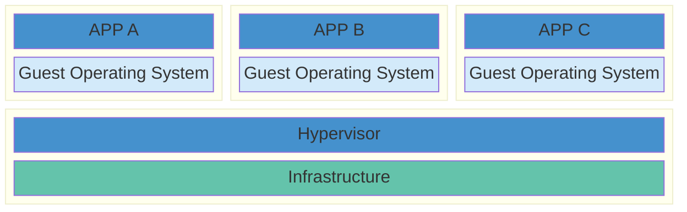
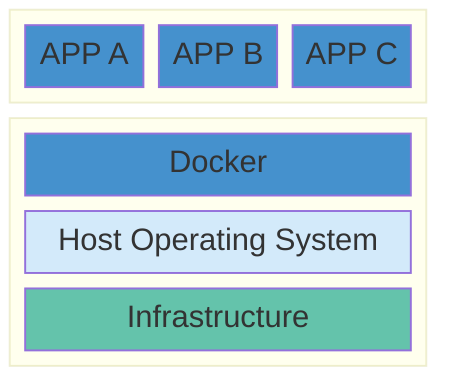
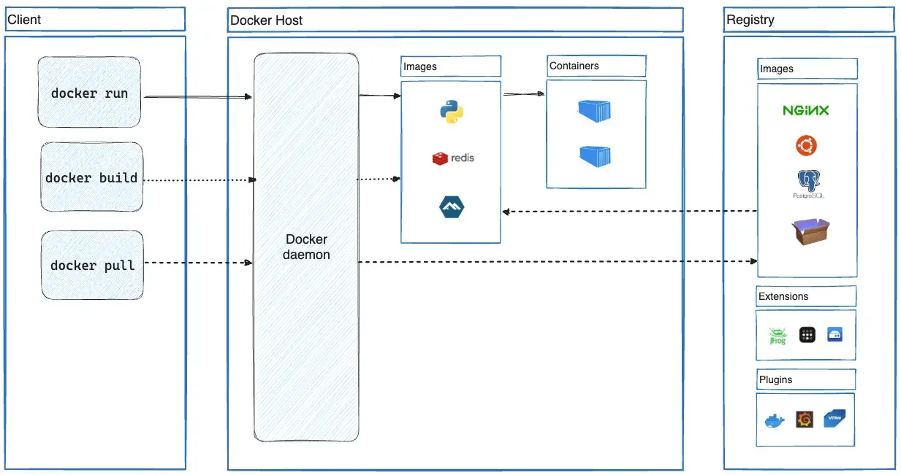
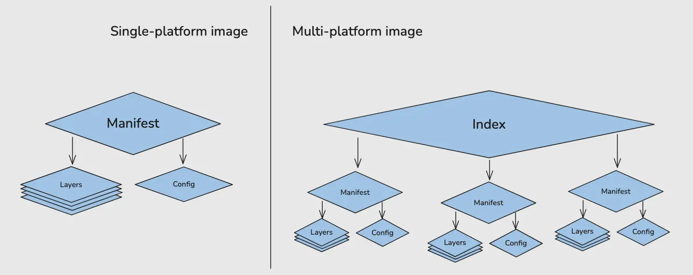

# 概括

**虚拟机**（VM）是将一台服务器转换为多台服务器的物理硬件的抽象。Hypervisor 允许多个 VM 在一台机器上运行。每个 VM 都包含一个操作系统、应用程序、必要的二进制文件和库的完整副本，这些文件占用了数十 GB，VM 启动也可能很慢。



**容器**是软件的标准单元，是应用程序层的一个抽象，它将代码和依赖关系打包在一起，以便应用程序在不同的计算环境之间快速可靠地运行。多个容器可以运行在同一台机器上，并与其他容器共享操作系统内核，每个容器都作为用户空间中的独立进程运行。容器比 VM 占用更少的空间，可以处理更多的应用程序。



Docker 是一个把开发的应用程序自动部署到容器的开源引擎，Docker 在虚拟化的容器执行环境中增加了一个应用程序部署引擎，用来提供一个轻量、快速的环境用来运行开发者的程序。



Docker 核心组件：

- The Docker daemon

  Docker 守护程序（dockerd）监听 Docker API 请求，并管理 Docker 对象，如图像、容器、网络和卷。守护程序还可以与其他守护程序通信来管理 Docker 服务。

- The Docker client

  Docker 客户端是和 Docker 交互的主要方式，当使用 docker run 等命令时，客户端会将这些命令发送到 dockerd，dockerd 会执行这些命令，docker 命令使用 Docker API。Docker 客户端可以与多个守护程序进行通信。

- Docker Registry

  Docker 使用 Registry 来保存用户构建的镜像，Registry 分为公共和私有两种，Docker 公司运营的公共 Registry 叫做 Docker Hub，用户可以分享保存自己的镜像。

- Docker 镜像

  用户基于镜像（image）来运行自己的容器。

- Docker 容器

  容器（container）是基于镜像启动的，容器可以运行一个或多个进程。每个容器都包含一个软件镜像，容器中的软件可以进行一些操作，如创建、启动、关闭和销毁。Docker 在执行操作时，不关心容器中到底塞进了什么，所有容器都按照相同的方式将内容装载进去。

# 安装

参考官网[安装说明](https://docs.docker.com/engine/install/)，或者镜像站[安装说明](https://mirrors.tuna.tsinghua.edu.cn/help/docker-ce/)。安装完成后可以使用 `docker info` 来查看信息。

# 镜像

搜索一个镜像：

```shell
# 搜索镜像，默认搜索官方仓库中的镜像
docker search <NAME>
```

从 registry 中下载一个镜像，如果不指定 tag，默认会选择 latest 标签，下载仓库中最新版本：

```shell
docker pull <NAME[:TAG]>
# 可以选择从其他 registry 的仓库下载
docker pull <REGISTRY/NAME[:TAG]>
```

可以使用 `docker iamges` 命令来查看本机已有的镜像，其中列出的信息中 IMAGE ID 表示镜像 ID，是镜像的唯一标识。

```shell
# 查看已有的镜像
docker images
```

为了方便后续使用镜像，可以使用 `docker tag` 来为本地镜像添加新的标签

```shell
docker tag <SOURCE_IMAGE[:TAG]> <TARGET_IMAGE[:TAG]>
```

> [!NOTE]
>
> 这些不同标签的镜像的 ID 是完全⼀致的，说明它们实际指向了同一个镜像文件，标签在这⾥起到了引⽤或快捷⽅式的作⽤。

使用 `docker inspect` 可以查看镜像的详细信息，这里返回的是一个 JSON 格式的消息。

```shell
# 可以使用名称或者ID
docker inspect <NAME|ID>
```

使用 `docker rmi` 来删除一个镜像：

```shell
# 删除镜像
docker rmi NAME[:TAG]
# 删除所有指向该镜像的标签，然后删除镜像
# 当该镜像创建的容器存在时，镜像文件默认是无法删除的，可以使用 -f 参数强制删除
docker rmi <ID>
```

> [!WARNING]
>
> 不推荐使用 `-f` 强制删除一个存在容器依赖的镜像，这样可能会造成一些遗留问题。

当需要导出或导入镜像时，可以将一个或者多个镜像归档到一个文件中，再从这个文件中导入镜像。

```shell
# 保存一个或者多个镜像到STDOUT中，-o表示指定归档文件代替标准输出流
docker save [OPTIONS] IMAGE [IMAGE...]
# 从 STDIN 中加载一个镜像，-i 表示指定归档文件代替标准输入流
docker load [OPTIONS] <archive>
```

> [!TIP]
>
> 可以简写为：
>
> ```shell
> docker save IMAGE_1 IMAGE_2 > archive.tar
> docker laod < archive.tar
> ```

如果需要上传镜像到仓库，首先需要登陆，默认会上传到官方仓库中。

```shell
# -u 表示用户名，-p 表示密码
docker login [OPTIONS] [SERVER]
# 退出登陆
docker loginout
# 上传镜像到仓库中
docker push NAME[:TAG]
```

# 容器

若要查看容器，使用 `docker ps`：

```shell
# 默认显示正在运行的容器，-a 表示显示所有的容器
docker ps [OPTIONS]
```

使用 `docker create` 可以创建一个容器，新建的容器处于停止状态。可以使用 `docker start` 来启动这个容器。

```shell
# 创建容器
docker create [OPTIONS] <IMAGE> [COMMAND] [ARG...]
# 启动容器
docker start <CONTAINER>
# 停止容器
docker stop <CONTAINER>
# 重启容器
docker restart <CONTAINER>
# 删除容器，-f表示强制终止并删除一个容器，-v表示同时删除容器挂载的匿名数据卷
docker rm [OPTIONS] <CONTAINER> [CONTAINER...]
# 显示日志
docker logs <CONTAINER>
```

> [!NOTE]
>
> 常用命令选项如下：
>
> - `-i`：保持标准输入流一直打开。
> - `-t`：分配一个伪终端并绑定到容器的标准输入流，通常与 `-i` 一起使用。
> - `-d`：在后台运行容器同时打印容器 ID。
> - `--name`：给容器分配一个名字。
> - `-p`：指定端口映射，例如 `-p 80:90`，将容器的80端口映射到主机的90端口。
> - `-P`：随机端口映射，容器内部端口映射到主机随机端口。
> - `--rm`：退出时自动移除容器。
> - `-v`：创建一个数据卷，多次使用可以创建多个数据卷。
> - `-e`：指定环境变量。

更快捷的方式是使用 `docker run` 直接从一个镜像中创建和运行一个容器，这个命令首先检查本地是否存在指定镜像，不存在就在公共仓库下载，然后使用镜像创建并启动一个容器，分配文件系统，并在只读的镜像层外面挂载一层可读可写层，从宿主主机配置的网桥接口中桥接一个虚拟接口到容器中，从地址池配置一个 IP 地址给容器，执行完用户指定的应用程序，执行完后容器被终止。

```shell
docker run [OPTIONS] <IMAGE> [COMMAND] [ARG...]
```

> [!NOTE]
>
> 当容器中指定的应用程序终结时，容器也会自动终止。例如启动一个终端 `docker run -it ubuntu /bin/bash`，当退出这个终端时这个容器也就处于终止状态。

有时候需要进入容器进行操作，这时可以使用 `docker attach` 或者 `docker exec` 命令。使用 `attach` 时，当多个窗口同时 `attach` 到一个容器的时候，所有窗口都会同步显示，当某个窗口因命令阻塞时，其他窗口就无法执行操作了。更常见的是使用 `docker exec`。

```shell
docker attach <CONTAINER>
docker exec -it <CONTAINER> <COMMAND> [ARG...]
```

可以基于已有的容器来创建一个新的镜像：

```shell
# -a 表示作者信息，-m 表示提交信息，-p 表示创建时暂停容器运行
docker commit [OPTIONS] <CONTAINER> [REPOSITORY[:TAG]]
```

若要导入或者导出容器快照到本地镜像库中：

```shell
# 导出容器文件系统作为 tar 归档文件，-o 表示输出到文件代替标准输出流
docker export [OPTIONS] <CONTAINER>
# 导入容器
docker import [OPTIONS] file|URL|- [REPOSITORY[:TAG]]
```

> [!CAUTION]
>
> `docker commit` 用于将一个容器的状态保存为一个新的镜像，当你在一个容器内进行了某些修改（例如安装软件、更改配置等），可以通过这个命令把这些修改保存到一个新的镜像中，当你需要基于现有容器快速创建包含特定修改的新镜像时这种方式非常有用。而 `docker export` 仅导出容器当前文件系统的快照，不保存容器的历史记录或元数据。

# 数据管理

用户在使用 Docker 过程中，往往需要查看容器内应用产生的数据，或者需要把容器内的数据进行备份，甚至多个容器之间进行数据的共享，这些涉及到容器的数据管理操作，容器中管理数据主要有两种方式：**数据卷**和**数据卷容器**。

## 数据卷

数据卷（_Data Volumes_）是一个可供容器使用的特殊目录，它绕过系统文件，可以提供很多特性：

- 数据卷可以在容器之间共享和重用。
- 对数据卷的修改会立马生效。
- 对数据卷的更新不会影响容器。
- 数据卷会一直存在，直到没有容器使用。

可以使用 `docker volume` 命令来对数据卷进行管理：

```shell
# 查看所有数据卷
docker volume ls
# 创建一个命名数据卷
docker volume create <volume>
# 删除所有未使用的的本地数据卷
docker volume prune
# 显示数据卷详细信息
docker volume inspect <volume>
# 删除数据卷
docker volume rm <volume>
```

在使用 `docker run` 命令时可以使用 `-v` 选项来创建一个数据卷，指定数据卷要挂载到容器的哪个目录下：

```shell
# 挂载一个匿名数据卷
docker run -d -v <mount_dir> <container> <exec>
# 挂载一个命名数据卷
docker run -d -v <volume_name>:<mount_dir> <container> <exec>
```

也可以指定挂载一个主机目录或者文件到容器中作为数据卷：

```shell
docker run -v /src/webapp:/opt/webapp <container> <exec>
docker run -v ~/.bash_history:/.bash_history <container> <exec>
```

> [!NOTE]
>
> Docker 挂载数据卷的默认权限是读写 rw，可以通过 ro 指定为只读，例如 `-v /dir:/dir:ro`，这样容器内挂载的数据卷的数据就无法修改了。

查看容器的数据卷信息，需要运行 `docker inspect <container>`，在输出中查找 Mounts 部分，例如：

```json
"Mounts": [
    {
        "Type": "volume",
        "Name": "2a1b3c4d5e6f7890abcdef1234567890",
        "Source": "/var/lib/docker/volumes/2a1b3c4d5e6f7890abcdef1234567890/_data",
        "Destination": "/app/data",
        "Driver": "local"
    }
]
```

## 数据卷容器

如果需要在容器之间共享一些持续更新的数据，可以使用**数据卷容器**。数据卷容器就是一个普通的容器，专门用它提供数据卷供其他容器挂载使用。

```shell
# 创建一个数据卷容器dbdata，并在其中创建一个数据卷，挂载到/dbdata目录
docker run -it -v /dbdata --name dbdata ubuntu
# 在其他容器中来挂载dbdata容器中的数据卷
docker run -it --volumes-from dbdata --name db1 ubuntu
docker run -it --volumes-from dbdata --name db2 ubuntu
```

此时容器 db1 和 db2 都挂载同一个数据卷到相同的 `/dbdata` 目录，这三个容器任何一方在该目录下的写入，其他容器都可以看见。

> [!NOTE]
>
> 如果删除了挂载的容器，数据卷并不会被自动删除，如果要删除一个数据卷，必须在删除最后一个还挂载着它的容器时使用 `docker rm -v <container>` 来指定同时删除关联的容器。

# 网络配置

在启动容器时，如果不指定对应参数，在容器外部是无法通过网络来访问容器内的网络应用和服务的。要让外部访问容器内部的应用，可以通过 `-P` 或 `-p` 选项来指定端口映射。当使用 `-P` 标记时，Docker 会随机映射一个 49000~49900 的端口至容器内部开放的网络端口。

```shell
# 查看端口映射配置
docker port <container>
```

1. 映射所有接口地址

   使用 `-p <host_port>:<container_port>` 格式将本地端口映射到容器的端口。此时会绑定本地所有接口上的所有地址。

2. 映射到指定地址的指定端口

   使用 `-p <ip>:<host_port>:<container_port>` 格式指定映射使用一个特定地址。

3. 映射指定地址的任意端口

   使用 `-p <ip>::<container_port>` 绑定指定地址的任意端口到容器的端口，指定的地址会自动分配一个端口。

> [!NOTE]
>
> 可以使用 udp 标记来指定 udp 端口。例如 `5000:5000/udp`。

# Docker Build

通过 `docker build` 命令可以构建自己的 Docker 镜像，这个命令会根据 Dockerfile 和构建上下文来构建镜像。构建上下文是可以访问的文件集合，可以是本地目录，也可以是远程的 Git 仓库的 URL。

```shell
# -t选项表示指定镜像的名称和标签
docker build -t <iamges>:<tag> <path>
```

> [!NOTE]
>
> 通过使用 `.dockerignore` 文件可以从构建上下文中排除指定的文件或者目录。

## Dockerfile

| 指令                                                                               | 含义                                                                       |
| ---------------------------------------------------------------------------------- | -------------------------------------------------------------------------- |
| [`FROM <image> `](https://docs.docker.com/reference/dockerfile/#from)              | 定义镜像的基础。对于多阶段构建，每个 `FROM` 指令都会开始一个新的构建阶段。 |
| [`RUN <command>`](https://docs.docker.com/reference/dockerfile/#run)               | 这个指令会执行命令并且在镜像的顶层添加一个新的 layer。                     |
| [`ENTRYPOINT <command>`](https://docs.docker.com/reference/dockerfile/#entrypoint) | 这个指令允许为容器配置一个可执行文件并运行。                               |
| [`WORKDIR <directory>`](https://docs.docker.com/reference/dockerfile/#workdir)     | 为 `RUN`、`CMD`、`ENTRYPOINT`、`COPY`、`ADD` 指令设置工作目录。            |
| [`COPY <src> <dest>`](https://docs.docker.com/reference/dockerfile/#copy)          | 从 `<src>` 路径复制文件或者目录到容器的文件系统下的 `<dest>` 目录。        |
| [`CMD <command>`](https://docs.docker.com/reference/dockerfile/#cmd)               | 这个指定用于定义启动容器时默认的命令，每个Dockerfile 只能有一个 `CMD`。    |

> [!NOTE]
>
> 更多命令含义请看：https://docs.docker.com/reference/dockerfile/#overview

`RUN`、`CMD` 和 `ENTRYPOINT` 指令有两种可能的形式：

- `INSTRUCTION ["executable","param1","param2"]` (exec form)
- `INSTRUCTION command param1 param2` (shell form)

exec form 会被解析成 JSON 数组，这意味着你必须在词语中使用双引号，而不是单引号。使用 exec form 不会自动调用命令 shell，这意味着正常的 shell 处理，例如变量替换不会发生。例如 `RUN [ "echo", "$HOME"]` 中 `$HOME` 不能被替换。而 shell form 将始终使用命令 shell。

`CMD` 可以和 `ENTRYPOINT` 结合使用，作为 `ENTRYPOINT` 的默认参数，例如 `CMD ["param1","param2"]`。

```dockerfile
# 构建镜像后运行容器，默认会执行'echo hello world'
FROM ubuntu
ENTRYPOINT ["echo", "hello"]
CMD ["world"]
```

一个 Dockerfile 例子如下，用于运行一个基于 Node.js 开发的应用程序：

```dockerfile
# syntax=docker/dockerfile:1

# 这里ARG指令用于定义参数
ARG NODE_VERSION="20"
ARG ALPINE_VERSION="3.21"

# 配置Node.js环境，通常选用alpine这种轻量的Linux发行版本，AS指令用于定义这个构建阶段的名称，WORKDIR指令定义当前的工作目录上下文，之后的相对目录会基于这个目录
FROM node:${NODE_VERSION}-alpine${ALPINE_VERSION} AS base
WORKDIR /src

# 选用之前的构建作为新的构建阶段
FROM base AS production
COPY package*.json ./
RUN npm ci
COPY --from=build /src/dist/ .
CMD ["node", "app.js"]
```

## 多平台镜像

多平台镜像的结构与单平台镜像不同。单平台镜像包含一个 Manifest 指向单个配置和一个 layer 集合，多平台镜像包含一个 Manifest 列表，指向多个 Manifest，每个 Manifest 指向不同的配置和 layer 集合。当发布一个多平台镜像到 Docker Registry 中，Registry 会存储 Manifest 列表和所有的 Manifest，当拉取一个镜像时，Docker 会根据主机的架构自动选择对应的 Manifest 来下载。



构建多平台镜像：

```shell
docker buildx build --platform <arch> <path>
```

# Docker Compose

Docker Compose 可以用来定义和运行多容器的应用。可以通过 YAML 配置文件管理服务、网络和数据卷。

```shell
# 启用所有定义在配置文件中的服务
docker compose up
# 停止服务
docker compose stop
# 停止和删除正在运行的服务
docker compose down
# 查看日志
docker compose logs
# 列出所有服务的状态
docker compose ps
```

## Compose 配置文件

Compose 配置文件的默认路径是工作目录下的 `compose.yaml` 或者 `compose.yml` 文件。一个简单的例子：

```
docker compose -f compose.yaml -f compose.admin.yaml run backup_db
```

```yaml
nam: myapp
services:
  web:
    build: .
    ports:
      - "8000:5000" # 这里定义了主机端口8000映射Dockerfile中暴露的端口5000
  redis:
    image: "redis:alpine"
```

这里定义了两个服务分别是 web 和 redis，web 服务会使用 Dockerfile 文件来构建镜像，然后指定端口号来启动容器，同时使用了 watch 来监听文件的变化，path 定义了源代码的位置，target 表示输出目录在容器中的位置。

> [!TIP]
>
> 对于不同应用的构建文件参考[用例](https://docs.docker.com/reference/samples/)。Compose 配置文件语法参考[文档](https://docs.docker.com/reference/compose-file/)。

## Profile

通过指定 `profile` 属性可以让 service 在指定的 Profile 中启用：

```yaml
services:
  frontend:
    image: frontend
    profiles: [frontend]

  phpmyadmin:
    image: phpmyadmin
    depends_on: [db]
    profiles: [debug]

  backend:
    image: backend

  db:
    image: mysql
```

若要指定 Profile，需要在命令行选项中指定 `--profile`：

```shell
# 启动phpmyadmin、backend、db
docker compose --profile debug up
# 启动fontend、phpmyadmin、backend、db
docker compose --profile frontend --profile debug up
# 启动全部
docker compose --profile "*" up
```

## 控制启动顺序

可以使用 `depends_on` 属性来控制服务启动和关闭的顺序，Compose 总是会根据依赖顺序来启动容器

## 监听

如果启用这个功能，当编辑和保存代码时会自动更新 Compose 服务。

```yaml
services:
  web:
    build: .
    command: npm start
    develop:
      watch:
        - action: sync
          path: ./web
          target: /src/web
          initial_sync: true
          ignore:
            - node_modules/
        - action: rebuild
          path: package.json
```

## 管理密钥

## 网络
