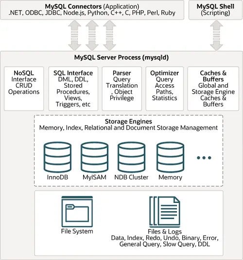
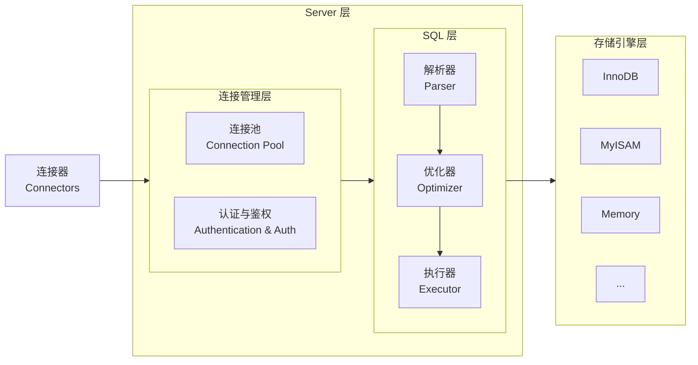
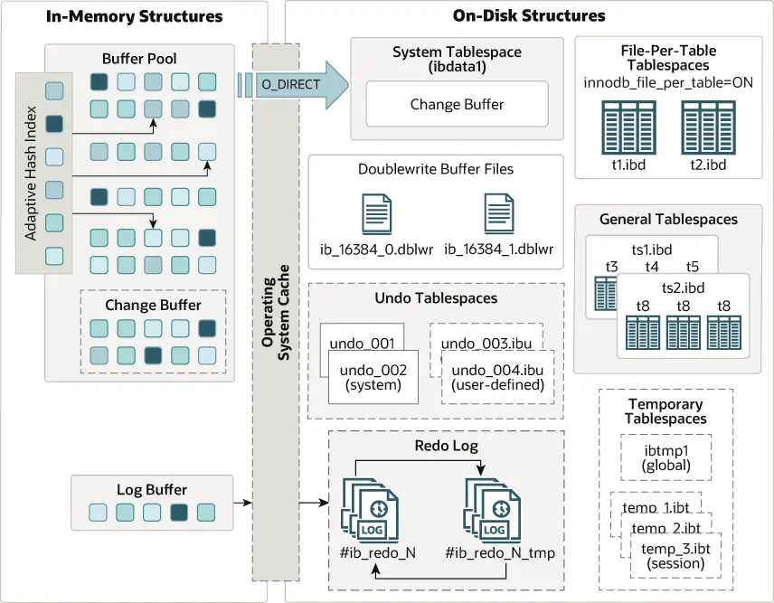
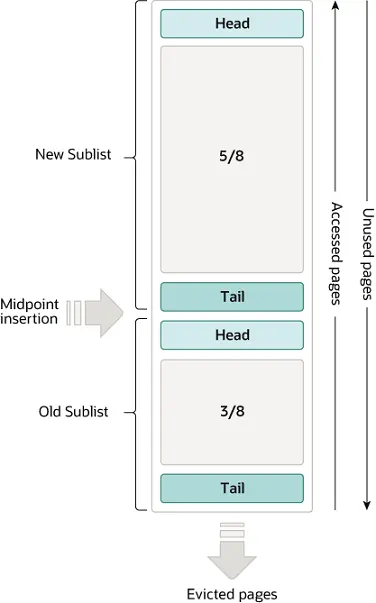

> [!TIP]
>
> 本教程基于 MySQL 8.0 说明。
>
> 参考资料：
>
> 1. https://dev.mysql.com/doc/refman/8.0/en
> 2. 《MySQL 技术内幕：InnoDB 存储引擎》
> 3. 《MySQL 实战45讲》
> 4. 《高性能 MySQL》

# 安装

## 在 Windows 上安装

MySQL 安装完成后必须要**初始化数据目录**，包括 mysql 系统数据库中的表。对于有些方法安装的 MySQL 是自动初始化数据目录的，有些方法是需要手动初始化数据目录的。

1. 创建参数文件

   当 MySQL 实例启动时，数据库会读取一个配置参数文件，用来寻找数据库的各种[文件位置](https://dev.mysql.com/doc/refman/8.0/en/option-files.html)以及某些初始化参数。默认情况下 MySQL 实例会按照一定的顺序在指定的位置进行读取。MySQL 的参数可以分为两种类型：

   - 动态参数

     可以在 MySQL 实例运行时进行更改，通过 `set` 命令对动态的参数值进行修改。

     ```sql
     SET variable = expr [, variable = expr] ...
     
     # variable: {
     #     user_var_name
     #   | param_name
     #   | local_var_name
     #   | {GLOBAL | @@GLOBAL.} system_var_name
     #   | {PERSIST | @@PERSIST.} system_var_name
     #   | {PERSIST_ONLY | @@PERSIST_ONLY.} system_var_name
     #   | [SESSION | @@SESSION. | @@] system_var_name
     # }
     ```

   - 静态参数

     不可以在运行时进行更改。

   如果需要指定启动选项，可以在命令行指定或者在参数文件中指定。当 MySQL 服务器在 Windows 上启动时，会在多个目录中搜索参数文件，例如 `c:\my.ini`、`BASEDIR\my.ini` 或者 `%WINDIR%\my.ini` 等，文件内容如下：

   ```ini
   [mysqld]
   # set basedir to your installation path
   basedir=E:\\mysql
   # set datadir to the location of your data directory
   datadir=E:\\mydata\\data
   ```

2. 初始化数据目录

   在 Windows 中，初始化数据目录使用以下命令之一：

   ```shell
   # 初始化数据目录，会生成随机密码
   mysqld --initialize --console
   # 初始化数据目录，不生成密码
   mysqld --initialize-insecure --console
   # 指定配置文件的路径
   mysqld --initialize --defaults-file=<configfile> --console
   ```

   mysqld 在初始化数据目录时执行以下操作：

   1. 检查数据目录是否存在。如果数据目录不存在，则创建；如果数据目录存在且不为空，将在产生错误消息后退出。
   2. 在数据目录中，将创建 mysql 系统数据库。
   3. 初始化管理 InnoDB 表所需的系统表空间和相关数据结构。
   4. 创建一个 `root@localhost` 超级用户帐户和其他保留帐户，`root@localhost` 用户的密码取决于你的调用。
      - 使用 `--initialize`，生成一个随机密码，将其标记为过期，并写入一条生成临时密码的消息。
      - 使用 `--initialize-insecure`，不生成密码，并写入警告消息。

3. 启动服务

   在命令行中输入以下命令启动服务：

   ```shell
   mysqld --console
   ```

4. 分配密码

   当连接 MySQL 服务器后需要给 `root@localhost` 用户分配密码，如下：

   ```shell
   # 使用 --initialize 初始化数据目录
   mysql -u root -p
   # 使用 --initialize-insecure 初始化数据目录
   mysql -u root --skip-password
   ```

   连接成功后使用 `alter user` 语句修改root用户的密码：

   ```sql
   ALTER USER 'root'@'localhost' IDENTIFIED BY 'root';
   ```

5. 停止服务

   ```shell
   # 如果root用户设置了密码则需要使用-p选项
   mysqladmin -u root -p shutdown
   ```

6. 启动 MySQL 作为 Windows 服务

   在 Windows 中运行 MySQL 最好的办法就是将它作为一个 Windows 服务，MySQL 将自动在 Windows 开机时启动。安装服务之前需要关闭 MySQL 服务，使用以下命令安装 MySQL 服务：

   ```powershell
   # --install选项后面可以指定服务名称，默认是MySQL，如果失败请使用管理员权限
   mysqld --install [service-name]
   # 同样可以指定配置文件
   mysqld --install [service-name] --defaults-file = <configfile>
   ```

   如果要移除服务，在命令行输入：

   ```powershell
   sc delete <service-name>
   ```

## 在 Linux 安装

在 Linux 中部署请看[安全部署指南](https://dev.mysql.com/doc/mysql-secure-deployment-guide/8.0/en/)。

# 连接 MySQL

MySQL 是一个客户机—服务器 DBMS，因此为了使用 MySQL，需要有一个客户机，每个 MySQL 都安装了一个名为 `mysql` 的简单命令行实用程序，在命令行中输入以下命令登陆 MySQL：

```shell
mysql -h [host_name] -u [user_name] -p
```

- `-h`：指定客户端所要登录的MySQL主机名, 登录本机该参数可以省略。
- `-u`： 登陆的用户名。
- `-p`： 告诉服务器将会使用一个密码来登录, 如果所要登录的用户名密码为空, 可以忽略此选项。

# MySQL 架构



MySQL 大致可以分为 Server 层和存储引擎层两部分。Server 层包括分析器、优化器、执行器等，涵盖 MySQL 的大多数核心服务功能，以及所有的内置函数（如日期、时间、数学和加密函数等），所有跨存储引擎的功能都在这一层实现，比如存储过程、触发器、视图等。而存储引擎层负责数据的存储和提取。其架构模式是插件式的，支持 InnoDB、MyISAM、Memory 等多个存储引擎。



- 连接器

  连接器负责跟客户端建立连接、获取权限、维持和管理连接。一个用户成功建立连接后，即使你用管理员账号对这个用户的权限做了修改，也不会影响已经存在连接的权限。修改完成后，只有再新建的连接才会使用新的权限设置。连接完成后，如果没有后续的动作，这个连接就处于空闲状态。客户端如果太长时间没动静，连接器就会自动将它断开。可以使用 `show processlist` 命令来查看当前的连接状态。

- 分析器

  对 SQL 语句进行词法分析和语法分析。

- 优化器

  这一部分进行 SQL 语句的优化，例如决定使用哪个索引、或者在一个语句有多表关联的时候，决定各个表的连接顺序。

- 执行器

  根据优化器制定的执行计划，调用存储引擎提供的接口一步步执行。执行过程中会利用 Buffer Pool 中的数据进行计算。

MySQL 支持多种存储引擎，可以使用 `show engines` 命令来查看 MySQL 支持的所有存储引擎，目前默认的存储引擎是 InnoDB，常见的存储引擎如下：

| 存储引擎    | 事务 | 锁粒度         | 物理存储特点                                                 | 最适合的场景                                                 | 不建议使用场景                                             |
| ----------- | ---- | -------------- | ------------------------------------------------------------ | ------------------------------------------------------------ | ---------------------------------------------------------- |
| InnoDB      | ✅    | 行级锁 /间隙锁 | 使用 .ibd 文件，数据和索引合并存储                           | 主要面向在线事务处理（OLTP）的应用。例如订单、会员、金融、ERP、高并发写入业务 | 极少场景不建议，除非硬盘空间极度紧缺且只读                 |
| MyISAM      | 🚫    | 表级锁         | 表由 MYD 和 MYI 组成，MYD 用来存放数据文件，MYI 用来存放索引文件 | 主要面向在线分析处理（OLAP）的应用。纯只读的数据仓库，系统里通常有一些“永不修改”的配置映射表，例如省市区编码、年度销售汇总表、月度财务报表 | 任何有并发写入、要求数据一致性、不能丢数据的核心业务       |
| Memory      | 🚫    | 表级锁         | 数据存储在内存中，只有表结构保留在磁盘                       | 高频查询的静态字典表、Session 会话临时表、实时统计中间缓存   | 存储过大或频繁更新的数据（内存溢出风险）；要求持久化的数据 |
| Archive     | 🚫    | 行级锁         | .ARZ 高度压缩文件，磁盘占用极小                              | 海量日志归档、IoT设备上报流水、操作审计轨迹（只 insert 和 select） | 需要更新、删除、或高频点查/范围查询的业务                  |
| NDB Cluster | ✅    | 行级锁         | 数据分布在多台数据节点的内存中（需专用集群）                 | 电信计费、游戏玩家实时状态、支付系统等极高可用、极低延迟场景 | 中小型项目、运维能力薄弱的团队（运维极其复杂）             |

> [!TIP]
>
> 关于其他引擎的详细信息请看[官方文档](https://dev.mysql.com/doc/refman/8.0/en/storage-engines.html)。

# 数据类型

1. 串数据类型

   有两种基本的串类型，分别为**定长串**和**变长串**，定长串接受长度固定的字符串，其长度是在创建表时指定，变长串存储可变长度的文本。

   |     类型     | 说明                                                         |
   | :----------: | :----------------------------------------------------------- |
   |    `char`    | 1～255个字符的定长串，它的长度必须在创建时指定，否则MySQL假定为 `char(1)` |
   |  `varchar`   | 长度可变的字符串，如果在创建时指定为 `varchar(n)`，则可存储0到n个字符的变长串（其中 n ≤ 255） |
   |    `enum`    | 枚举类型                                                     |
   |  `tinytext`  | 最大长度为 2^8^ -1字符的变长文本                             |
   |    `text`    | 最大长度为 2^16^ -1字符的变长文本                            |
   | `mediumtext` | 最大长度为 2^24^ -1字符的变长文本                            |
   |  `longtext`  | 最大长度为 2^32^ -1字符的变长文本                            |
   |    `blob`    | 最大长度位65535（2^16^ -1）字节二进制形式的长文本数据        |

2. 数值类型

   |                  类型                  | 说明                                                         |
   | :------------------------------------: | ------------------------------------------------------------ |
   |                `bit(m)`                | 一个比特值的类型，`m` 表示每个值的位数，取值范围为1~64，如果省略 `m`，则默认值为1 |
   |            `boolean`/`bool`            | 布尔标志，值为0或1，或者使用 `true` 或 `false` 来代替。这个类型是 `tinyint(1)` 的同义词 |
   | `deciaml(m[,d]) [unsigned] [zerofull]` | 精确定点数，`m` 为总位数，`d `为小数点后的位数               |
   |  `float[(m,d)] [unsigned] [zerofull]`  | 单精度浮点数                                                 |
   | `double[(m,d)] [unsigned] [zerofull]`  | 双精度浮点数                                                 |
   |   `tinyint(m) [unsigned] [zerofull]`   | 1字节整数值                                                  |
   |  `smallint(m) [unsigned] [zerofull]`   | 2字节整数值                                                  |
   |  `mediumint(m) [unsigned] [zerofull]`  | 3字节整数值                                                  |
   |     `int(m) [unsigned] [zerofull]`     | 4字节整数值                                                  |
   |   `bigint(m) [unsigned] [zerofull]`    | 8字节整数值                                                  |

   > [!NOTE]
   >
   > `zerofull` 表示如果值不够位数将用0来填充。

3. 日期和时间类型

   | 类型               | 说明                                                         |
   | ------------------ | ------------------------------------------------------------ |
   | `date`             | 一个日期，MySQL 以 `YYYY-MM-DD` 格式显示日期值，允许使用字符串或数字将值分配给日期列 |
   | `time[(fsp)]`      | 一个时间，取值范围是 `-838:59:59.000000` 到 `838:59:59.000000`，MySQL 以 `hh:mm:ss[.fraction]` 的格式显示时间值，但允许使用字符串或数字将值分配给 `time` 列 |
   | `datetime[(fsp)]`  | `date` 和 `time`的组合，支持范围 `1000-01-01 00:00:00.000000` 到 `9999-12-31 23:59:59.999999`，MySQL 以 `YYYY-MM-DD hh:mm:ss[.fraction]` 的格式显示 `datetime` 值 |
   | `timestamp[(fsp)]` | 一个时间戳，范围是 `1970-01-01 00:00:01.000000` UTC 到 `2038-01-1903:14:07.999999` UTC，`timestamp` 值存储为从 `1970-01-01 00:00:00` UTC 开始的秒数。MySQL 将 `timestamp` 值从当前时区转换为 UTC 存储，然后从 UTC 返回到当前时区，以便检索 |
   | `year`             | 四位数格式的一年，MySQL 以 `YYYY` 格式显示 `year` 值，但允许使用字符串或数字将值分配给 `year` 列，值显示为1901到2155或0000 |

   > [!NOTE]
   >
   > `fsp` 表示精度，默认为0，如果给出 `fsp` 的值，则取值范围必须是0 ~ 6，值0表示没有小数部分。

# 基本操作

多条 SQL 语句必须以分号分隔，MySQL 和多数 DBMS 一样，不需要在单条 SQL 语句后面加分号，如果使用的命令行，则必须加上分号来结束 SQL 语句。**SQL 语句不区分大小写**，但最好按照大小写的惯例且使用时保持一致，在处理 SQL 语句时，其中所有的空格都被忽略，SQL 语句可以在一行给出，也可以在多行给出。常用命令如下：

## 创建和使用数据库

```sql
# 创建一个数据库，charset_name 和 collate_name 分别表示字符集和排序规则
create database database_name character set charset_name collate collate_name;
# 创建后需要选择使用数据
use database_name;
# 删除数据库
drop database database_name;
# 显示管理的数据库列表
show databases;
```

> [!TIP]
>
> MySQL 支持的字符集可以使用 `show character set` 命令来查看，排序规则可以使用 `show collation` 命令查看。排序规则是一个用于字符集中字符之间的比较的规则集合。通常新建表时，首选 `utf8mb4` 字符集和 `utf8mb4_0900_ai_ci` 排序规则即可。`utf8mb4` 是唯一真正支持全 Unicode 的字符集，这是 MySQL 中 UTF8 的完整实现。

## 创建和操纵表

```sql
create table table_name(
	column_name_1 dataType not null auto_increment, # 不允许为空，自动增列
    column_name_2 dataType null unique, # 允许为空，唯一约束
    column_name_3 dataType default 1, # 默认值为1
    column_name_4 dataType check(column_name_4 > 0), # 检查约束，该列值必须大于0
    primary key (column_name_1), # 设置主键
    foreign key (column_name_2) references table_name(column_name) # 设置外键
)engine=InnoDB auto_increment = 10001; # 指定引擎类型，指定自增从10001开始，同一个库中不同表的引擎类型可以混用，但是外键不能跨引擎
```

> [!NOTE]
>
> `auto_increment` 关键字告诉 MySQL，本列每当增加一行时自动增量，每个表只允许一个 `auto_increment` 列，而且它必须被索引（例如使它成为主键）。

常用命令如下：

```sql
# 给表添加一个列
alter table table_name add column_name data_type;
# 删除一个列
alter table table_name drop column column_name;
# 删除表
drop table table_name;
# 重命名表
rename table origin_table_name to new_table_name;
# 显示指定数据库的所有表
show tables;
# 显示表字段信息
describe table_name;
# 显示数据表的详细索引信息，包括主键
show index from table_name;
# 显示数据库中表的信息
show table status from database_name;
```

通常建表有以下规约：

- 表名不使用复数名词。
- 表达是与否概念的字段，必须使用 `is_xxx` 的方式命名。
- 主键索引名为 `pk_字段名`，唯一索引名为 `uk_字段名`，普通索引名则为 `idx_字段名`。
- 表中必备的三个字段：`id`、`create_time`、`update_time`。其中 `id` 必为主键，类型为 `bigint unsigned`，单表时自增，步长为 1。`create_time` 和 `update_time` 的类型均为 `datetime` 类型， 如果要记录时区信息，那么类型设置为 `timestamp`。

## 创建约束

约束是一种简单的用于表中一列或者多列的限制，约束有一下几种类型：

1. 主键约束

   标志一列或者多列，并保证其值在表内的唯一性。

   ```sql
   alter table table_name add constraint pk_name primary key (colunm_name);
   ```

2. 外键约束

   限制一列或者多列中的值必须被包含在另一表中的外键列中，并且在级联更新或者级联删除规则建立后也可也限制其他表中的可用值。

   ```sql
   alter table table_name add constraint fk_table1_table2
   foreign key (column_name) references table_name(column_name);
   ```

3. 唯一约束

   限制一列或者多列的值，保证其在表内的唯一性，但是允许多个 `null` 值（主键约束是一种特殊类型的唯一约束），唯一约束的本质创建了一个 B+ Tree 唯一索引。

   ```sql
   alter table table_name add constraint uk_name unique(column_name);
   ```

4. 检查约束

   限制一列的可用值范围。

   ```sql
   alter table table_name add constraint constraint_name check(表达式);
   ```

## 插入数据

```sql
# 插入数据
insert into table_name values(value_1, value_2, ...);
# 可以省略某些列
insert into table_name (column_1, column_2, ...) values (value_1, value_2, ...);
# 插入多行
insert into table_name values (value_1, value_2, ...), (value_1, value_2, ...);
```

## 更新数据

```sql
update table_name set column_name = 'xxx' where 条件;
update table_name set column_name1 = 'xxx' , column_name2 = 'xxx' where 条件;
```

> [!TIP]
>
> 如果用 `update` 更新多行，并且在更新时有一行或者多行出现一个错误，则 `update` 操作被取消。可以使用 `ignore` 关键字忽略错误继续进行更新，例如 `update ignore table_name ...`。

## 删除数据

```sql
delete from table_name where 条件;
```

## 检索行

```sql
select colunm_name from table_name;
# 将 alias_name 作为 colunm_name 的别名
select colunm_name as alias_name from table_name
# 如果要检索不同的行，使用关键字 distinct
select distinct colunm_name from table_name;
```

> [!TIP]
>
> `distinct` 不能部分使用，这个关键字会应用于指定的所有列而不仅仅是前置它的列。

使用 `limit` 子句来限制返回的结果：

```sql
# 限制返回的结果不多于 num 行
select colunm_name from table_name limit num;
# 限制返回的结果为从第 start_index 行开始的 rows 行，start_index 为开始位置，rows 为要检索的行数，start_index 索引从0开始
select colunm_name from table_name limit start_index, rows;
```

在某些情况下需要完全限定名，例如限定列名和表名：

```sql
# 对 edu 数据库中的 student 表和 student 表中的 name 列名使用完全限定名
select student.name from edu.student;
```

## 排序数据

如果不排序，检索出的数据一般将以它在底层表中出现的顺序显示，但是如果数据后来进行过更新或删除，则此顺序受到MySQL重用回收存储空间的影响，因此如果不明确控制的话，不应该依赖于改排序关系，不应该假定检索出的数据的顺序有意义。

使用`order by`子句取**一个**或**多个**列的名字，据此对输出进行排序：

```sql
order by colunm_name # 默认使用升序排序
```

数据排序不限于升序排序，这只是默认的排序顺序，还可以使用关键字`desc`降序排序：

```sql
order by colunm_name desc
```

`desc`关键字只应用到位于其前面的列名，如果想在多个列上进行降序排序，必须对每个列指定`desc`关键字。

与`desc`相反的是`asc`，如果都不指定这两个关键字，则默认是`asc`（升序排序）。

> 注意：在使用`limit`和`order by`子句时要注意子句的位置，`order by`要在`from`子句的后面，`limit`要在`order by`的后面，使用子句的次序不对将产生错误消息。

## 过滤数据

使用`where`子句指定条件检索数据：

```sql
where 条件
```

> 注意：`where`子句必须要在`order by`子句之前，否则会出错。

|   操作符   | 说明               |
| :--------: | :----------------- |
|    `=`     | 等于               |
| `<>`或`!=` | 不等于             |
|  `<`和`>`  | 小于和大于         |
| `<=`和`>=` | 小于等于和大于等于 |
| `between`  | 在两个指定值之间   |
|   `and`    | 逻辑操作符，与     |
|    `or`    | 逻辑操作符，或     |
|    `in`    | 指定条件范围       |
|   `not`    | 逻辑操作符，非     |

当为了检查某个范围的值，可使用`between`操作符：

```sql
# 检索colunm_name在value_1和value_2之间的所有记录
where colunm_name between value_1 and value_2
```

`select`语句有一个特殊的`where`子句，就是`is null`子句，可用来检查具有`NULL`值的列：

```sql
# null与0、空字符串和空格不同
where colunm_name is null
# 检测不为空
where column_name is not null
```

使用`in`操作符指定条件范围，范围中的每个值都可以进行匹配：

```sql
# 检索colunm_name为value_1或value_2的记录
where colunm_name in (value_1, value_2, ...) # 这种写法与or操作符有相同的效果
```

`not`操作符用来否定后跟条件的关键字，例如：

```sql
# 检索colunm_name不为value_1、value_2的记录
where colunm_name not in (value_1, value_2)
```

为了使用通配符，必须使用`like`操作符，`like`指示MySQL后跟的搜索模式利用通配符匹配而不是直接相等的匹配进行比较

```sql
# 使用百分号%通配符，在搜索串中，%表示任何字符出现任意次数，可以表示0个字符
where colunm_name like 'name%'
# 使用下划线_通配符，_表示一个字符
where colunm_name like '_name'
```

MySQL 用`where`子句对正则表达式提供了初步的支持，MySQL仅支持多数正则表达式实现的一个很小的子集。

1. 基本字符串匹配

   ```sql
   # 检索colunm_name包含文本'xxxx'的所有记录
   where colunm_name regexp 'xxxx'
   # .是正则表达式中一个特殊的字符，表示匹配任意一个字符
   where colunm_name regexp '.xxx'
   ```

   `like`和`regexp`有一个重要的区别，`like`会匹配列中的整个文本，而`regexp`会匹配列中的部分文本。

   ```sql
   # 对于'xxxabc'，使用like不会返回，而regexp会
   where colunm_name like 'xxx'
   where colunm_name regexp 'xxx'
   ```

   MySQL 中的正则表达式匹配**不区大小写**，如果要区分大小写，可使用关键字`binary`。

   ```sql
   where colunm_name regexp binary 'xxx'
   ```

2. 进行 or 匹配

   `|`为正则表达式的或操作符，表示匹配其中之一：

   ```sql
   # 匹配字段含有'100'或'200'的记录
   where colunm_name regexp '100|200'
   ```

3. 匹配几个字符之一

   如果想要匹配任何单一字符，可以使用`[]`：

   ```sql
   # [123]表示匹配1或2或3
   where colunm_name regexp '[123]xxx'
   ```

   可以使用`-`来定义一个范围，如`[0-9]`或`a-z`

   ```sql
   # [0-9]表示匹配0到9
   where colunm_name regexp '[0-9]xxx'
   ```

4. 匹配特殊字符

   要匹配特殊字符如`|`或`.`，必须用`\\`为前导，例如：

   ```sql
   # '\\.'表示查找'.'
   where colunm_name regexp '\\.'
   ```

   |   特殊字符   | 说明     |
   | :----------: | -------- |
   |    `\\f`     | 换页     |
   |    `\\n`     | 换行     |
   |    `\\r`     | 回车     |
   |    `\\t`     | 制表     |
   |    `\\v`     | 纵向制表 |
   |    `\\\`     | 反斜杠   |
   |    `\\?`     | 问号     |
   | `\\(`或`\\)` | 括号     |

5. 匹配多个实例

   |  字符   | 说明                          |
   | :-----: | ----------------------------- |
   |   `*`   | 0个或多个匹配                 |
   |   `+`   | 1个或多个匹配（等价于`{1,}`） |
   |   `?`   | 0个或1个匹配                  |
   |  `{n}`  | 指定数目匹配                  |
   | `{n,}`  | 不少于指定数目匹配            |
   | `{n,m}` | 匹配数目的范围                |

6. 定位符

   | 字符 | 说明       |
   | :--: | ---------- |
   | `^`  | 文本的开始 |
   | `$`  | 文本的结束 |

   `^`在`[]`中使用时有另一种含义，表示匹配任何不在指定范围内的任意字符

   ```sql
   # 匹配不是0-9的字符
   where colunm_name regexp '[^0-9]'
   ```

7. 测试正则表达式

   可以在不使用数据表的情况下用`select`测试正则表达式：

   ```sql
   # regexp检查总是返回0或1
   select 'xxxx' regexp 'x';
   ```

## 创建计算字段

1. 拼接字段

   在MySQL的`select`语句中，可以使用`concat()`函数来拼接列：

   ```sql
   select concat(column_1, column_2) from table_name;
   ```

2. 执行算数运算

   MySQL可以执行基本的加减乘除运算（`+`，`-`，`*`，`/`）

   ```sql
   # 计算汇总物品价格count_price
   select price, quantity, price * quantity as count_price from table_name;
   ```

   可以利用`select`来测验函数与计算，省略`from`子句可以简单地处理表达式：

   ```sql
   select 2 * 3; # 返回6
   ```

## 使用函数处理数据

1. 文本处理函数

   | 函数                 | 说明                   |
   | -------------------- | ---------------------- |
   | `left()`或`right()`  | 返回串左边或右边的字符 |
   | `length()`           | 返回串的长度           |
   | `locate()`           | 找出一个串的子串       |
   | `lower()`或`upper()` | 将串转为小写或大写     |
   | `ltrim()`或`rtrim()` | 去掉串左边或右边的空格 |

2. 日期和时间处理函数

   | 函数                         | 说明                           |
   | ---------------------------- | ------------------------------ |
   | `curdate()`或`curtime()`     | 返回当前日期或时间             |
   | `now()`                      | 返回当前日期时间               |
   | `date()`                     | 返回日期时间的日期部分         |
   | `time()`                     | 返回一个日期的时间部分         |
   | `datediff()`                 | 计算两个日期之差               |
   | `dayofweek()`                | 对于一个日期，返回对应的星期几 |
   | `year()`或`month()`或`day()` | 返回一个日期的年或月或日       |

   日期格式必须为`yyyy-mm-dd`，虽然其他日期格式可能也行，但是这是首选的日期格式。当使用日期检索记录时，最好使用`date()`函数，因为如果字段的数据类型为`datetime`，那么使用`where order_date = 'yyyy-mm-dd'`这种语句不会检索出来记录，更可靠的语句：

   ```sql
   # 对于日期最好使用date()函数
   where date(order_date) = 'yyyy-mm-dd'
   ```

3. 数值处理函数

   | 函数     | 说明   |
   | :------- | :----- |
   | `abs()`  | 绝对值 |
   | `mod()`  | 余数   |
   | `pi()`   | 圆周率 |
   | `rand()` | 随机数 |
   | `sqrt()` | 平方根 |

4. 聚集函数

   聚集函数运行在组上，计算和返回单个值的函数，可以对聚合函数指定`distinct`参数来包含不同的值。

   | 函数             | 说明                     |
   | ---------------- | ------------------------ |
   | `avg()`          | 返回某列的平均值         |
   | `count()`        | 返回某列的行数           |
   | `max()`或`min()` | 返回某列的最大值或最小值 |
   | `sum()`          | 返回某列值之和           |

   `count()`函数有两种使用方式，`count(*)`对表中的行数进行计数，`count(column_name)`对特定列中具有值的行进行计数，忽略`NULL`值。

   ```sql
   # 对avg()函数指定distinct参数
   select avg(distinct colunm_name) from table_name;
   ```

5. 窗口函数

   窗口函数一般语法如下：

   ```sql
   window_function([param]) OVER (
     [PARTITION BY <column>]
     [ORDER BY <column [ASC | DESC]>]
     [frame_clause]
   )
   ```

   首先指定窗口函数名称，后跟表达式，`over`具有三个可能元素的子句：`PARTITION BY`、`ORDER BY`和`ROWS BETWEEN`。

   `PARTITION BY`子句将行分区，两个分区之间由分区边界分隔，窗口函数在分区内执行，并在跨越分区边界时重新初始化。`ORDER BY`子句指定行在分区中的排序方式。

   ```sql
   SELECT
     user_name,
     SUM( money ) OVER ( PARTITION BY user_name ) total
   FROM
     user;
   ```

   如果给出了`frame_clause`子句，则其语法如下：

   ```
   frame_clause:
       frame_units frame_extent
   
   frame_units:
       {ROWS | RANGE}
   ```

   `frame_units`值指示当前行和帧行之间的关系类型，`ROWS`表示框架由起始行和结束行位置定义，偏移量是行号与当前行号的差值。`RANGE`表示框架由值范围内的行定义，偏移量是行值与当前行值的差值。

   `frame_extent`值指示帧的起点和终点，可以只指定帧的开始（在这种情况下，当前行隐式地是结束），或者使用`BETWEEN`指定两个帧端点，语法如下：

   ```
   frame_extent:
       {frame_start | frame_between}
   
   frame_between:
       BETWEEN frame_start AND frame_end
   
   frame_start, frame_end: {
       CURRENT ROW
     | UNBOUNDED PRECEDING
     | UNBOUNDED FOLLOWING
     | expr PRECEDING
     | expr FOLLOWING
   }
   ```

## 分组数据

使用`group by`子句来创建分组：

```sql
select * from table_name group by column_name;
```

过滤分组中的数据使用`having`子句：

```sql
select * from table_name group by column_name having 条件;
```

## 子查询

子查询是可以嵌套在其他查询中的查询，例如：

```sql
select * form table_name where colunm_name in (子查询语句);
```

作为计算字段使用子查询，例如查询每个客户的订单数：

```sql
select cust_name,(select count(*)) from orders where orders.cust_id = customers.cust_id) as orders from customers;
```

带有`exist`的子查询不返回任何数据，只产生`true`和`false`。如果子查询返回任何行，则`exists`子查询为`true`，`not exists`子查询为`false`。

```sql
# 哪种商店不存在城市中
SELECT DISTINCT store_type FROM stores
  WHERE NOT EXISTS (SELECT * FROM cities_stores
                    WHERE cities_stores.store_type = stores.store_type);
# 哪种商店在所有的城市中
SELECT DISTINCT store_type FROM stores
  WHERE NOT EXISTS (
    SELECT * FROM cities WHERE NOT EXISTS (
      SELECT * FROM cities_stores
      WHERE cities_stores.city = cities.city
      AND cities_stores.store_type = stores.store_type));
```

## 连接表

1. 内部连接

   如果在一个表中的连接字段的值在另一个表中不存在对应的值，那么相关行将会从结果集中排除，这种类型的连接被称为**内连接**。没有条件的内连接相当于两个表的的笛卡尔积。

   ```sql
   # 第一种写法
   select * from table_1, table_2 where table_1.column_1 = table_2.column_2;
   # 第二种写法，使用inner join
   select * from table_1 inner join table_2 on table_1.column_1 = table_2.column_2;
   ```

   假设需要查询某件物品的供应商生产的其他物品，可以使用子查询，也可以使用自连接，使用相同的表进行连接：

   ```sql
   # 使用自连接查询
   select p1.prod_name from products as p1, products as p2 where p1.vend_id = p2.vend_id and p1.prod_name = 'xxx';
   ```

2. 外部连接

   外部连接将一个表中的行与另一个表中的行关联，同时包含了那些在相关表中没有关联行的行。例如检索每个客户的订单数量，包括没有订单的客户：

   ```sql
   # 对于没有订单数量的用户，显示的结果为null
   select customers.cust_id, orders.order_num from customers left outer join orders on customers.cust_id = orders.cust_id;
   ```

   在使用`outer join`时必须使用`left`或者`right`关键字指定包括其所有行的表，`left`表示左边的表包括所有行，`right`表示右边的表包括所有的行。

## 集合

集合操作主要包括并、交和差，两个数据集执行集合操作时，必须具有相同数目的列，且对应列的数据类型是一样的。

1. `union`

   使用`union`将结果并起来时，系统会自动去掉重复的行，如果要保留重复行，则用`union all`。

   ```sql
   # 表1和表2的并集
   select * from table_1 union select * from table_2;
   ```

2. `instersect`

   ```sql
   # 表1和表2的交集
   select * from table_1 intersect select * from table_2;
   ```

3. `except`

   ```sql
   # 表1和表2的差集
   select * from table_1 except select * from table_2;
   ```

# 视图

视图是虚拟的表，视图只包含使用时动态检索数据的查询。使用视图为了重用 SQL 语句，简化复杂的 SQL 操作等。在视图创建之后，可以用与表基本相同的方式利用它们。

```sql
# 创建视图
create view view_name as select_statement;
# 查看创建视图的语句
show create view view_name;
# 删除视图
drop view view_name;
```

通常视图是可更新的，可以对它们使用 `update`、`insert`、`delete` 操作，更新一个视图将更新其基表，如果对视图增加或删除行，实际上是对其基表增加或删除行。但是并非所有视图都是可更新的，如果 MySQL 不能正确地确定被更新的基数据，则不允许更新（包括插入和删除）。即如果视图定义中有以下操作，则不能进行视图的更新：

- 分组（使用`group by`和`having`）。
- 连接。
- 子查询。
- `union`、`distinct`。
- 聚合函数（`max()`、`min()`、`avg()`等）。

# 存储过程

存储过程是为了以后的使用而保存的一条或多条 MySQL 语句的集合。通过把处理封装在容易使用的单元中，简化复杂的操作。存储过程在创建之后被保存在服务器上。

```sql
# 创建名为 productpricing 的存储过程，返回产品平均价格的存储过程
create procedure productpricing()
begin
	select avg(prod_price) from products;
end;
# 调用存储过程
call productpricing();
# 删除存储过程
drop procedure productpricing;
# 显示用来创建一个存储过程的 create 语句
show create procedure procedure_name;
# 列出所有的存储过程
show procedure status;
```

MySQL 支持 `in`、`out` 和 `inout` 类型的参数，`in` 表示传递给存储过程，`out` 表示从存储过程传出，`inout` 表示对存储过程传入和传出：

```sql
# 创建存储过程，out 关键字将参数从存储过程传出返回给调用者
create procedure my_procedure(
	out min_value int,
	out max_value int,
	out avg_value int
)
begin
	select min(age) into min_value from student;
	select max(age) into max_value from student;
	select avg(age) into avg_value from student;
end;
# 调用存储过程
call my_procedure(@a, @b, @c);
# 输出结果
SELECT @a, @b, @c;
```

# 游标

游标（_cursor_）是一个存储在 MySQL 服务器上的数据库查询，是被 `select` 语句检索出来的结果集。在存储了游标之后，应用程序就可以根据需要滚动或浏览其中的数据。若要创建游标，使用 `declare` 语句命名游标，并定义相应的 `select` 语句，例如：

```sql
# 定义了名为 order_numbers 的游标，在存储过程处理完成后，游标就消失，因为它局限于存储过程
create procedure my_procedure()
begin
	declare order_numbers cursor
	for
	select order_num from orders;
	...
end;
```

在定义游标之后，就可以打开它。在游标处理完后，应该关闭游标，如果没有显式声明关闭，MySQL 将在到达 `end` 语句时自动关闭。

```sql
# 打开游标
open cursor_name;
# 关闭游标
close cursor_name;
```

在一个游标被打开后，可以使用 `fetch` 语句分别访问它的每一行。

```sql
create procedure my_procedure()
begin
	# 声明局部变量
	declare n int;
	declare done boolean default false;
	# 定义游标
	declare order_numbers cursor
	for
	select order_num from orders;
	# 声明处理程序，当 sqlstate '02000' 出现时将 done 设置为 true
	declare continue handler for sqlstate '02000' set done = true;
	# 打开游标
	open order_numbers;
	# 循环
	repeat
		fetch order_numbers into n;
	until done end repeat;
	# 关闭游标
	close order_numbers;
end;
```

> [!NOTE]
>
> `sqlstate '02000'` 表示数据未找到，当 `repeat` 由于没有更多行供循环而不能继续时出现这个条件。

# 触发器

在创建触发器时需要给出触发器关联的表、触发器响应的活动（删除、插入或者更新）以及触发器何时执行（处理之前或者之后）。触发器按每个表每个事件每次地定义，每个表每个事件每次只允许一个触发器。因此每个表最多支持6个触发器（每条 `insert`、`update` 和 `delete` 的之前和之后）：

```sql
# 创建触发器
create trigger trigger_name <before|after> <insert|update|delete> on table_name
for each row
begin
  ...
end;
# 查看触发器
show triggers;
# 删除触发器
drop trigger trigger_name;
```

1. `insert` 触发器

   在 `insert` 触发器代码内可以引用一个名为 `new` 的虚拟表，访问被插入的行。在 `before insert` 触发器中，`new` 中的值也可以被更新（允许更改被插入的值）。对于 `auot_increment` 列，`new` 在 `insert` 执行之前包含0，在 `insert` 执行之后包含新的自动生成列。

   ```sql
   # 在插入一个新的订单到 orders 表后获取新的订单号将它存储到变量中
   create trigger new_order after insert on orders
   for each row
   select new.order_num into @num;
   ```

2. `delete` 触发器

   在 `delete` 触发器代码内可以引用一个名为 `old` 的虚拟表，访问被删除的行，`old` 中的值全部都是只读的，不能更新。

   ```sql
   # 使用old保存将要被删除的行到一个存档表中
   create trigger delete_order before delete on orders
   for each row
   begin
   	insert into archive_orders (cust_id) values (old.cust_id);
   end;
   ```

3. `update` 触发器

   在 `update` 触发器中，可以引用一个名为 `old` 的虚拟表访问更新前的值，引用一个名为 `new` 的虚拟表访问更新后的值。在 `before update` 触发器中，`new` 中的值也可以被更新（允许更改被插入的值）。

   ```sql
   create trigger upd_check before update on account
   for each row
   begin
   	if new.amount < 0 then
   		set new.amount = 0;
   	elseif new.amount > 100 then
   		set new.amount = 100;
   	end if;
   end;
   ```

# Server 日志

日志文件记录了影响 MySQL 数据库的各种类型活动，可以对数据库的运行状态进行诊断，从而更好的进行数据库层面的优化。

## 错误日志

错误日志文件对 MySQL 的启动、运行、关闭过程进行了记录。该文件记录了所有错误信息，也记录一些警告信息和正确信息。

```sql
# 使用这个命令来定位该文件，默认情况下错误文件名为服务器的主机名
SELECT @@log_error;
```

## 慢查询日志

慢查询日志可以定位可能存在问题的 SQL 语句，从而进行 SQL 语句层面的优化。可以通过参数 `long_query_time` 来设置一个阈值，将运行时间超过该值的所有 SQL 语句都记录到慢查询日志文件中，默认值为10，表示10秒。默认情况下，MySQL 并不启动慢查询日志，用户需要手动将这个参数设置为 `ON`。

```sql
# 开启慢查询日志（重启后失效，如果要永久生效需要在配置文件中添加）
SET GLOBAL slow_query_log = ON;
# 查询是否开启慢查询日志
SELECT @@slow_query_log;
# 查询时间阈值
SELECT @@long_query_time;
# 查看日志位置
SELECT @@slow_query_log_file;
# 查询是否开启未使用索引的查询也被记录到慢查询日志中
SELECT @@log_queries_not_using_indexes;
```

可以设置参数 `log_output` 来指定日志输出的格式，默认为 `FILE`，可以设置为 `TABLE`，这样日志就输出到 `mysql.slow_log` 这张表中。这张表使用的是 CSV 引擎，对大数据量下的查询效率可能不高。用户可以把 `slow_log` 表的引擎转换到 MyISAM，并在 start_time 列上添加索引以进一步提高查询的效率。

```sql
ALTER TABLE mysql.slow_log ENGINE=MyISM;
```

> [!IMPORTANT]
>
> `slow_log` 表中 `Rows_examined` 字段表示 Server 层检查的行数（不包括存储引擎内部的任何处理）。`Rows_sent` 字段表示这条 SQL 最终返回给客户端（或用于更新）的结果行数。数据库的响应时间基本取决于 `Rows_examined` 的大小，检查的行数越多，CPU 消耗越高，磁盘 I/O 越重，内存占用也越大。优化的核心目标，就是在不改变返回结果的前提下，尽可能降低 `Rows_examined`。通常来说如果 `Rows_examined` / `Rows_sent` 的比值特别大，说明查询为了得到少量结果，却扫描了大量无关的数据行，这种情况往往是性能瓶颈的直接体现，最常见的原因是没有使用索引或索引设计不合理。

## 查询日志

查询日志记录了所有对数据库请求的信息，无论这些请求是否得到了正确的执行，查询日志默认不会被开启。与 `slow_log` 类似，查询日志的记录也可以输出到表 `mysql.general_log` 中。

```sql
# 查询是否开启了查询日志
SELECT @@general_log;
```

## 二进制日志

二进制日志（*binary log*）通常用于恢复和复制，默认是开启的，记录了对 MySQL 数据库执行更改的所有操作，但是不包括 SELECT 和 SHOW 这类操作，因为这类操作对数据本身并没有修改。

```sql
# 查看是否开启了二进制日志
SELECT @@log_bin;
```

若要禁用二进制日志需要在参数文件中添加：

```ini
[mysql]
skip-log-bin
```

可以通过参数文件中的 `log-bin[=name]` 指定 binlog 文件名称。如果不指定名称，默认 binlog 文件名为 *host_name*-bin，后缀名为 binlog 的序列号，所在路径为数据库所在目录。MySQL 通过向名称添加数字后缀来按顺序创建 binlog 文件，每当服务器创建新的日志文件时，这个数字就会增加，从而创建一系列有序的文件。当服务器创建或重启、服务器刷新日志或者当前日志文件的大小达到 `max_binlog_size` 时（指定了单个二进制文件的最大值），服务器都会创建一个新文件。为了跟踪使用了哪些 binlog 文件，MySQL 创建了一个包含 binlog 文件名称的 binlog 索引文件，默认情况下，其名称与 binlog 文件相同，扩展名为 .index。

> [!TIP]
>
> 可以使用系统变量 `log_bin_basename` 来查询当前正在使用的 binlog 文件的完整路径和基础文件名。

当一个线程开启一个事务时，MySQL 会自动分配一个大小为 `binlog_cache_size` 的缓冲区（默认为 32 KB）用于存储所有未提交的 binlog，当事务提交时直接将缓冲区中的 binlog 写入 binlog 文件中。如果 binlog 大于缓冲区的容量，这个线程将打开一个临时文件来存储 binlog，临时文件将在线程结束时被删除。因此缓存区的大小不能设置过大，也不能设置的过小，通过以下的状态变量可用于将 `binlog_cache_size` 调优为足够大的值，以避免使用临时文件：

- `Binlog_cache_use`：使用缓冲写二进制日志的次数。
- `Binlog_cache_disk_use`：使用临时文件写二进制日志的次数。

```sql
SHOW GLOBAL STATUS LIKE 'Binlog_cache%';
```

在默认情况下，二进制日志并不是在每次写的时候同步到磁盘，当数据库所在操作系统发生宕机时，可能会有最后一部分数据没有写入 binlog 文件中，这会给恢复和复制带来问题。可以使用系统变量 `sync_binlog` 来调整每写到缓冲区多少次就同步到磁盘，默认值为 1，表示采用同步写磁盘的方式来写 binlog，此时写操作不会使用操作系统的缓冲来写 binlog。

> [!NOTE]
>
> 在早期的 MySQL 版本中，如果发生崩溃，即使 `sync_binlog` 设置为1，表内容和 binlog 内容之间也有不一致的可能性。例如如果正在使用支持事务的表，并且正在处理 `COMMIT` 语句，MySQL 会将许多处于 prepare 阶段的事务写入 binlog 缓冲区（同步到 binlog 日志的时机由 `sync_binlog` 控制），最后将事务提交。如果服务器在这两个操作之间意外退出，该事务将在重新启动时被回滚，但仍存在于 binlog 日志中。在以前的版本中，通过启用 InnoDB 支持 XA 事务中的两阶段提交，解决了此类问题。在 MySQL  8.0 中，InnoDB 对 XA 事务中的两阶段提交的支持始终处于启用状态。

MySQL 使用以下三种日志记录格式在 binlog 中记录信息，通过 `binlog_format` 变量来控制：

| 格式          | 记录方式                                                     | 优点                                                         | 缺点与风险                                                   |
| :------------ | :----------------------------------------------------------- | :----------------------------------------------------------- | :----------------------------------------------------------- |
| `STATEMENT`   | 记录执行的SQL语句本身                                        | 日志量小，记录的是逻辑操作，对于 `WHERE` 条件匹配大量行的操作，效率高 | 不安全。如果 SQL 语句是非确定性的（例如使用了 `NOW()`、`UUID()` 等函数），在主库和从库执行的结果可能不同，导致数据不一致 |
| `ROW`（默认） | 记录每一行数据被修改的具体值                                 | 最安全，能保证主从数据绝对一致，即使 SQL 语句是非确定性的也没问题。是大多数数据同步工具（如ClickHouse、Canal）的唯一选择 | 日志量大，如果一次修改了10万行，就会记录10万行的变更，可能产生大量日志，影响性能 |
| `MIXED`       | 默认使用 `STATEMENT` 格式，当发现语句可能不安全时，会自动为这条语句切换到 `ROW` 格式 | 在安全性和性能之间取得了一个平衡                             | 逻辑复杂，在某些边缘情况下可能仍有不确定的行为               |

# InnoDB 存储引擎



## InnoDB 内存结构

InnoDB 存储引擎是基于磁盘存储的，并将其中的记录按照页的方式进行管理。缓冲池（*Buffer Pool*）是一块内存区域，通过内存的速度来弥补磁盘速度较慢对数据库性能的影响。在数据库中进行读取页的操作时，首先会将从磁盘读到的页存放在缓冲池中，下一次再读相同的页时，首先判断该页是否在缓冲池中。若在缓冲池中，则该页在缓冲池中被命中，直接读取该页。否则，读取磁盘上的页然后放在缓冲池中。缓冲池中缓存的数据页通常有索引页、数据页、undo 页、插入缓冲、自适应哈希索引、InnoDB存储的锁信息、数据字典信息等。

在 InnoDB 存储引擎中，缓冲池中页的大小默认为16 KB，使用改进后的 LRU 算法对缓冲池进行管理，LRU 列表中加入了 midpoint 位置。当需要空间将新页面添加到缓冲池时，最近使用最少的页面将被驱逐，并将新页面添加到列表的 midpoint 位置。midpoint 位置可由参数 `innodb_old_blocks_pct` 控制，默认值为37，表示新读取的页插入到 LRU 列表尾端的 37% 的位置（约为 3/8）。



缓冲池的大小可以通过参数 `innodb_buffer_pool_size` 来设置。

允许有多个缓冲池实例，每个页根据哈希值平均分配到不同缓冲池实例中。这样做的好处是减少数据库内部的资源竞争，增加数据库的并发处理能力。可以通过参数 `innodb_buffer_pool_instances` 来进行配置，该值默认为1。


对于数据库中的 DML 操作，首先会修改在缓冲池中的页，然后再以一定的频率刷新到磁盘上，页从缓冲池刷新回磁盘的操作并不是在每次页发生更新时触发，而是通过一种称为 Checkpoint 的机制刷新回磁盘。

为了避免发生数据丢失的问题，当前事务数据库系统普遍都采用了 WAL（*write Ahead Log*）策略，即当事务提交时，先写重做日志，再修改页。当由于发生宕机而导致数据丢失时，通过重做日志来完成数据的恢复。


Change Buffer

Adaptive Hash Index

Log Buffer


InnoDB存储引擎首先将重做日志信息先放入到这个缓冲区，然后按一定频率将其刷新到重做日志文件。重做日志缓冲一般不需要设置得很大，因为一般情况下每一秒钟会将重做日志缓冲刷新到日志文件，因此用户只需要保证每秒产生的事务量在这个缓冲大小之内即可。该值可由配置参数innodb_log_buffer_size控制，默认为8MB


可以通过命令 `show engine innodb status` 来查看当前存储引擎的状态：

```
----------------------
BUFFER POOL AND MEMORY
----------------------
Total large memory allocated 2198863872
Dictionary memory allocated 776332
Buffer pool size   131072
Free buffers       124908
Database pages     5720
Old database pages 2071
Modified db pages  910
Pending reads 0
Pending writes: LRU 0, flush list 0, single page 0
Pages made young 4, not young 0
0.10 youngs/s, 0.00 non-youngs/s
Pages read 197, created 5523, written 5060
0.00 reads/s, 190.89 creates/s, 244.94 writes/s
Buffer pool hit rate 1000 / 1000, young-making rate 0 / 1000 not
0 / 1000
Pages read ahead 0.00/s, evicted without access 0.00/s, Random read
ahead 0.00/s
LRU len: 5720, unzip_LRU len: 0
I/O sum[0]:cur[0], unzip sum[0]:cur[0]
```

其中含义如下：

| 名称                         | 含义                                                         |
| :--------------------------- | :----------------------------------------------------------- |
| Total memory allocated       | The total memory allocated for the buffer pool in bytes.     |
| Dictionary memory allocated  | The total memory allocated for the `InnoDB` data dictionary in bytes. |
| Buffer pool size             | The total size in pages allocated to the buffer pool.        |
| Free buffers                 | The total size in pages of the buffer pool free list.        |
| Database pages               | The total size in pages of the buffer pool LRU list.         |
| Old database pages           | The total size in pages of the buffer pool old LRU sublist.  |
| Modified db pages            | The current number of pages modified in the buffer pool.     |
| Pending reads                | The number of buffer pool pages waiting to be read into the buffer pool. |
| Pending writes LRU           | The number of old dirty pages within the buffer pool to be written from the bottom of the LRU list. |
| Pending writes flush list    | The number of buffer pool pages to be flushed during checkpointing. |
| Pending writes single page   | The number of pending independent page writes within the buffer pool. |
| Pages made young             | The total number of pages made young in the buffer pool LRU list (moved to the head of sublist of “new” pages). |
| Pages made not young         | The total number of pages not made young in the buffer pool LRU list (pages that have remained in the “old” sublist without being made young). |
| youngs/s                     | The per second average of accesses to old pages in the buffer pool LRU list that have resulted in making pages young. See the notes that follow this table for more information. |
| non-youngs/s                 | The per second average of accesses to old pages in the buffer pool LRU list that have resulted in not making pages young. See the notes that follow this table for more information. |
| Pages read                   | The total number of pages read from the buffer pool.         |
| Pages created                | The total number of pages created within the buffer pool.    |
| Pages written                | The total number of pages written from the buffer pool.      |
| reads/s                      | The per second average number of buffer pool page reads per second. |
| creates/s                    | The average number of buffer pool pages created per second.  |
| writes/s                     | The average number of buffer pool page writes per second.    |
| Buffer pool hit rate         | The buffer pool page hit rate for pages read from the buffer pool vs from disk storage. |
| young-making rate            | The average hit rate at which page accesses have resulted in making pages young. See the notes that follow this table for more information. |
| not (young-making rate)      | The average hit rate at which page accesses have not resulted in making pages young. See the notes that follow this table for more information. |
| Pages read ahead             | The per second average of read ahead operations.             |
| Pages evicted without access | The per second average of the pages evicted without being accessed from the buffer pool. |
| Random read ahead            | The per second average of random read ahead operations.      |
| LRU len                      | The total size in pages of the buffer pool LRU list.         |
| unzip_LRU len                | The length (in pages) of the buffer pool unzip_LRU list.     |
| I/O sum                      | The total number of buffer pool LRU list pages accessed.     |
| I/O cur                      | The total number of buffer pool LRU list pages accessed in the current interval. |
| I/O unzip sum                | The total number of buffer pool unzip_LRU list pages decompressed. |
| I/O unzip cur                | The total number of buffer pool unzip_LRU list pages decompressed in the current interval. |

## InnoDB 磁盘结构

### 表空间

在 InnoDB 存储引擎中，表都是根据主键顺序组织存放的，这种存储方式的表称为**索引组织表**，每张表都有个主键。如果在创建表的时候没有显式定义主键，则首先判断表中是否有非空唯一索引，如果有，则该列即为主键；当表中有多个非空唯一索引时，将会选择创建表时第一个定义的非空唯一索引为主键，否则会创建一个6字节大小的指针来作为主键。

> [!NOTE]
>
> 可以使用 `_rowid` 来显示表的主键，`_rowid` 只能用于查看单个列为主键的情况，不适用于多列主键。

InnoDB 使用表空间（*tablespace*）来进行数据存放的设计，在默认配置下会有一个初始大小为10MB，名为 ibdata1 的文件，该文件就是系统表空间文件，用户可以通过系统变量 `innodb_data_file_path` 来设置

若这两个文件位于不同的磁盘上，磁盘的负载可能被平均，因此可以提高数据库的整体性能。同时，两个文件的文件名后都跟了属性，表示文件idbdata1的大小为2000MB，文件ibdata2的大小为2000MB，如果用完了这2000MB，该文件可以自动增长（autoextend）。

设置innodb_data_file_path参数后，所有基于InnoDB存储引擎的表的数据都会记录到该共享表空间中。若设置了参数innodb_file_per_table，则用户可以将每个基于InnoDB存储引擎的表产生一个独立表空间。独立表空间的命名规则为：表名.ibd。”

这些单独的表空间文件仅存储该表的数据、索引和插入缓冲BITMAP等信息，其余信息还是存放在默认的表空间中。

默认情况下 InnoDB 存储引擎有一个共享表空间 idbdata1，所有的数据都存放在这个表空间内，如果用户启用了`innodb_file_per_table`，则每张表内的数据可以单独放到一个表空间中，其中存放的只是数据、索引和插入缓冲 Bitmap 页，其它类的数据，如回滚信息、插入缓冲索引页、系统事务信息，二次写等还是存放在原来的共享表空间内。

表空间又由段（_segment_）、区（_extent_）、页（_page_）、行（*row*）组成。

- 段

  表空间是由各个段组成的，常见的段有数据段、索引段、回滚段等。

- 区

  “区是由连续页组成的空间，在任何情况下每个区的大小都为1MB。为了保证区中页的连续性，InnoDB存储引擎一次从磁盘申请4～5个区。在默认情况下，InnoDB存储引擎页的大小为16KB，即一个区中一共有64个连续的页。”

  摘录来自
  MySQL 技术内幕：InnoDB存储引擎
  姜承尧
  此内容可能受版权保护。

- 页

  “页是InnoDB磁盘管理的最小单位。在InnoDB存储引擎中，默认每个页的大小为16KB。而从InnoDB 1.2.x版本开始，可以通过参数innodb_page_size将页的大小设置为4K、8K、16K。若设置完成，则所有表中页的大小都为innodb_page_size，不可以对其再次进行修改。除非通过mysqldump导入和导出操作来产生新的库。
  ”

  摘录来自
  MySQL 技术内幕：InnoDB存储引擎
  姜承尧
  此内容可能受版权保护。

  “在InnoDB存储引擎中，常见的页类型有：
  ❑数据页（B-tree Node）
  ❑undo页（undo Log Page）
  ❑系统页（System Page）
  ❑事务数据页（Transaction system Page）
  ❑插入缓冲位图页（Insert Buffer Bitmap）
  ❑插入缓冲空闲列表页（Insert Buffer Free List）
  ❑未压缩的二进制大对象页（Uncompressed BLOB Page）
  ❑压缩的二进制大对象页（compressed BLOB Page）”

  摘录来自
  MySQL 技术内幕：InnoDB存储引擎
  姜承尧
  此内容可能受版权保护。

- 行

  InnoDB存储引擎是面向列的（row-oriented），也就说数据是按行进行存放的。每个页存放的行记录也是有硬性定义的，最多允许存放16KB/2-200行的记录，即7992行记录。

### Doublewrite Buffer

### Redo Log

在默认情况下，在InnoDB存储引擎的数据目录下会有两个名为ib_logfile0和ib_logfile1的文件。在MySQL官方手册中将其称为InnoDB存储引擎的日志文件

redo log 是 InnoDB 引擎特有的，记录的是“数据页的物理修改”，用于保证事务的持久性。万一数据库崩溃，可以通过它恢复已提交但还没来得及写入磁盘的数据。

“每个InnoDB存储引擎至少有1个重做日志文件组（group），每个文件组下至少有2个重做日志文件，如默认的ib_logfile0和ib_logfile1。为了得到更高的可靠性，用户可以设置多个的镜像日志组（mirrored log groups），将不同的文件组放在不同的磁盘上，以此提高重做日志的高可用性。在日志组中每个重做日志文件的大小一致，并以循环写入的方式运行。InnoDB存储引擎先写重做日志文件1，当达到文件的最后时，会切换至重做日志文件2，再当重做日志文件2也被写满时，会再切换到重做日志文件1中。”

写入重做日志文件的操作不是直接写，而是先写入一个重做日志缓冲（redo log buffer）中，然后按照一定的条件顺序地写入日志文件


如果每一次的更新操作都需要写进磁盘，然后磁盘也要找到对应的那条记录，然后再更新，整个过程 IO 成本、查找成本都很高。为了解决这个问题，当有一条记录需要更新的时候，InnoDB 引擎就会先把记录写到 redo log 里面，并更新内存，此时 redo log 处于 prepare 状态，执行器生成这个操作的 binlog，并把 binlog 写入磁盘。执行器调用引擎的提交事务接口，引擎把刚刚写入的 redo log 改成 commit 状态，更新完成。之后，InnoDB 引擎会在适当的时候，将这个操作记录更新到磁盘里面，而这个更新往往是在系统比较空闲的时候做的。

> [!NOTE]
>
> 这里 redo log 的写入拆成了 prepare 和 commit 这两个步骤，并且先写 redo log，后写 binlog，是保证两阶段提交（2PC）协议能正常工作的关键，这个机制在崩溃恢复时保证了数据一致性。假设：
>
> - 先写 redo log 后写 binlog
>
>   假设在 redo log 写完，binlog 还没有写完的时候，MySQL 进程异常重启。redo log 写完之后，系统即使崩溃，仍然能够把数据恢复回来，但是由于 binlog 没写完所以这个时候 binlog 里面就没有记录这个语句。因此，之后备份日志的时候，存起来的 binlog 里面就没有这条语句。如果需要用这个 binlog 来恢复临时库的话，由于这个语句的 binlog 丢失，这个临时库就会少了这一次更新。
>
> - 先写 binlog 后写 redo log
>
>   如果在 binlog 写完之后，由于 redo log 还没写，崩溃恢复以后这个事务无效，但是 binlog 里面已经记录了这个日志。所以在之后用 binlog 来恢复的时候就多了一个事务出来。

### Undo Logs

# 索引

InnoDB 存储引擎支持以下几种常见的索引：B+ 树索引、全文索引、哈希索引。

## B+ 树索引

B+ 树索引的本质就是 B+ 树在数据库中的实现，但是 B+ 树索引在数据库中有一个特点是高扇出性（即每个非叶子节点能够拥有大量的子节点指针），在数据库中 B+ 树的高度一般都在2～4层，这也就是说查找某一键值的行记录时最多只需要2到4次 IO。B+ 树索引能找到被查找数据行所在的页，然后数据库通过把页读入到内存，再在内存中进行查找，最后得到要查找的数据。数据库中的 B+ 树索引可以分为以下两种：

1. 聚集索引（*clustered inex*）

   聚集索引就是按照每张表的主键构造一棵B+树，同时叶子节点中存放的即为整张表的行记录数据，也将聚集索引的叶子节点称为数据页，每个数据页都通过一个双向链表来进行链接。在多数情况下，查询优化器倾向于采用聚集索引。因为聚集索引能够在B+树索引的叶子节点上直接找到数据。此外，由于定义了数据的逻辑顺序，聚集索引能够特别快地访问针对范围值的查询。查询优化器能够快速发现某一段范围的数据页需要扫描。

2. 辅助索引（*secondary index*）

## 哈希索引

InnoDB存储引擎支持的哈希索引是自适应的，InnoDB存储引擎会根据表的使用情况自动为表生成哈希索引，不能人为干预是否在一张表中生成哈希索引。

## 全文本索引

# 锁

锁是数据库系统区别于文件系统的一个关键特性，锁机制用于管理对共享资源的并发访问。数据库系统使用锁是为了支持对共享资源的并发访问，提供数据的完整性和一致性。

## lock 和 latch

latch 一般被称为闩锁（轻量级的锁），在 InnoDB 中 latch 又可以分为互斥锁 mutex 和读写锁 rwlock，其目的是用来保证并发线程操作临界资源的正确性，并且通常没有检测死锁的机制。

lock 的对象是事务，用来锁定数据库中的对象，如表、页、行。一般 lock 的对象仅在事务 commit 或 rollback 后进行释放（不同事务隔离级别释放的时间可能不同）。lock 是有死锁机制的。

|          | latch                                                            | lock                                                    |
| -------- | ---------------------------------------------------------------- | ------------------------------------------------------- |
| 对象     | 线程                                                             | 事务                                                    |
| 保护     | 内存数据结构                                                     | 数据库内容                                              |
| 持续时间 | 临界资源                                                         | 整个事务过程                                            |
| 模式     | 读写锁、互斥量                                                   | 行锁、表锁、意向锁                                      |
| 死锁     | 无死锁检测与处理机制，仅通过应用程序加锁的顺序保证无死锁情况发生 | 通过 waits-for graph、time out 等机制进行死锁检测与处理 |
| 存在于   | 每个数据结构的对象中                                             | Lock Manger 的哈希表中                                  |

## 共享锁和排他锁

InnoDB 实现了标准的行级锁，其中有两种类型的锁：

- 共享锁（_shared locks_）：允许持有锁的事务读取行。
- 排他锁（_exclusive locks_）：允许持有锁的事务更新或删除行。

如果一个事务 T1 已经获得了行 R 的共享锁，那么事务 T2 可以立即获得行 R 的共享锁，这种情况称为锁兼容。如果有其他事务想要获取行 R 的排他锁，那么需要等待事务 T1、T2 释放行 R 上的共享锁，这种情况称为锁不兼容。

> 排他锁与任何锁都不兼容，共享锁只与共享锁兼容。

## 意向锁

## 记录锁

## 间隙锁

## Next-Key 锁

# 事务

事务（_Transaction_）是访问并更新数据库中各种数据项的一个程序执行单元，在事务中的操作，要么全做，要么全不做。事务必须满足四个特性，即事务的 ACID。虽然理论上定义了严格的事务要求，但是数据库厂商出于各种目的，并没有严格满足事务的 ACID 标准，例如，对于 MySQL 的 NDB Cluster 引擎来说，虽然支持事务，但是不满足持久性的要求。对于 Oracle，其默认的事务隔离级别为 READ COMMITTED，不满足隔离性。大多数情况下，不会导致严重的结果，甚至可能还会带来性能的提升，但是需要知道严谨的事务标准，避免实际生产应用中可能存在的潜在问题。对于 InnoDB 存储引擎，其默认的事务隔离级别为 READ REPEATABLE，完全满足事务的 AICD 特性。

1. 原子性（_Atomictiy_）

   原子性指整个数据库事务是不可分割的工作单位，只有使事务中的所有数据库操作都执行成功，才算整个事务成功。事务中任何一个 SQL 语句执行失败，已经执行成功的 SQL 语句也必须撤销，数据库状态应该退回到执行事务前的状态。

2. 一致性（_Consistency_）

   一致性指对数据的一组特定约束必须始终成立，即不变式（_invariants_）。例如，在会计系统中，所有账户整体上必须借贷相抵。如果一个事务开始于一个满足这些不变式的有效数据库，且在事务处理期间的任何写入操作都保持这种有效性，那么可以确定，不变式总是满足的。一致性的这种概念取决于应用程序对不变式的理解，应用程序负责正确定义它的事务，并保持一致性。这并不是数据库可以保证的事情，如果你写入违反不变式的脏数据，数据库也无法阻止你（一些特定类型的不变式可以由数据库检查，例如外键约束或唯一约束，但是一般来说，是应用程序来定义什么样的数据是有效的，什么样是无效的，数据库只管存储）。

3. 隔离性（_Isolation_）

4. 持续性（_Durability_）

## 事务的分类

## 隔离级别

SQL 标准的事务隔离级别包括：

- 读未提交（*read uncommitted*）

  一个事务还没提交时，它做的变更就能被别的事务看到。

- 读提交（*read committed*）

  一个事务提交之后，它做的变更才会被其他事务看到。

- 可重复读（*repeatable read*）

  一个事务执行过程中看到的数据，总是跟这个事务在启动时看到的数据是一致的。当然在可重复读隔离级别下，未提交变更对其他事务也是不可见的。

- 串行化（*serializable*）

  顾名思义是对于同一行记录，“写”会加“写锁”，“读”会加“读锁”。当出现读写锁冲突的时候，后访问的事务必须等前一个事务执行完成，才能继续执行。

# 全文本搜索

使用通配符或者正则表达式匹配通常需要 MySQL 匹配表中的所有行，由于行数的不断增加，这些搜索可能非常耗时。在使用全文本搜索时，MySQL 不需要分别查看每个行，不需要分别分析和处理每个词。为了进行全文本搜索，必须索引被搜索的列，而且要随着数据的改变不断地重新索引。

## 启动全文本搜索

一般在创建表时启用全文本搜索，使用`fulltext`子句：

```sql
create table table_name(
	column_name_1 dataType,
    column_name_2 dataType,
    fulltext(column_name_1), # 索引这个列
);
```

在定义之后，MySQL 自动维护该索引，在增加、更新或者删除行时索引随之更新。

## 执行全文本搜索

使用`match()`和`against()`函数执行全文本搜索，`match()`函数指定被搜索的列，`against()`函数指定要使用的表达式。

```sql
select text from demo where match(text) against('xxx');
```

全文本搜索会对结果进行排序，具有较高等级的行先返回，因为这些可能是你真正想要的结果。等级由MySQL 根据行中词的数目、唯一词的数目、整个索引中词的总数以及该词的行的数目计算出来。

```sql
# 计算等级值
select text, match(text) against('xxx') from demo;
```

# 优化

## explain

当使用`explain`语句时，MySQL 显示来自优化器的关于语句执行计划的信息。`explain`语句输出的列如下：

- `id`

  这是查询中`select`的序列号，决定了表的执行顺序，如果序列号相同则从上到下执行，如果不同则序号大的先执行。如果行引用其他行的联合结果，则该值可以为`null`，在这种情况下，table 列显示一个类似`<unionM，N>`的值，以指示该行引用`id`值为 M 和 N 的行的并集。

- `select_type`

  查询的类型，可以是下表中显示的任何类型：

  | 查询类型               | 含义                                                    |
  | :--------------------- | ------------------------------------------------------- |
  | `SIMPLE`               | 简单查询（不使用`union`或子查询）                       |
  | `PRIMARY`              | 最外层的`select`语句                                    |
  | `UNION`                | `union`中的第二个或以后的`select`语句                   |
  | `DEPENDENT UNION`      | `union`中的第二个或以后的`select`语句，依赖于外层的查询 |
  | `UNION RESULT`         | `union`的结果                                           |
  | `SUBQUERY`             | 子查询中第一个`select`语句                              |
  | `DEPENDENT SUBQUERY`   | 子查询中第一个`select`语句，依赖于外层的查询            |
  | `DERIVED`              | 派生表                                                  |
  | `DEPENDENT DERIVED`    | 派生表依赖于另一个表                                    |
  | `MATERIALIZED`         | 物化子查询                                              |
  | `UNCACHEABLE SUBQUERY` | 不可缓存的子查询，必须为外部查询的每一行重新计算        |
  | `UNCACHEABLE UNION`    | 属于不可缓存子查询的`union`中的第二个或以后的选择       |

- `table`

  输出行引用的表的名称。也可以是以下值之一：

  | 表名称         | 含义                                    |
  | -------------- | --------------------------------------- |
  | `<union M,N>`  | 行引用`id`值为 M 和 N 的行的并集        |
  | `<derived N>`  | 行引用`id`值为 N 的行的派生表结果       |
  | `<subquery N>` | 行引用`id`值为 N 的行的物化子查询的结果 |

- `partitions`

  查询将从中匹配记录的分区。对于未分区的表，该值为`NULL`。

- `type`

  表示连接类型，值为下：

- `possible_keys`

  表示 MySQL 可以从中选择查找此表中的行的索引。

- `key`

  表示 MySQL 实际决定使用的索引。`key`可能会选择一个在`possible_keys`值中不存在的索引。如果`possible_keys`都不适合查找行，但查询选择的所有列都是其他索引的列，则会发生这种情况。

- `key_len`

  表示 MySQL 决定使用的索引的长度，`key_len`的值能够确定 MySQL 实际使用了多部分键的多少部分。`key_len`的计算取决于字符集、长度和是否为空。

- `ref`

  显示将哪些列或常数与键列中命名的索引进行比较，以从表中选择行。

  如果值是func，则使用的值是某个函数的结果。要查看是哪个函数，请在EXPLAIN后使用SHOW WARNINGS查看扩展的EXPLAIN输出。该函数实际上可能是一个运算符，如算术运算符。

- `rows`

- `filtered`

- `extra`
