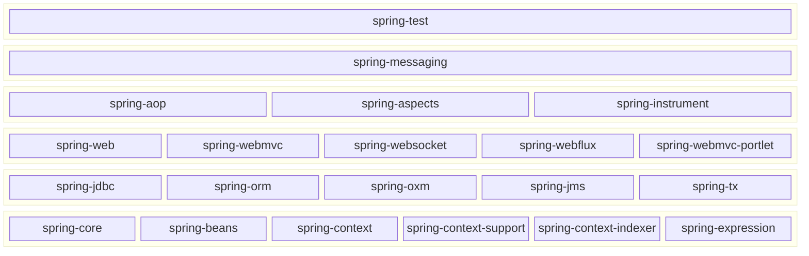

# 概括

> [!NOTE]
>
> 本教程基于 Spring Framework 6.2 来说明，需要 JAVA 17+ 以上的版本才能运行。
>
> 参考资料：https://docs.spring.io/spring-framework/reference/6.2/index.html

Spring 的架构如下所示：



# IoC 容器

Spring Framework 的核心功能之一就是 IoC（_Inversion of Control_，控制反转）容器，IoC 容器的基础是由 `org.springframework.beans` 和 `org.springframework.context` 这两个包来组成的。IoC 的意思是对象的创建不通过开发者在代码中手动使用 new 来创建，而且是交由 IoC 容器来进行统一管理。而对象的依赖关系通过构造函数参数、工厂方法的参数、或在对象实例上设置的属性来定义，这些属性是在对象实例从工厂方法构建时或返回后设置的。IoC 容器在创建 bean 时会注入这些依赖项。

`ApplicationContext` 接口代表 Spring IoC 容器，负责实例化、配置和组装 beans，`ApplicationContext` 接口有多个实现，通常会使用基于 Java 配置的 `ApplicationContext` 对象或者基于 XML 配置的 `ApplicationContext` 对象。

- `AnnotationConfigApplicationContext`

  读取基于 Java 的元数据配置。

  ```java
  ApplicationContext context = new AnnotationConfigApplicationContext(AppConfig.class);
  ```

- `ClassPathXmlApplicationContext`

  从类路径中读取 XML 的元数据配置。

  ```java
  ApplicationContext context = new ClassPathXmlApplicationContext("configuration.xml");
  ```

## 配置元数据

IoC 容器通过读取元数据中的信息来实例化、配置和组装 beans。元数据可以通过基于 Java 配置、基于 XML 配置或者基于 Groovy DSL 配置。Spring 通过 `BeanDefinition` 对象来描述 bean 的定义信息。

每个 bean 都有一个或多个标识符，这些标识符在 IoC 容器中必须唯一。在基于 XML 的元数据配置中，可以使用 `id` 或者 `name` 属性来定义标识符，但这不是必须的，如果都不指定，IoC 容器会自动生成唯一标识符。

> [!NOTE]
>
> 当注册 bean 时使用了已经分配的标识符，会出现 bean 覆盖的情况，若要禁止 bena 覆盖，需要 `ApplicationContext` 中设置 `allowBeanDefinitionOverriding` 属性为 `false`。

配置元数据有两种风格：一种是基于 Java 的元数据配置，一种是基于 XML 的元数据配置。

::: code-group

```java [基于 Java 配置]
@Configuration
public class AppConfig {

	@Bean
	public MyServiceImpl myService() {
		return new MyServiceImpl();
	}
}
```

```xml [基于 XML 配置]
<beans>
	<bean id="myService" class="com.acme.services.MyServiceImpl"/>
</beans>
```

:::

## 实例化 Bean

```xml
<beans>
  <bean id="serviceLocator" class="examples.DefaultServiceLocator"/>

  <!-- 通过静态工厂方法 -->
  <bean id="clientService"
        class="examples.ClientService"
  			factory-method="createClientServiceInstance"/>

  <!-- 通过实例工厂方法 -->
  <bean id="accountService"
  			factory-bean="serviceLocator"
  			factory-method="createAccountServiceInstance"/>
</beans>
```

## 依赖注入

基于 XML 的元数据配置的依赖注入通常有两种主要的方式：

1. 构造方法注入

   这种方式会根据对象的构造方法来注入对象的属性。

   ```xml
   <bean id="exampleBean" class="examples.ExampleBean">
   	<!-- constructor injection using the nested ref element -->
   	<constructor-arg>
   		<ref bean="anotherExampleBean"/>
   	</constructor-arg>

   	<!-- constructor injection using the neater ref attribute -->
   	<constructor-arg ref="yetAnotherBean"/>

   	<constructor-arg type="int" value="1"/>
   </bean>

   <bean id="anotherExampleBean" class="examples.AnotherBean"/>
   <bean id="yetAnotherBean" class="examples.YetAnotherBean"/>
   ```

2. Setter 方法注入

   这种方式会在容器调用无参构造方法和或者静态无参工厂方法实例化 bean 之后调用 setter 方法来完成注入。

   ```xml
   <bean id="exampleBean" class="examples.ExampleBean">
   	<!-- setter injection using the nested ref element -->
   	<property name="beanOne">
   		<ref bean="anotherExampleBean"/>
   	</property>
   
   	<!-- setter injection using the neater ref attribute -->
   	<property name="beanTwo" ref="yetAnotherBean"/>
   	<property name="integerProperty" value="1"/>
   </bean>
   
   <bean id="anotherExampleBean" class="examples.AnotherBean"/>
   <bean id="yetAnotherBean" class="examples.YetAnotherBean"/>
   ```

> [!WARNING]
>
> 当使用构造器注入时，可能会出现循环依赖的情况。当 IoC 容器在运行时察觉到循环依赖时，会抛出 `BeanCurrentlyInCreationException` 异常。对于循环依赖，可能的解决的办法是通过 Setter 方法注入而不是使用构造方法注入。

## Bean 作用域

## 容器扩展点
